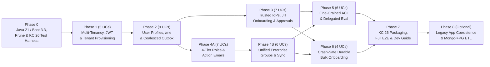

# Iterative Implementation Plan: `awgment-app-account` (`v2.3`)

**Authoritative Specification:** [USE_CASES.md](./USE_CASES.md) (`v2.3` — 44 Use Cases across 8 Domains)  
**Migration Strategy:** [MIGRATION_GUIDE.md](../MIGRATION_GUIDE.md)  
**Engineering Rules:** [GEMINI.md](../GEMINI.md) · [CLAUDE.md](../CLAUDE.md) · [CHATGPT_INSTRUCTIONS.md](../CHATGPT_INSTRUCTIONS.md)

> **Mandatory Execution Discipline (Every Phase):**
> 1. **Tests First (TDD):** Write unit & Testcontainers integration tests *before* production code — covering happy paths, boundary conditions, RBAC/escalation denials, tenant isolation, concurrency races, and failure/recovery flows.
> 2. **Production Integrity:** Never alter production business logic just to force a test to pass.
> 3. **Quality Gate:** Every phase ends with `./gradlew check` green and **>= 85% JaCoCo coverage**.
> 4. **Lockstep Docs & Postman Collection:** Update OpenAPI annotations, Flyway docs, error codes, Postman Collection v2.1 (`docs/postman/awgment-app-account-v2.postman_collection.json` + `awgment-local.postman_environment.json` with 1:1 endpoint parity test), and developer guides at the close of every phase.

---

## 1. Phase Dependency Graph

---

## 2. Iterative Delivery Phases

---

### Phase 0 — Modernization Bootstrap, Legacy Pruning & Keycloak 26 Test Harness (Skeleton)
* **Use Cases:** Infrastructure & test foundation (`0` business UCs)
* **Checklist:**
  - [x] Upgrade Gradle wrapper to `8.10.2`, `sourceCompatibility = 21`, `targetCompatibility = 21`, Spring Boot `3.3.5`.
  - [x] Replace MongoDB (`spring-boot-starter-data-mongodb`, `mongock`, `lib-multitenancy-mongo`), Spring Cloud Config (`bootstrap.yml`), and Springfox with `spring-boot-starter-data-jpa`, `org.postgresql:postgresql:42.7.4`, `flyway-core`, `flyway-database-postgresql`, `springdoc-openapi-starter-webmvc-ui:2.6.0`, and `keycloak-admin-client:26.0.5`.
  - [x] Prune all decommissioned legacy classes & tests: `Menu*`, `MenuRoleAssign*`, `Themes*`, `UserPreferences*`, `Otp*`, `UserFormData*`, `InternalController*`, `Rsa4096*`, `GroupsController*`, Mongo changelogs & custom Mongo repos.
  - [x] Configure standalone `application.yml` (+ env-var bindings), Snowflake `IdGenerator` bean, Jackson strict deserialization helpers, global RFC 7807 `ProblemDetail` exception handler, and Actuator probe security (`/actuator/health/liveness`, `/actuator/health/readiness` public; `/env`, `/beans`, `/configprops` disabled).
  - [x] **3-Layer Test Harness & Local Keycloak 26 Blueprints:**
    * **Layer 1 (`./gradlew test`):** In-memory RSA JWK token factory (`TestJwtFactory` minting signed JWTs with arbitrary `iss`, `aud`, `identity_provider`, `idp_tenant_id`, `awgment_status`, `client_id`, `resource_access`, `groups`) + Mockito + H2/Testcontainers `postgres:16-alpine` + JaCoCo `>= 85%` gate (`97.8%` instruction / `99.2%` line coverage).
    * **Layer 2 (`./gradlew integrationTest`):** Add `dasniko/testcontainers-keycloak` (`quay.io/keycloak/keycloak:26.0.5`, Testcontainers `1.21.4`) auto-importing the shared Realm Blueprint JSONs + Mailpit container (`PostgresKeycloakContainersIT` verified live against PostgreSQL 16 + Keycloak 26.0.5).
    * **Layer 3 (`docker compose up -d`):** Mount `./awgment-app-account/src/test/resources/keycloak:/opt/keycloak/data/import:ro` (`--import-realm`, single source of truth shared with Layer 2) with 3 pre-wired realms + add `axllent/mailpit` (`1025` SMTP / `8025` Web Inbox UI) to `docker-compose.yml`:
      1. `platform-realm.json` (`platform`): Platform Control Realm (`awgment-platform-admin`, `aud = awgment-account`).
      2. `tenant-acme-realm.json` (`acme`): Section-3-compliant Tenant Realm (zero default app roles; Declarative User Profile locking `awgment_status`, `userId`, `awgment_sync_version` to `permissions.edit = ["admin"]` with unmanaged attributes disabled via omitted `unmanagedAttributePolicy`; `aud`, `identity_provider`, `idp_tenant_id`, `awgment_status`, `userId`, `groups` mappers; clients `awgment-account`, `awgment-app-client`, `awgment-service-client`, `awgment-admin-sync`; `accessTokenLifespan = 300`; First Broker Login email-linking disabled; SMTP → `mailpit:1025`; brokered IdP `entra-acme` → `mock-entra`).
      3. `mock-entra-realm.json` (`mock-entra`): Local Enterprise IdP simulator emitting `email_verified = true` + corporate `tid` claim (for offline Type 1 `EXTERNAL_IDP` & `external_tenant_id` mismatch testing).
      4. Add `./docker/scripts/get-token.sh` helper to fetch local test JWTs by persona for curl/Swagger testing.
* **Exit Gate:** `./gradlew check integrationTest` green on Java 21 (`19/19` unit/MockMvc tests, `97.8%` JaCoCo, `1/1` live PostgreSQL 16 + Keycloak 26.0.5 Testcontainers IT importing `platform`, `acme`, and `mock-entra`) with zero MongoDB/FormIO/Camunda/Cloud Config deps.

---

### Phase 1 — Multi-Tenancy, Security Core & Tenant Provisioning (`5` UCs)
* **Use Cases:** `UC-TENANT-01`, `UC-TENANT-02`, `UC-TENANT-03`, `UC-TENANT-04`, `UC-AUTH-01`
* **Tests Written First:**
  - [ ] `TenantIdValidatorTest`: valid IDs (`2..50` chars), 51-char rejection, uppercase/special char rejection, reserved denylist (`public`, `master`, `platform`, `information_schema`, `admin`, `system`, `pg_catalog`, `pg_toast`).
  - [ ] `MultiTenantConnectionProviderIT` (Testcontainers PG 16): `SET search_path TO tenant_<id>` (no `, public` fallback), unconditional `RESET search_path` on release, connection eviction on reset failure, zero cross-tenant leakage under concurrent pool reuse.
  - [ ] `TenantAuthenticationManagerResolverTest` & `JwtSecurityIT`: Platform Control Realm isolation for `/accounts/v2/tenants/**` (rejects tenant tokens), active `tp_tenant` check before decoder creation (SSRF prevention), mandatory `aud` validation, single-client `JWTRoleConverter`, `ServiceAccountPrincipalDetector` (rejects `preferred_username=service-account-*` spoofing).
  - [ ] `TenantProvisioningIT`: `POST /tenants` (`PROVISIONING` → `ACTIVE`), failure → `PROVISIONING_FAILED` + `UC-TENANT-02` retry, boot Flyway migration skipping `SUSPENDED`, `PATCH /tenants/{id}/status` disabling KC realm on suspend & running pending Flyway + `KeycloakRealmContractVerifier` before reactivation.
* **Implementation:**
  - [ ] Flyway `V1` migrations (`public.tp_tenant` + tenant baseline schemas), `TenantContext`, Hibernate 6 `CurrentTenantIdentifierResolver` & `MultiTenantConnectionProvider`, `SecurityFilterChain`, `KeycloakRealmContractVerifier`, `tp_security_audit_log`, `TenantController`/`TenantService`.
* **Exit Gate:** All Phase 1 unit & Testcontainers tests green; `>= 85%` coverage.

---

### Phase 2 — Core User Profiles, Self-Service & Coalesced Outbox Engine (`9` UCs)
* **Use Cases:** `UC-USER-01`, `UC-USER-02`, `UC-USER-03`, `UC-USER-04`, `UC-USER-05`, `UC-USER-06`, `UC-USER-07`, `UC-SYNC-01`, `UC-SYNC-02`
* **Tests Written First:**
  - [ ] `CoalescedOutboxConcurrencyIT` (**Section 10 Scenario 1**): single active reconcile row per aggregate (`UNIQUE` partial index, `dirty` flag), strict `<= 10s` HTTP timeout `<< 60s` lease TTL, `awgment_sync_version` pre-write fencing, and **paused-worker resumption after disable reconciliation** healed by the `15s` forced verification pass.
  - [ ] `UserRevocationIT` (**Section 10 Scenario 2**): synchronous-first Keycloak `disable+logout` returning `204` on success, `202` + `awgment_revocation_sync_failed_total` metric on KC failure while blocking `awgment-app-account` immediately; self-disable (`403 SELF_ACTION_FORBIDDEN`) and higher-tier target guard (`403`).
  - [ ] `UserProfileServiceTest` & `UserControllerIT`: partial unique email/username (`WHERE status IN ('ACTIVE', 'DISABLED')`), `@Version` optimistic lock (`409 CONCURRENT_MODIFICATION`), immutable `userName`/`emailId`/`identitySource`/`idpAlias`, indexed JPA search/pagination, `/users/me` strict `sub` lookup, and `PUT /users/me` rejecting `department`/`attributes` (`400 IMMUTABLE_FIELD_MODIFICATION`).
  - [ ] `OutboxControllerIT`: `UC-SYNC-01` inspect & `UC-SYNC-02` retry.
* **Implementation:**
  - [ ] `UserDefinition`, `KeycloakOutboxEvent`, coalesced outbox worker + `KeycloakAdminAdapter` (timeouts, `awgment_sync_version`, zero plaintext passwords), core 4-tier `RoleGovernancePolicy` (direct + composite closure), `UserController`/`UserService`, `SyncOutboxController`.
* **Exit Gate:** Section 10 Scenarios 1 & 2 pass; `./gradlew check` green.

---

### Phase 3 — Trusted IdPs, Dedicated JIT Onboarding & Approval Gatekeeper (`7` UCs)
* **Use Cases:** `UC-AUTH-02`, `UC-AUTH-03`, `UC-AUTH-04`, `UC-AUTH-05`, `UC-AUTH-06`, `UC-AUTH-07`, `UC-AUTH-08`
* **Tests Written First:**
  - [ ] `OnboardingSessionIT` (**Section 10 Scenario 3**): human JWT with missing `awgment_status` blocked on `/users/me` (`403`), accepted on `POST /accounts/v2/onboarding/session`; returns `202 PENDING_SYNC` when KC sync is delayed and `200 SYNCED { tokenRefreshRequired: true }` once KC confirms `ACTIVE`.
  - [ ] `TrustedIdpAndSquattingIT` (**Section 10 Scenario 7a**): verified `EXTERNAL_IDP` pre-staged binding + `external_tenant_id` (`tid`/`hd`) match; mismatched `external_tenant_id` or `email_verified=false` quarantined; unverified `PENDING_APPROVAL` signup does NOT squat/block real employee's verified IdP login; disabling `tp_trusted_idp.enabled=false` immediately blocks returning users (`403 IDP_TRUST_REVOKED`); IdP/method switch returns `403 IDENTITY_SOURCE_MISMATCH`.
  - [ ] `ApprovalWorkflowIT`: `awgment-account-admin` strict separation of duties (`awgment-account-all` gets `403`), `GET /users/approvals` verification flags, `UC-AUTH-05` requiring `confirmUnverifiedIdentity + attestationNote` when unverified, `409 EMAIL_ALREADY_CLAIMED`, approver assigning Tier 3 app roles without holding them (and blocked on Tier 0/1/2), `UC-AUTH-06` sync-first reject.
* **Implementation:**
  - [ ] `TrustedIdpDefinition`, `DomainAllowlistDefinition`, `OnboardingController` (`/accounts/v2/onboarding/session`), `UserApprovalGatekeeperFilter`, `ApprovalController`, `TrustedIdpController`, `DomainAllowlistController`.
* **Exit Gate:** Section 10 Scenarios 3 & 7a pass; complete dual-identity (`EXTERNAL_IDP` + `KEYCLOAK_LOCAL`) onboarding working end-to-end.

---

### Phase 4A — Governed Keycloak Roles & Rate-Limited Action Emails (`7` UCs)
* **Use Cases:** `UC-KC-01`, `UC-KC-02`, `UC-KC-03`, `UC-KC-04`, `UC-KC-05`, `UC-KC-06`, `UC-KC-07`
* **Tests Written First:**
  - [ ] `RoleGovernancePolicyTest`: all 4 tiers, recursive composite-role expansion (nested composites hiding Tier 1/2 roles rejected `403`), ancestor group chain checks on `UC-KC-04`, allowlisted client check & `awgment-*` block on `UC-KC-02`, higher-tier target protection on `UC-KC-03/04/06/07`.
  - [ ] `ActionEmailOutboxIT`: `EXTERNAL_IDP` rejected (`400 PASSWORD_MANAGED_BY_EXTERNAL_IDP`), per-user 60s cooldown (`429 RATE_LIMIT_EXCEEDED` + `Retry-After`), `SEND_ACTION_EMAIL` waiting when `keycloak_sub == NULL`, auto-canceling if user disabled before send, and at-most-once behavior on ambiguous HTTP read timeout.
* **Implementation:**
  - [ ] `KeycloakRoleController`, `KeycloakUserSyncService`, `ActionEmailService` + rate-limit guard, `SEND_ACTION_EMAIL` outbox processor.
* **Exit Gate:** All 7 role & action-email UCs green; zero plaintext password paths anywhere.

---

### Phase 4B — Unified Enterprise Groups & Bidirectional Governance (`6` UCs)
* **Use Cases:** `UC-GRP-01`, `UC-GRP-02`, `UC-GRP-03`, `UC-GRP-04`, `UC-GRP-05`, `UC-GRP-06`
* **Tests Written First:**
  - [ ] `GroupBidirectionalGovernanceIT` (**Section 10 Scenario 4**): operator blocked (`403 HIGHER_TIER_MEMBER_AFFECTED`) when mutating/deleting a group (or ancestor of a subgroup) containing an `awgment-account-admin` member or flagged `protected_group=true`; self-authority strip blocked (`403 SELF_ACTION_FORBIDDEN`); deleting parent with subgroups returns `409 GROUP_HAS_SUBGROUPS`; deleting leaf group tombstones `tp_group`, prevents out-of-order resurrection, and **atomically scrubs the group ID from all `tp_user.desired_groups` JSONB arrays**.
  - [ ] `GroupSyncIT`: `POST /groups/sync` $O(G)$ map upsert, sets `origin = KEYCLOAK_IMPORTED`, and skips `tp_group` rows where `sync_status != 'SYNCED'` (`skippedPendingSync`).
* **Implementation:**
  - [ ] `GroupDefinition` (tombstone, `origin`, `protected_group`, `desired_roles`, `sync_version`), `RECONCILE_GROUP` outbox handler, `GroupController`/`GroupService`.
* **Exit Gate:** Section 10 Scenario 4 passes; core IAM (Users + Groups + Roles + Onboarding) 100% complete.

---

### Phase 5 — Fine-Grained ACL Engine & Delegated Evaluation (`6` UCs)
* **Use Cases:** `UC-ACL-01`, `UC-ACL-02`, `UC-ACL-03`, `UC-ACL-04`, `UC-ACL-05`, `UC-ACL-06`
* **Tests Written First:**
  - [ ] `AclEvaluationSecurityIT` (**Section 10 Scenario 5**):
    * `0..N-1` strict first-match ordering; unmatched returns `decision="undefined", effectiveAllowed=false`; evaluation error fails closed.
    * Narrowed `Rules.SYSTEM` matches **only** verified service accounts holding `awgment-system-service` (rejects generic client-credentials tokens & `service-account-*` usernames).
    * End-user or unprivileged service passing `context` fails (`400 UNTRUSTED_ACL_CONTEXT`); `awgment-acl-evaluate-context` & `awgment-acl-evaluate-delegated` (`UC-ACL-06`) validate keys/primitive types against `tp_acl.allowed_context_keys`.
    * `AclEvaluationView` excludes `selfServicePreferences`/self-service fields; leaf-by-leaf StringTemplate rendering neutralizes JSON structural injection (`"`, `}`, `,`) and SSTI.
  - [ ] `AclCrudIT`: `UC-ACL-01..04` (`awgment-acl-*` RBAC, unique `name`, `@Version`, `204` delete).
* **Implementation:**
  - [ ] `ACLDefinition`, `LeafSafeTemplateRenderer`, `AclContextSchemaValidator`, `AclService`, `AclController`.
* **Exit Gate:** Section 10 Scenario 5 passes; `./gradlew check` green.

---

### Phase 6 — Crash-Safe Durable Bulk User Onboarding (`4` UCs)
* **Use Cases:** `UC-BULK-01`, `UC-BULK-02`, `UC-BULK-03`, `UC-BULK-04`
* **Tests Written First:**
  - [ ] `BulkCsvSecurityTest`: max size (`5 MB`), max rows (`5,000`), path-traversal/multi-dot filename rejection, formula-injection neutralization (`=`, `+`, `-`, `@`), intra-file duplicate detection, upfront $O(1)$ role/group/IdP + 4-tier policy validation.
  - [ ] `BulkDurableWorkerIT` (**Section 10 Scenario 6**):
    * Lease reclaim after simulated crash/expiry + **single-TX atomic `tp_user` + `tp_keycloak_outbox` + `lease_token` CAS completion** (stale worker's late TX rolls back on 0-row CAS).
    * Idempotent `provisioning_key` replay recovers `created_user_id` without false `409 DUPLICATE_RESOURCE`.
    * Live operator status/authority revocation mid-batch cancels remaining `CREATED` rows (`OPERATOR_AUTHORITY_REVOKED`, batch `CANCELLED_AUTH_REVOKED`).
    * `UC-BULK-04` (`retry-failed`) re-validates calling operator and resumes `FAILED`/`CANCELLED` rows.
* **Implementation:**
  - [ ] `BulkBatchDefinition`, `BulkUserDefinition`, `StreamingCsvUserParser`, `DurableBulkUserWorker`, `BulkUserController`/`BulkUserService`.
* **Exit Gate:** Section 10 Scenario 6 passes; all **44/44 use cases** implemented and verified.

---

### Phase 7 — Production Keycloak 26 Packaging, Full E2E Suite & Developer Guide
* **Deliverables:**
  - [ ] Finalize `awgment-keycloak` production Quarkus `26.0.5` `Dockerfile` (removing legacy WildFly/JBoss configs and retired `ts_awgment_user_register_spi` push callback; retaining modernized themes).
  - [ ] Full cross-domain E2E suite (`./gradlew integrationTest`) running real **PostgreSQL 16 + Keycloak 26.0.5 + Mailpit** containers verifying all 7 scenarios in `USE_CASES.md` Section 10 end-to-end.
  - [ ] Export verified OpenAPI 3 specification (`openapi-v2.yaml`), finalize Postman Collection v2.1 (`docs/postman/awgment-app-account-v2.postman_collection.json` + `awgment-local.postman_environment.json` with 100% endpoint parity test), and verify [awgment-app-account/README.md](./README.md) with architecture overview, local Keycloak/Mailpit setup, realm security contract verification, error catalog, and testing/deployment runbooks.
* **Exit Gate:** Clean `./gradlew check integrationTest` (`>= 85%` JaCoCo) + live `docker compose` smoke runbook green.

---

### Phase 8 (Optional Follow-On) — Dependent Application Coexistence Track
* Per [MIGRATION_GUIDE.md](../MIGRATION_GUIDE.md), scheduled independently when onboarding legacy Awgment apps:
  - [ ] Idempotent MongoDB → PostgreSQL 16 + Keycloak `awgment_status=ACTIVE` ETL & parity tool.
  - [ ] `awgment-commons` `1.x-v2-bridge` (Java 11 / Boot 2.7) and `2.0.0` (Java 21 / Boot 3.3) with fail-closed `awgment_status` filter.
  - [ ] Feature-flagged, sunset-dated read/evaluate-only `/accounts/v1` Compatibility Adapter (`awgment.compat.v1.enabled=false` by default).

---

## 3. Progress Tracker

| Phase | Use Cases | Status |
| :--- | :---: | :--- |
| **Phase 0:** Modernization Bootstrap, Pruning & Keycloak 26 Test Harness | — | Completed (`feat/phase-0-bootstrap-keycloak-harness`) |
| **Phase 1:** Multi-Tenancy, Security Core & Tenant Provisioning | 5 | Not Started |
| **Phase 2:** Core User Profiles, `/me` & Coalesced Outbox | 9 | Not Started |
| **Phase 3:** Trusted IdPs, JIT Onboarding & Approvals | 7 | Not Started |
| **Phase 4A:** Governed Roles & Action Emails | 7 | Not Started |
| **Phase 4B:** Unified Enterprise Groups | 6 | Not Started |
| **Phase 5:** Fine-Grained ACL Engine & Delegation | 6 | Not Started |
| **Phase 6:** Crash-Safe Durable Bulk Queue | 4 | Not Started |
| **Phase 7:** Production Keycloak 26 Packaging, Full E2E & Developer Guide | — | Not Started |
| **Total Core Implementation** | **44** | **0 / 44** |
