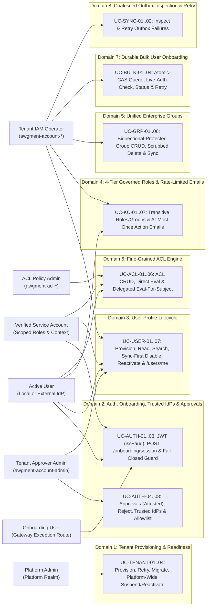

# Use Cases Specification: `awgment-app-account` (`v2.3` — Implementation Contract)

**Service:** `awgment-app-account` (Headless Multi-Tenant IAM API)  
**API Base Path:** `/accounts/v2`  
**Target Stack:** Java 21 LTS · Spring Boot 3.3.5 · PostgreSQL 16 (JPA + Flyway) · Keycloak 26.0.5 (Quarkus)  
**Configuration Mode:** Standalone (`application.yml` + environment variables; Spring Cloud Config removed)  
**Version History / Archives:**
* [USE_CASES_v2.2_archive.md](./docs/archive/USE_CASES_v2.2_archive.md) (`v2.2` — archived prior to Round 3 concurrency, revocation-SLA, gateway, and delegation contract updates)
* [USE_CASES_v2.1_archive.md](./docs/archive/USE_CASES_v2.1_archive.md) (`v2.1`)
* [USE_CASES_v2.0_archive.md](./docs/archive/USE_CASES_v2.0_archive.md) (`v2.0`)

**Related Specifications:**
* [IMPLEMENTATION_PLAN.md](./IMPLEMENTATION_PLAN.md) — Iterative phased delivery plan (Phases 0–7, 44 UCs, test-first)
* [GEMINI.md](../GEMINI.md) — Mandatory TDD, complexity, security, and migration rules
* [MIGRATION_GUIDE.md](../MIGRATION_GUIDE.md) — Dependent application impact assessment & 5-phase migration pathway
* [SERVICE_RATIONALIZATION.md](../SERVICE_RATIONALIZATION.md) — Service pruning & database consolidation
* [JIT_ONBOARDING_APPROVAL_ARCHITECTURE.md](../JIT_ONBOARDING_APPROVAL_ARCHITECTURE.md) — JIT user staging & approval gatekeeper

---

## 1. Explicit Engineering Guarantees, Trust Boundaries & Failure Assumptions

Rather than relying on absolute labels, this contract states exact guarantees and their governing failure assumptions:

| # | Control Area | Defined Guarantee & Mechanism | Explicit Failure Assumption / Boundary |
| :--- | :--- | :--- | :--- |
| **1** | **Dual Identity & Trusted IdP Admission** | Supports **Type 1 (`EXTERNAL_IDP`)** pinned via `tp_trusted_idp` (`idp_alias`, `external_tenant_id`, `tenant_claim_name`, `enabled`) and **Type 2 (`KEYCLOAK_LOCAL`)**. Disabling `tp_trusted_idp.enabled = false` blocks **both** new onboarding and returning logins via that IdP (`403 IDP_TRUST_REVOKED`). Partial unique email index (`WHERE status IN ('ACTIVE', 'DISABLED')`) prevents unverified `PENDING_APPROVAL`/`REJECTED` signups from squatting on active emails. | Assumes Keycloak 26 satisfies Section 3 (single-tenant IdP issuers, disabled First Broker Login email-linking, unforgeable `identity_provider` & `idp_tenant_id` session-note mappers). |
| **2** | **Gateway-Reachable JIT Onboarding** | **`POST /accounts/v2/onboarding/session`** is the **sole** human-JWT route permitted through the API Gateway when `awgment_status` is absent or non-`ACTIVE` (after full signature/`iss`/`aud` validation). All other gateway routes and sibling services enforce fail-closed `awgment_status == "ACTIVE"`. Onboarding returns `200 OK` (`tokenRefreshRequired=true`) **only after** Keycloak confirms `awgment_status=ACTIVE`, or `202 Accepted` (`PENDING_SYNC`) while reconciliation completes. | Clients must call `POST /accounts/v2/onboarding/session` before entering the application when `awgment_status` is missing, and poll on `202` until `200` before triggering OIDC token refresh. |
| **3** | **Bounded Revocation & Platform-Wide Suspension** | `UC-USER-04` (`DISABLED`) and `UC-AUTH-06` (`REJECTED`) execute **synchronous-first** Keycloak `enabled=false` + `awgment_status` + `logout()` within a 5s deadline after committing PG+outbox. When sync succeeds (`204`/`200`), stateless sibling-service exposure is bounded by `access_token_ttl <= 5 min`. When sync fails transiently (`202`), PG blocks `awgment-app-account` immediately, outbox retries, and ops SLA alerts fire if un-synced `> 30s`. `UC-TENANT-04` (`SUSPENDED`) disables the Keycloak realm (`realm.enabled=false`) and publishes to the Gateway suspension denylist. | **Stateless mode:** revocation window = `0` on `awgment-app-account`; `<= access_token_ttl (5m)` on sibling services once KC revocation succeeds (or `outbox_recovery + 5m` during KC outage). **Strict mode (optional):** Gateway checks shared revocation/suspended-tenant denylist (`<= 10s` bound independent of KC). |
| **4** | **Coalesced Aggregate-Serialized Outbox + Fencing** | Each `(aggregate_type, aggregate_id)` has **at most ONE** active `RECONCILE` row (`UNIQUE` partial index, upserted with `target_version` / `dirty` flag), preventing two workers from running concurrent jobs for the same user/group. Keycloak HTTP timeout (`<= 10s`) `<<` lease TTL (`60s`). Admin-only `awgment_sync_version` attribute in Keycloak fences stale pre-write checks; any forcibly reclaimed lease schedules a **forced verification reconcile** after `15s` to detect and overwrite any late write from a paused JVM. | Keycloak Admin REST lacks native atomic CAS (`If-Match`) on user updates; therefore a paused JVM waking after lease expiry can briefly write stale state, which the forced verification reconcile bounds and heals within `<= 15s + retry`. |
| **5** | **4-Tier Role Governance + Bidirectional Group Closure** | **`RoleGovernancePolicy`** enforces 4 tiers (Tier 0 Platform, Tier 1 Approver, Tier 2 Privileged IAM/ACL strict subset, Tier 3 Standard App Roles assignable by Approvers and Operators) across **recursive composite roles**, **ancestor group chains**, **descendant subgroups**, and **protected/higher-tier members** (`403 HIGHER_TIER_MEMBER_AFFECTED`, `409 GROUP_HAS_SUBGROUPS`, `403 SELF_ACTION_FORBIDDEN`). `JWTRoleConverter` reads strictly from the single configured trusted Awgment client. | Assumes tenant Keycloak realms do not bypass `awgment-app-account` by granting `awgment-*` roles through external admin console edits without re-running governance audits. |
| **6** | **Scoped ACL Delegation, Context Schemas & Fail-Closed `undefined`** | Admin-managed `department`/`attributes` are read-only on `PUT /users/me`; self-service fields are excluded from ACL evaluation. StringTemplate v4 renders **leaf-by-leaf on string values only** (eliminating JSON structural injection). `Rules.SYSTEM` matches **only** service accounts holding explicit `awgment-system-service` authority. `context` is accepted only from service accounts holding `awgment-acl-evaluate-context` (direct) or `awgment-acl-evaluate-delegated` (`UC-ACL-06`, on behalf of a subject user) and strictly validated against client/ACL `allowedContextKeys`. Rule evaluation is strict array index order `0..N-1`; **`undefined` MUST be enforced as `DENY`**, reflected via `effectiveAllowed: boolean`. | Downstream consumers must honor `effectiveAllowed == true` (never treating `undefined` as allow). |
| **7** | **Crash-Safe Bulk Queue with Lease-Token CAS & Live Auth** | Bulk rows commit `INSERT tp_user` + `UPSERT tp_keycloak_outbox` + `UPDATE tp_bulk_user SET status='COMPLETED', created_user_id=:uid WHERE id=:id AND lease_token=:tok` in **one local PostgreSQL ACID transaction** (zero network I/O inside TX). Stable `provisioning_key` (`bulk:<docId>:<row>`) makes replay idempotent without false duplicate failures. Workers verify **live operator status & authority** before each chunk, canceling remaining rows if revoked. | If an operator's authority is revoked mid-batch, already-committed rows remain provisioned while remaining `CREATED` rows are `CANCELLED` (`OPERATOR_AUTHORITY_REVOKED`). |
| **8** | **Multi-Tenant Isolation & Provisioning Recovery** | `/accounts/v2/tenants/**` accepts tokens exclusively from `awgment.security.platform-realm` (`public` schema). `tenantId` matches `^[a-z][a-z0-9_]{1,49}$` (max **50** chars, matching `VARCHAR(50)`) + reserved denylist, mapped internally to `tenant_<tenantId>` (`<= 57` chars). Exact `iss` prefix + mandatory `aud`. `SET search_path TO tenant_<id>` (no `, public`) + unconditional `RESET search_path` (evicting connection on error). Tenant provisioning tracks `PROVISIONING` / `PROVISIONING_FAILED` / `ACTIVE` / `SUSPENDED` with idempotent retry (`UC-TENANT-02`) and mandatory Flyway + `KeycloakRealmContractVerifier` checks before reactivation (`UC-TENANT-04`). | Tenant-keyed caches have `<= 60s` TTL and explicit eviction on suspension/mutation. |

---

## 2. Actors & Security Authorities

| Actor | Realm Scope | Required Authority / Auth Mechanism | Responsibilities |
| :--- | :--- | :--- | :--- |
| **Platform Administrator** | Platform Control Realm (`awgment.security.platform-realm`) | `awgment-platform-admin` | Provisions, retries, lists, suspends, and reactivates tenants (`/accounts/v2/tenants/**`); bootstraps initial tenant approvers. |
| **Tenant Approver Admin** | Tenant Realm | `awgment-account-admin` *(strictly separate from `awgment-account-all`)* | Reviews approval queue (`PENDING_APPROVAL` & `REJECTED`), approves/rejects users (with verification attestation), reactivates `DISABLED` users, manages `tp_trusted_idp` and `tp_domain_allowlist`. |
| **Tenant IAM Operator** | Tenant Realm | `awgment-account-all`, `awgment-account-create-or-update`, `awgment-account-read`, `awgment-account-delete` | Direct user/group/bulk CRUD, governed role/group assignment, Keycloak group sync, and outbox inspection/retry. |
| **ACL Policy Administrator** | Tenant Realm | `awgment-acl-create-or-update`, `awgment-acl-read` | Creates, updates, lists, reads, and deletes ACL policies (including `allowedContextKeys` schemas). |
| **Authenticated Active User** | Tenant Realm | Valid Tenant OIDC JWT (`awgment_status = ACTIVE`, valid `aud`) | Self-service profile (`/users/me` non-ACL fields), rate-limited password email (local only), direct ACL evaluation (no `context`). |
| **Onboarding / Unstaged User** | Tenant Realm | Valid Tenant OIDC JWT (valid `aud`, missing/non-`ACTIVE` `awgment_status`) | Permitted **only** on `POST /accounts/v2/onboarding/session` via explicit Gateway exception. |
| **Verified Service Account** | Tenant Realm | Client-Credentials OIDC JWT verified by `ServiceAccountPrincipalDetector` (`client_id` + allowlisted confidential `azp`) | Bypasses JIT Gatekeeper; requires `@PreAuthorize` roles; matches `Rules.SYSTEM` **only** if holding `awgment-system-service`; passes validated ACL `context` only if holding `awgment-acl-evaluate-context` / `awgment-acl-evaluate-delegated`. |

---

## 3. Keycloak 26 Realm Security Contract (Verified Before Tenant `ACTIVE`)

Verified automatically by `KeycloakRealmContractVerifier` during `UC-TENANT-01`, `UC-TENANT-02`, and `UC-TENANT-04` reactivation:

1. **Zero Default Application Roles:** Newly brokered and self-registered users receive zero Awgment functional roles by default.
2. **Single-Tenant Enterprise IdPs:** Brokered Enterprise IdPs MUST use single-tenant issuers (specific Entra ID `tid`, never `/common` or `/organizations`; Google Workspace restricted by `hd`) and map `tid`/`hd` into unforgeable session-note claim `idp_tenant_id`.
3. **Disable Automatic Email Account Linking:** `First Broker Login` MUST disable email-based auto-linking.
4. **Local Email Verification:** If local self-registration is enabled, require `Verify Email` before issuing usable tokens.
5. **Admin-Only Declarative User Profile Attributes:** Register `awgment_status`, `userId`, `awgment_sync_version`, and `locale` in Keycloak 26 Declarative User Profile with **`permissions.edit = ["admin"]`** and unmanaged attributes disabled (omit `unmanagedAttributePolicy` / set `null` in Keycloak 26 `UPConfig`; or use `ADMIN_EDIT`). Enable realm internationalization (`internationalizationEnabled = true`, `supportedLocales`, `defaultLocale`) so Keycloak renders login pages and `execute-actions-email` notifications in the user's synced `locale`.
6. **Fail-Closed Gateway & Sibling Services (With Explicit Onboarding Exception):**
   * API Gateway & all sibling microservices MUST reject any human JWT where `awgment_status` is **absent/null OR `!= "ACTIVE"`** (`403 ACCESS_PENDING_APPROVAL`).
   * **Sole Gateway Exception:** Route `POST /accounts/v2/onboarding/session` to `awgment-app-account` after validating JWT signature, `exp`, `iss`, and `aud`, even when `awgment_status` is absent or non-`ACTIVE`.
7. **Unforgeable Session-Note `identity_provider` Mapper:** Stamps brokered IdP alias into access tokens (absent for local logins).
8. **Audience (`aud`) & Client-Credentials Mappers:** Include `awgment-account` in `aud`; emit `client_id` on confidential service clients.
9. **Short Access-Token Lifespan:** Access-token TTL `<= 5 minutes`.

---

## 4. PostgreSQL 16 Data Model, Field Ownership & Concurrency Contracts

### 4.1 Schema Layout

* **Shared Control Schema (`public` — `@Table(schema = "public")`):**
  * `public.tp_tenant`: `id` (Snowflake `BIGINT`), `tenant_id` (`VARCHAR(50) UNIQUE`), `schema_name` (`VARCHAR(63) UNIQUE`, always `tenant_<tenant_id>`), `display_name`, `status` (`PROVISIONING` | `PROVISIONING_FAILED` | `ACTIVE` | `SUSPENDED`), `last_error`, `opt_lock_version` (`BIGINT`), audit columns.
* **Per-Tenant Isolated Schema (`tenant_<tenant_id>`):**
  * `tp_trusted_idp`: `id`, `idp_alias` (`VARCHAR(100) UNIQUE`), `external_tenant_id` (`VARCHAR(128)`), `tenant_claim_name` (`VARCHAR(64) DEFAULT 'idp_tenant_id'`), `enabled` (`BOOLEAN NOT NULL DEFAULT TRUE`), `opt_lock_version`, audit columns.
  * `tp_domain_allowlist`: `id`, `domain_name` (lowercase), `idp_alias` (`VARCHAR(100) NOT NULL REFERENCES tp_trusted_idp(idp_alias)`), `auto_approve` (`BOOLEAN`), `default_roles` (`JSONB DEFAULT '[]'::jsonb`), `opt_lock_version`, audit columns; `UNIQUE (domain_name, idp_alias)`.
  * `tp_user`:
    * `id` (`BIGINT PK`), `keycloak_sub` (`VARCHAR(64)`, partial `UNIQUE WHERE keycloak_sub IS NOT NULL`)
    * `provisioning_key` (`VARCHAR(128)`, partial `UNIQUE WHERE provisioning_key IS NOT NULL` — idempotent bulk replay key)
    * `user_name` (`VARCHAR(100) NOT NULL`, lowercase; partial `UNIQUE WHERE status IN ('ACTIVE', 'DISABLED')`)
    * `email_id` (`VARCHAR(255) NOT NULL`; partial `UNIQUE` on `LOWER(email_id) WHERE status IN ('ACTIVE', 'DISABLED')`)
    * `first_name`, `last_name`, `mobile_number`, `department` *(admin/IdP-managed; read-only via `/users/me`)*
    * `locale`, `timezone`, `self_service_preferences` (`JSONB DEFAULT '{}'::jsonb` — *user-editable; excluded from ACL evaluation*)
    * `attributes` (`JSONB NOT NULL DEFAULT '{}'::jsonb` + GIN index — *admin-managed only; safe for ACL templates*)
    * `identity_source` (`KEYCLOAK_LOCAL` | `EXTERNAL_IDP`), `idp_alias` (`VARCHAR(100)`, FK to `tp_trusted_idp` when external)
    * `email_verified_at_staging` (`BOOLEAN`), `idp_verified_at_staging` (`BOOLEAN`)
    * `provisioning_mode` (`JIT_AUTO_APPROVED` | `JIT_ADMIN_APPROVED` | `JIT_PENDING` | `DIRECT_OPERATOR` | `BULK_IMPORT`)
    * `status` (`PENDING_APPROVAL` | `ACTIVE` | `REJECTED` | `DISABLED`)
    * `desired_roles` (`JSONB` — nullable until Awgment-managed), `desired_groups` (`JSONB` — nullable until Awgment-managed)
    * `sync_version` (`BIGINT NOT NULL DEFAULT 1`), `synced_version` (`BIGINT NOT NULL DEFAULT 0`), `sync_status` (`SYNCED` | `PENDING_SYNC` | `SYNC_FAILED`)
    * `opt_lock_version` (`BIGINT NOT NULL DEFAULT 0`), `approved_by_id`, `approved_on`, `approval_attestation`, `rejection_reason`, `last_action_email_at`, audit columns.
  * `tp_group`:
    * `id` (`BIGINT PK`), `name` (`VARCHAR(100) NOT NULL`; partial `UNIQUE WHERE status = 'ACTIVE'`), `description`
    * `group_id` (Keycloak Group UUID; partial `UNIQUE WHERE group_id IS NOT NULL`), `origin` (`AWGMENT_MANAGED` | `KEYCLOAK_IMPORTED`), `protected_group` (`BOOLEAN NOT NULL DEFAULT FALSE`)
    * `status` (`ACTIVE` | `DELETED` tombstone), `desired_roles` (`JSONB`)
    * `sync_version` (`BIGINT NOT NULL DEFAULT 1`), `synced_version` (`BIGINT NOT NULL DEFAULT 0`), `sync_status` (`SYNCED` | `PENDING_SYNC` | `SYNC_FAILED`), `opt_lock_version`, audit columns.
  * `tp_acl`: `id`, `name` (`UNIQUE`), `allowed_context_keys` (`JSONB DEFAULT '{}'::jsonb` — key → primitive type schema), `read_permissions` (`JSONB`), `update_permissions` (`JSONB`), `delete_permissions` (`JSONB`), `opt_lock_version`, audit columns.
  * `tp_bulk_batch`: `document_id` (`BIGINT PK`), `file_name`, `total_rows`, `operator_id` (`BIGINT NOT NULL`), `status` (`QUEUED` | `IN_PROGRESS` | `COMPLETED` | `COMPLETED_WITH_ERRORS` | `CANCELLED_AUTH_REVOKED`), audit columns.
  * `tp_bulk_user`: `id`, `document_id` (`FK → tp_bulk_batch`), `row_number`, `provisioning_key` (`VARCHAR(128) UNIQUE`), `identity_source`, `idp_alias`, `user_data` (`JSONB`), `status` (`CREATED` | `IN_PROGRESS` | `COMPLETED` | `FAILED` | `CANCELLED`), `created_user_id` (`BIGINT`), `lease_token` (`UUID`), `locked_at` (`TIMESTAMPTZ`), `locked_by` (`VARCHAR(100)`), `attempt_count` (`INT DEFAULT 0`), `error_message`, audit columns.
  * `tp_keycloak_outbox`:
    * **Coalesced Reconcile Rows (`RECONCILE_USER`, `RECONCILE_GROUP`):** Partial unique index **`UNIQUE (aggregate_type, aggregate_id) WHERE job_type IN ('RECONCILE_USER', 'RECONCILE_GROUP')`** — guarantees **at most ONE reconcile state row per aggregate**! Columns: `id`, `aggregate_type`, `aggregate_id`, `target_version` (`BIGINT`), `dirty` (`BOOLEAN DEFAULT FALSE`), `verification_required_at` (`TIMESTAMPTZ`), `status` (`PENDING` | `IN_PROGRESS` | `COMPLETED` | `FAILED`), `lease_token` (`UUID`), `locked_at`, `locked_by`, `retry_count`, `next_retry_at`, `last_error`, `updated_on`.
    * **Discrete Email Rows (`SEND_ACTION_EMAIL`):** `id`, `aggregate_type='USER'`, `aggregate_id`, `payload` (`actions`, `lifespan`), `status` (`PENDING` | `DISPATCHED` | `CANCELLED` | `FAILED`), `dispatched_at`, `last_error`, `created_on`.
  * `tp_security_audit_log`: `id`, `actor_id`, `actor_sub`, `action`, `target_type`, `target_id`, `outcome` (`SUCCESS` | `DENIED` | `FAILURE`), `metadata` (`JSONB` — zero PII/secrets), `created_on`.

### 4.2 PostgreSQL ↔ Keycloak Source-of-Truth Ownership Matrix

| Domain / Field | Authoritative Owner | Conflict Resolution Rule |
| :--- | :--- | :--- |
| `tp_user.status` & Keycloak `awgment_status` / `enabled` | **PostgreSQL (`awgment-app-account`)** | Outbox always overwrites Keycloak to match PostgreSQL. |
| `tp_user.desired_roles`, `desired_groups`, `tp_group.desired_roles` | **PostgreSQL** (once non-null / managed) | `RECONCILE_*` converges Keycloak non-default roles/groups via $O(R)$ diff; if `null`, Awgment does not strip externally managed IdP groups. |
| `tp_user.keycloak_sub`, `tp_group.group_id` | **Keycloak 26** | Captured once on create/bind/sync and stored immutably in PostgreSQL. |
| `EXTERNAL_IDP` profile (`first_name`, `last_name`, `email_id`, `department`) | **External IdP (via verified Keycloak JWT)** | Refreshed on login (`UC-AUTH-02`) only when `isVerifiedTrustedIdp(jwt) == true`. |
| `KEYCLOAK_LOCAL` profile (`first_name`, `last_name`) | **PostgreSQL (`awgment-app-account`)** | Pushed to Keycloak via `RECONCILE_USER`. |
| `tp_user.locale` (BCP-47 language tag, e.g., `en`, `fr`, `ja`) | **PostgreSQL (`awgment-app-account`)** | User-editable via `PUT /users/me` or admin update; synced to Keycloak's `locale` user attribute via `RECONCILE_USER` so Keycloak login & `execute-actions-email` messages render in the user's preferred language. |
| `tp_group` (`origin = AWGMENT_MANAGED` vs `KEYCLOAK_IMPORTED`) | **PostgreSQL** for `AWGMENT_MANAGED`; **Keycloak** for `KEYCLOAK_IMPORTED` | `UC-GRP-06` (`POST /groups/sync`) **skips** any `tp_group` with `sync_status != 'SYNCED'` (reported as `skippedPendingSync`) so pending local renames/deletes are never clobbered. |
| Deleted group references in `tp_user.desired_groups` | **PostgreSQL** | `UC-GRP-04` atomically removes deleted group IDs from all `tp_user.desired_groups` JSONB arrays inside the tombstone transaction. |

### 4.3 Coalesced Aggregate-Serialized Outbox Algorithm

1. **Upsert Coalescing (Single Row Per Aggregate):** Every Keycloak-relevant mutation increments `entity.sync_version` (`+1`), sets `sync_status = 'PENDING_SYNC'`, and **UPSERTS** the single `(aggregate_type, aggregate_id)` row in `tp_keycloak_outbox`:
   * If currently `PENDING`/`COMPLETED`/`FAILED`: sets `status = 'PENDING'`, `target_version = entity.sync_version`, `next_retry_at = NOW()`.
   * If currently `IN_PROGRESS`: sets `target_version = entity.sync_version`, `dirty = TRUE` (signaling the active worker to run another pass immediately upon completion).
2. **Claim & Lease Fencing:** A worker claims a row via `SELECT ... FOR UPDATE SKIP LOCKED WHERE status = 'PENDING' OR (status = 'IN_PROGRESS' AND locked_at < NOW() - INTERVAL '60 seconds')`, stamping a fresh `lease_token` (UUID) and `locked_at = NOW()`.
   * If the claim **reclaimed an expired `IN_PROGRESS` lease**, the worker flags `verification_required_at = NOW() + INTERVAL '15 seconds'` (strictly `> max_http_timeout` of `10s`) so a follow-up verification pass detects and overwrites any stale write from a previously paused worker!
3. **Keycloak Fencing & Convergence:**
   * Reads latest committed `tp_user` / `tp_group` row (`reconciledVersion = entity.sync_version`) and reads live Keycloak user/group (`kcVersion = kc.attributes["awgment_sync_version"]`).
   * If `kcVersion > reconciledVersion`, aborts write (fenced!).
   * Applies full desired state to Keycloak (with `<= 10s` HTTP deadline) stamping `awgment_sync_version = reconciledVersion`.
   * Completes via CAS `UPDATE tp_keycloak_outbox ... WHERE id = :id AND lease_token = :tok`: if `dirty == TRUE`, transitions straight back to `PENDING` (`dirty = FALSE`); else marks `COMPLETED` (or schedules `verification_required_at` pass if lease was reclaimed) and updates `entity.synced_version = reconciledVersion` (`sync_status = 'SYNCED'` iff `entity.sync_version == reconciledVersion`).
4. **Email Delivery Dependency & At-Most-Once Timeout Guard (`SEND_ACTION_EMAIL`):**
   * Runs **only when** `tp_user.keycloak_sub IS NOT NULL` AND `tp_user.status == 'ACTIVE'` AND `identity_source == 'KEYCLOAK_LOCAL'`. If `keycloak_sub IS NULL`, waits until `RECONCILE_USER` binds `keycloak_sub`; if `status != 'ACTIVE'`, marks `CANCELLED`.
   * Stamps `status = 'DISPATCHED'` and `dispatched_at = NOW()` before invoking Keycloak `execute-actions-email`. Ambiguous HTTP read-timeouts are marked `FAILED` (with `ambiguousDelivery=true`) and **never auto-retried** to prevent duplicate email spam; operators may explicitly trigger `UC-KC-07`.

---

## 5. High-Level Use Case Map

---

## 6. Detailed Use Cases (`44` Total)

---

### Domain 1: Tenant Provisioning & Readiness (`UC-TENANT` — 4 Use Cases)

> **Realm Isolation:** `/accounts/v2/tenants/**` accepts JWTs **exclusively** from `awgment.security.platform-realm` (`public` schema). Tenant realm tokens fail with `403 TENANT_NOT_ACTIVE`.

#### `UC-TENANT-01`: Provision New Tenant Schema, Verify Keycloak Contract & Seed Defaults
* **Actor / Authority:** Platform Admin (`awgment-platform-admin`) · `POST /accounts/v2/tenants` (`201 Created`)
* **Main Flow:**
  1. Validates `tenantId` against **`^[a-z][a-z0-9_]{1,49}$`** (max 50 chars) + reserved denylist (`public`, `master`, `platform`, `information_schema`, `admin`, `system`, `^pg_.*`).
  2. Inserts `public.tp_tenant` with `status = 'PROVISIONING'`, `schema_name = 'tenant_<tenantId>'` (`409 DUPLICATE_RESOURCE` if exists).
  3. Executes `CREATE SCHEMA IF NOT EXISTS tenant_<tenantId>`, runs Flyway migrations, seeds `SYSTEM` user & optional bootstrap `awgment-account-admin`, and runs **`KeycloakRealmContractVerifier`** verifying Section 3 controls on the tenant's Keycloak realm.
  4. Transitions `status = 'ACTIVE'`, writes audit log, returns `201 Created`.
* **Alternate / Failure Flow:** Any failure in step 3 records `status = 'PROVISIONING_FAILED'` + `last_error` in `public.tp_tenant` and returns `502`/`500` without admitting traffic; safely resumable via `UC-TENANT-02`.

#### `UC-TENANT-02`: Retry Failed Tenant Provisioning
* **Actor / Authority:** Platform Admin (`awgment-platform-admin`) · `POST /accounts/v2/tenants/{tenantId}/retry-provisioning` (`200 OK`)
* **Main Flow:** Validates `status == 'PROVISIONING_FAILED'` (`409` otherwise), transitions to `PROVISIONING`, idempotently re-runs schema/Flyway/seed/`KeycloakRealmContractVerifier`, and activates `status = 'ACTIVE'`.

#### `UC-TENANT-03`: List Registered Tenants & Startup Flyway Migrations
* **Actor / Authority:** Platform Admin (`awgment-platform-admin`) · `GET /accounts/v2/tenants` (paginated) + Boot `ApplicationRunner`
* **Main Flow:** Boot migrates `public`, then all `ACTIVE` tenants in `public.tp_tenant` (each wrapped in `try/finally TenantContext.clear()`). `SUSPENDED` tenants are skipped at boot and migrated mandatorily upon reactivation (`UC-TENANT-04`).

#### `UC-TENANT-04`: Platform-Wide Suspend or Reactivate Tenant
* **Actor / Authority:** Platform Admin (`awgment-platform-admin`) · `PATCH /accounts/v2/tenants/{tenantId}/status` (`200 OK`)
* **Main Flow (Suspend — `ACTIVE` → `SUSPENDED`):**
  1. Updates `public.tp_tenant.status = 'SUSPENDED'` (`@Version` checked), evicts tenant caches, and stops background worker ticks for `{tenantId}`.
  2. Disables the tenant's Keycloak 26 realm (`realmRep.setEnabled(false)`) to halt all token issuance/refresh platform-wide, and publishes `{tenantId}` to the API Gateway suspension denylist (optional strict mode).
* **Main Flow (Reactivate — `SUSPENDED` → `ACTIVE`):**
  1. Runs all pending Flyway migrations on `tenant_<tenantId>` (eliminating schema drift across upgrades!).
  2. Re-enables the Keycloak realm and runs **`KeycloakRealmContractVerifier`** (`502` if realm contract fails — tenant stays `SUSPENDED`!).
  3. Commits `status = 'ACTIVE'`, clears Gateway suspension denylist, logs audit event, and admits traffic.

---

### Domain 2: Stateless Auth, Dedicated Onboarding, Trusted IdPs & Approvals (`UC-AUTH` — 8 Use Cases)

#### `UC-AUTH-01`: Stateless Multi-Tenant JWT Validation (`iss`+`aud`) & Pooled Schema Isolation
* **Endpoint Scope:** All `/accounts/v2/**` endpoints
* **Main Flow:**
  1. Validates exact `iss` prefix `<keycloak-base-url>/realms/<realm>` before decoder lookup (Platform Realm for `/tenants/**`; `ACTIVE` row in `public.tp_tenant` for tenant routes; `403 TENANT_NOT_ACTIVE`/`TENANT_SUSPENDED` otherwise).
  2. Verifies signature (tenant-keyed JWKS cache), `exp`/`nbf`, and mandatory `aud` (`awgment-account`).
  3. Extracts Awgment authorities statelessly from `resource_access.<awgment-client-id>.roles`.
  4. Executes `SET search_path TO tenant_<tenantId>` (no `, public` fallback) on connection checkout; unconditionally runs `RESET search_path` on release (evicting connection on error); clears `TenantContext` in `finally`.

#### `UC-AUTH-02`: Dedicated JIT Onboarding & Session Bootstrap (`POST /accounts/v2/onboarding/session`)
* **Primary Actor:** New, Pre-Staged, or Returning User (Human JWT)
* **Endpoint:** **`POST /accounts/v2/onboarding/session`** *(sole Gateway route exception allowing missing/non-`ACTIVE` `awgment_status`)*
* **Main Flow:**
  1. Evaluates `isVerifiedTrustedIdp(jwt)`: true ONLY when `identity_provider != null`, `email_verified == true`, `tp_trusted_idp(idp_alias, enabled=true)` exists, and `jwt[tenant_claim_name] == external_tenant_id` (when configured).
  2. **Returning User (`keycloak_sub` found):**
     * If `identity_source == EXTERNAL_IDP`: verifies `jwt.identity_provider == tp_user.idp_alias` (`403 IDENTITY_SOURCE_MISMATCH` otherwise) AND `tp_trusted_idp.enabled == true` + `external_tenant_id` match (`403 IDP_TRUST_REVOKED` otherwise).
     * Refreshes mutable IdP claims (`first_name`, `last_name`, `department`; updates `email_id` only if verified and collision-free).
     * Returns status per step 5 below.
  3. **Pre-Staged `EXTERNAL_IDP` Binding:** If not found by `sub` AND `isVerifiedTrustedIdp(jwt)`:
     * Matches `tp_user` by `LOWER(email_id)` WHERE `keycloak_sub IS NULL AND status = 'ACTIVE' AND identity_source = 'EXTERNAL_IDP' AND idp_alias = jwt.identity_provider`.
     * Binds `keycloak_sub`, increments `sync_version`, upserts coalesced `RECONCILE_USER`, and attempts **synchronous** Keycloak convergence (`awgment_status=ACTIVE` + `desired_roles`/`groups`).
  4. **First-Time Unstaged User:**
     * Derives collision-safe `user_name`; records `email_verified_at_staging` and `idp_verified_at_staging`.
     * Checks `tp_domain_allowlist(LOWER(emailDomain), idp_alias)` **ONLY if `isVerifiedTrustedIdp(jwt)`**:
       * **Auto-Approved (`auto_approve == TRUE`):** Inserts `tp_user` (`status='ACTIVE'`, `desired_roles=default_roles`), upserts `RECONCILE_USER`, and attempts synchronous Keycloak convergence.
       * **Approval Required (all local self-signups, unverified emails, or non-allowlisted domains):** Inserts `tp_user` (`status='PENDING_APPROVAL'`), upserts `RECONCILE_USER(PENDING_APPROVAL)`, returns `403 ACCESS_PENDING_APPROVAL`.
  5. **Sync-Aware Deterministic Response:**
     * `status == ACTIVE && sync_status == SYNCED` → **`200 OK`** `{ status: "ACTIVE", syncStatus: "SYNCED", tokenRefreshRequired: (jwt.awgment_status != "ACTIVE") }`.
     * `status == ACTIVE && sync_status != SYNCED` → **`202 Accepted`** `{ status: "ACTIVE", syncStatus: "PENDING_SYNC", retryAfterSeconds: 5 }` (client polls before refreshing OIDC token).
     * `PENDING_APPROVAL` → `403 ACCESS_PENDING_APPROVAL`; `REJECTED` → `403 ACCESS_REJECTED`; `DISABLED` → `403 ACCESS_DISABLED`.

#### `UC-AUTH-03`: Fail-Closed Status Enforcement & Returning Trusted-IdP Admission Guard
* **Endpoint Scope:** All tenant `/accounts/v2/**` endpoints (except `/onboarding/session`) + Gateway / sibling services
* **Main Flow:**
  1. Verified Service Accounts (`ServiceAccountPrincipalDetector`) bypass human status gatekeeping.
  2. Human requests require `tp_user.status == 'ACTIVE'` AND (for `EXTERNAL_IDP`) active `tp_trusted_idp.enabled == true` with matching `idp_alias` & `external_tenant_id` (`403 IDP_TRUST_REVOKED` / `403 IDENTITY_SOURCE_MISMATCH`).
  3. Gateway & sibling services enforce fail-closed `jwt.awgment_status == "ACTIVE"`.

#### `UC-AUTH-04`: View Approval Queue (With Staging Verification Signals)
* **Actor / Authority:** `awgment-account-admin` · `GET /accounts/v2/users/approvals?status={PENDING_APPROVAL|REJECTED}&page=0&size=20`
* **Main Flow:** Returns paginated queue including `emailVerifiedAtStaging`, `idpVerifiedAtStaging`, `identitySource`, `idpAlias`, and `rejectionReason`.

#### `UC-AUTH-05`: Approve Pending or Rejected User (With Identity-Verification Precondition)
* **Actor / Authority:** `awgment-account-admin` · `POST /accounts/v2/users/{id}/approve` (`200 OK`)
* **Main Flow:**
  1. Validates `status` is `PENDING_APPROVAL` or `REJECTED` (`409 INVALID_STATE_TRANSITION`) and no `ACTIVE`/`DISABLED` user owns `LOWER(email_id)` or `user_name` (`409 EMAIL_ALREADY_CLAIMED`).
  2. **Identity-Verification Precondition:** If `email_verified_at_staging == FALSE` or (for `EXTERNAL_IDP`) `idp_verified_at_staging == FALSE`, rejects with `400 UNVERIFIED_IDENTITY_ATTESTATION_REQUIRED` unless request explicitly supplies `confirmUnverifiedIdentity: true` AND non-blank `attestationNote` (persisted to `tp_user.approval_attestation` and audit log).
  3. Validates `roles`/`groups` via 4-tier **`RoleGovernancePolicy`** (recursive composites + ancestor groups; Tier 3 assignable without holding them; Tier 0/1/2 forbidden).
  4. Commits `status='ACTIVE'`, `desired_roles`, `desired_groups`, increments `sync_version`, upserts coalesced `RECONCILE_USER`, audits, dispatches immediately, returns `200 OK` (with `syncStatus`).

#### `UC-AUTH-06`: Reject Pending User (Synchronous-First Revocation)
* **Actor / Authority:** `awgment-account-admin` · `POST /accounts/v2/users/{id}/reject` (`200 OK` or `202 Accepted` if KC sync deferred)
* **Main Flow:**
  1. Validates `status == PENDING_APPROVAL` (`409`) and non-blank `reason` (`<= 500` chars).
  2. Commits `status='REJECTED'`, `rejection_reason`, increments `sync_version`, upserts coalesced `RECONCILE_USER`, writes audit log.
  3. Executes **synchronous-first** Keycloak `enabled=false` + `awgment_status=REJECTED` + `logout()` within 5s deadline; returns `200 OK` (`syncStatus=SYNCED`) on success, or `202 Accepted` (`syncStatus=PENDING_SYNC`) + SLA alert metric on transient KC failure.

#### `UC-AUTH-07`: Manage Trusted Enterprise IdPs (`tp_trusted_idp`)
* **Actor / Authority:** `awgment-account-admin` · `GET/POST/PUT/DELETE /accounts/v2/trusted-idps`
* **Main Flow:** Manages `idpAlias` (verified against Keycloak realm IdPs), `externalTenantId`, `tenantClaimName`, `enabled`. Setting `enabled = false` immediately blocks both new onboarding and returning logins via that IdP (`403 IDP_TRUST_REVOKED`) and emits an audit event. `DELETE` fails (`409`) while referenced by active `tp_domain_allowlist` rows.

#### `UC-AUTH-08`: Manage Trusted-IdP Domain Allowlist (`tp_domain_allowlist`)
* **Actor / Authority:** `awgment-account-admin` · `GET/POST/PUT/DELETE /accounts/v2/domain-allowlist`
* **Main Flow:** Requires valid lowercase `domainName`, enabled `idpAlias` in `tp_trusted_idp`, and strictly **Tier 3** `defaultRoles` (verified via recursive composite closure; `403 ROLE_ESCALATION_FORBIDDEN`).

---

### Domain 3: User Profile Lifecycle Management (`UC-USER` — 7 Use Cases)

#### `UC-USER-01`: Provision or Update User Profile (Coalesced Outbox)
* **Actor / Authority:** Operator (`awgment-account-create-or-update` / `all`) · `POST /accounts/v2/users` (`201`) / `PUT /accounts/v2/users/{id}` (`200`)
* **Main Flow (Create):** Validates `userName` (no `service-account*`), uniqueness vs `ACTIVE`/`DISABLED`, enabled `tp_trusted_idp` (if `EXTERNAL_IDP`), and 4-tier **`RoleGovernancePolicy`**. Commits `tp_user` + coalesced `RECONCILE_USER` (+ `SEND_ACTION_EMAIL` for `KEYCLOAK_LOCAL`, gated on `keycloak_sub != NULL`) + audit log; dispatches post-commit.
* **Main Flow (Update):** Blocks modifying higher-tier users (`403`), enforces immutability of `userName`, `emailId`, `identitySource`, `idpAlias` (`400`), updates admin fields + `attributes`, increments `sync_version`, upserts `RECONCILE_USER`.

#### `UC-USER-02`: Fetch User Profile by ID
* `GET /accounts/v2/users/{id}?onlyMandatoryFields={true|false}` (`awgment-account-read` / `all`, `200 OK`).

#### `UC-USER-03`: Search, Filter, Sort & Paginate Users
* `GET /accounts/v2/users` (`q`, `status`, `identitySource`, `idpAlias`, `department`, `loginId`, `onlyMandatoryFields`, `page=0`, `size=20` max `200`, `sort`; `SYSTEM` resolved only for verified service accounts or explicit `loginId=system`).

#### `UC-USER-04`: Soft-Delete (Deactivate) User & Synchronous-First Revocation
* **Actor / Authority:** Operator (`awgment-account-delete` / `all`) · `DELETE /accounts/v2/users/{id}` (`204 No Content` if KC revoked; `202 Accepted` if KC revocation deferred to outbox)
* **Main Flow:**
  1. Loads `tp_user` (`404`); enforces `403 SELF_ACTION_FORBIDDEN` on self-disable and `403 ROLE_ESCALATION_FORBIDDEN` if target holds a higher tier (full transitive closure).
  2. Commits `status='DISABLED'`, increments `sync_version`, upserts coalesced `RECONCILE_USER`, writes audit log.
  3. Attempts **synchronous-first** Keycloak `enabled=false` + `awgment_status=DISABLED` + `logout()` within 5s deadline (plus Gateway denylist publish if configured). Returns empty-body `204 No Content` when KC confirms revocation, or `202 Accepted` (`{ status: "DISABLED", syncStatus: "PENDING_SYNC" }`) + ops SLA metric on transient KC failure.

#### `UC-USER-05`: Reactivate Disabled User
* **Actor / Authority:** `awgment-account-admin` · `POST /accounts/v2/users/{id}/reactivate` (`200 OK`) — transitions `DISABLED` → `ACTIVE`, increments `sync_version`, upserts `RECONCILE_USER`.

#### `UC-USER-06`: View Logged-In User's Own Profile
* `GET /accounts/v2/users/me` (any `ACTIVE` user; resolved strictly by `keycloak_sub = jwt.getSubject()`).

#### `UC-USER-07`: Self-Service Update of Logged-In User Profile (Non-ACL Fields Only)
* `PUT /accounts/v2/users/me` (any `ACTIVE` user; accepts ONLY `mobileNumber`, `locale`, `timezone`, `selfServicePreferences`, and `firstName`/`lastName` for `KEYCLOAK_LOCAL` only; rejects `department`, `attributes`, `userName`, `emailId`, `status`, `roles`, `groups` with `400 IMMUTABLE_FIELD_MODIFICATION`).

---

### Domain 4: 4-Tier Governed Roles, Memberships & Credentials (`UC-KC` — 7 Use Cases)

* **`UC-KC-01`** (`GET /accounts/v2/keycloak/roles`): Lists realm & manageable client roles annotated with governance `tier` (`0..3`) and `assignableByCaller`.
* **`UC-KC-02`** (`POST /accounts/v2/keycloak/{clientName}/roles`, `201`): Restricted to allowlisted application clients (`403 FORBIDDEN_CLIENT`); blocks `awgment-*` prefix (`403 RESERVED_ROLE_NAME`); creates non-composite role only.
* **`UC-KC-03`** (`PUT /accounts/v2/keycloak/users/{id}/roles`, `200`): Canonical Snowflake `{id}`; blocks higher-tier targets; validates added + removed roles (full recursive composite closure) via 4-tier `RoleGovernancePolicy`; updates `tp_user.desired_roles` + `sync_version` + coalesced `RECONCILE_USER`.
* **`UC-KC-04`** (`PUT /accounts/v2/keycloak/users/{id}/groups`, `200`): Validates target groups `ACTIVE`; inspects full **ancestor chain + recursive composite roles** on added/removed groups; updates `tp_user.desired_groups` + `sync_version` + coalesced `RECONCILE_USER`.
* **`UC-KC-05`** (`POST /accounts/v2/keycloak/users/change-password`, `202`): `KEYCLOAK_LOCAL` only (`400` for `EXTERNAL_IDP`), 60s cooldown (`429`), at-most-once `SEND_ACTION_EMAIL(["UPDATE_PASSWORD"])`.
* **`UC-KC-06`** (`POST /accounts/v2/keycloak/users/{id}/password-reset`, `202`): Rejects higher-tier targets (`403`), `EXTERNAL_IDP` (`400`), non-`ACTIVE` (`409`), cooldown (`429`); at-most-once `SEND_ACTION_EMAIL(["UPDATE_PASSWORD"])` gated on `keycloak_sub != NULL`.
* **`UC-KC-07`** (`POST /accounts/v2/users/{id}/resend-invite`, `202`): Same guards as `UC-KC-06`; at-most-once `SEND_ACTION_EMAIL(["UPDATE_PASSWORD", "VERIFY_EMAIL"])` gated on `keycloak_sub != NULL`.

---

### Domain 5: Unified Enterprise Group Management (`UC-GRP` — 6 Use Cases)

* **`UC-GRP-01`** (`POST /accounts/v2/groups` `201`, `PUT /accounts/v2/groups/{id}` `200`): Creates/updates `tp_group` (`origin = AWGMENT_MANAGED`, unique active `name`, `@Version`, `sync_version`, coalesced `RECONCILE_GROUP`). Blocks renaming/modifying a `protected_group` or group affecting higher-tier members (`403 HIGHER_TIER_MEMBER_AFFECTED`).
* **`UC-GRP-02`** (`GET /accounts/v2/groups`): Paginated search/batch-ID lookup across `ACTIVE` groups.
* **`UC-GRP-03`** (`GET /accounts/v2/groups/{id}`): Returns `ACTIVE` `tp_group` enriched with live Keycloak roles & `syncStatus`.
* **`UC-GRP-04`** (`DELETE /accounts/v2/groups/{id}`, `204 No Content`):
  1. Rejects if group has active **descendant subgroups** (`409 GROUP_HAS_SUBGROUPS` — bottom-up deletion required).
  2. Rejects if group carries unmanageable Tier 1/2 roles, is `protected_group = true`, contains higher-tier members, or revokes the caller's own required governance role (`403 HIGHER_TIER_MEMBER_AFFECTED` / `ROLE_ESCALATION_FORBIDDEN` / `SELF_ACTION_FORBIDDEN`).
  3. **In one PostgreSQL ACID transaction:** Sets `tp_group.status = 'DELETED'`, increments `sync_version`, **scrubs `{id}` from all `tp_user.desired_groups` JSONB arrays**, upserts coalesced `RECONCILE_GROUP`, and logs audit event.
* **`UC-GRP-05`** (`PUT /accounts/v2/groups/{id}/roles`, `200`):
  1. Validates added/removed roles (recursive composites) + ancestor chain against 4-tier `RoleGovernancePolicy`.
  2. **Bidirectional Member & Descendant Guard:** Rejects with `403 HIGHER_TIER_MEMBER_AFFECTED` if the group is `protected_group = true` OR if any member of the target group or its **descendant subgroups** holds a higher privilege tier than the caller (and `403 SELF_ACTION_FORBIDDEN` if it would escalate or strip the caller's own governance authority).
  3. Persists `tp_group.desired_roles`, increments `sync_version`, upserts coalesced `RECONCILE_GROUP`.
* **`UC-GRP-06`** (`POST /accounts/v2/groups/sync`, `200`): Imports Keycloak/IdP groups ($O(G)$ map lookup), marking newly imported groups `origin = KEYCLOAK_IMPORTED`, and **skipping** any existing `tp_group` where `sync_status != 'SYNCED'` (returns `{ created, updated, skippedPendingSync, total }`).

---

### Domain 6: Fine-Grained Access Control Lists (`UC-ACL` — 6 Use Cases)

* **`UC-ACL-01` – `UC-ACL-04`:** Full ACL CRUD (`POST /accounts/v2/acl` `201`, `PUT /{id}` `200`, `GET /accounts/v2/acl`, `GET /{id}`, `DELETE /{id}` `204`). `UC-ACL-01` validates optional `allowedContextKeys` (key name → allowed primitive type `STRING|NUMBER|BOOLEAN`), `decision` (`allow`/`deny`), `ruleType` (`USERS|GROUPS|ROLES|SYSTEM|ALL`), and bounded `additionalDetails` templates (`<= 4 KB`, max depth `4`).
* **`UC-ACL-05`: Direct Principal ACL Evaluation (`POST /accounts/v2/acl/{id}/evaluate`, `200 OK`):**
  1. Evaluates the Bearer token's **own** principal statelessly (`sub`, `preferred_username`, `groups`, roles).
  2. **`Rules.SYSTEM` Scope:** Matches **only** verified service accounts holding the explicit configured role **`awgment-system-service`** (not every OAuth client).
  3. **Context Validation:** Accepts `context` **only** when the caller is a verified service account holding **`awgment-acl-evaluate-context`** AND every key/type matches `tp_acl.allowed_context_keys` (and client's registered context allowlist); rejects unauthorized/unknown context keys with `400 UNTRUSTED_ACL_CONTEXT`.
  4. Constructs allowlisted `AclEvaluationView` using **only admin/IdP-managed `tp_user` fields** (`userId`, `username`, `department`, `attributes`) — never self-service fields or raw JWTs.
  5. Evaluates `read`, `update`, `delete` strictly in **array index order `0..N-1` (first-match wins)**; renders StringTemplate v4 **leaf-by-leaf on individual string values only** (zero JSON structural injection); any template/rule error fails closed (`500` or `deny`).
  6. Returns `ACLDecision { decision: "allow"|"deny"|"undefined", effectiveAllowed: (decision == "allow"), additionalDetails }` — mandating fail-closed `DENY` for `undefined`.
* **`UC-ACL-06`: Delegated On-Behalf-Of ACL Evaluation (`POST /accounts/v2/acl/{id}/evaluate-for-subject`, `200 OK`):**
  1. **Required Authority:** Verified service account holding **`awgment-acl-evaluate-delegated`** (or RFC 8693 Token Exchange token with verified `act` actor + `sub` subject).
  2. Accepts `{ subjectUserId (Snowflake ID), context }` — validates `context` strictly against client + `tp_acl.allowed_context_keys`, loads subject user's `tp_user` (requiring `status == ACTIVE`; `403` otherwise) and subject's roles/groups, and evaluates the ACL **as the subject user with the trusted service's authoritative `context`** (using the same leaf-by-leaf renderer and fail-closed `effectiveAllowed` contract).

---

### Domain 7: Crash-Safe Durable Bulk User Onboarding (`UC-BULK` — 4 Use Cases)

* **`UC-BULK-01`** (`POST /accounts/v2/bulk-users/upload`, `202 Accepted`):
  1. Upload hardening (`<= 5 MB`, `<= 5,000` rows, sanitized `.csv`, streaming parse, formula-injection neutralization, intra-file duplicate check) + upfront $O(1)$ role/group/IdP + 4-tier `RoleGovernancePolicy` validation.
  2. Commits `tp_bulk_batch` (`operator_id`) + `tp_bulk_user` rows (`status='CREATED'`, deterministic `provisioning_key = "bulk:<documentId>:<rowNumber>"`).
  3. **Durable Worker Contract (Live Auth + Atomic Single-TX CAS + Idempotent Replay):**
     * Claims bounded rows via `SELECT ... FOR UPDATE SKIP LOCKED` stamping fresh `lease_token` (UUID) and `locked_at = NOW()` (5-min lease expiry).
     * **Live Operator Authority Check:** Before processing each claimed chunk, verifies `operator_id` is still `ACTIVE` in `tp_user` and still holds required create + Tier 2 roles; if revoked, transitions remaining `CREATED` rows to `CANCELLED` (`OPERATOR_AUTHORITY_REVOKED`) and batch to `CANCELLED_AUTH_REVOKED`.
     * Re-checks `RoleGovernancePolicy` composite/ancestor closures per row.
     * **Idempotent Duplicate Recovery:** Checks if `tp_user` already exists with `tp_user.provisioning_key == row.provisioning_key`; if found, recovers `created_user_id` and marks row `COMPLETED` without false `DUPLICATE_RESOURCE` error.
     * **Single-TX Atomic Commit + Lease Fencing:** Commits `INSERT tp_user` + `UPSERT tp_keycloak_outbox` + `UPDATE tp_bulk_user SET status='COMPLETED', created_user_id=:uid WHERE id=:rowId AND lease_token=:myToken` in **one single PostgreSQL ACID transaction** (zero network I/O inside TX). If `0` rows updated (lease lost to another worker), rolls back the entire transaction!
* **`UC-BULK-02`** (`GET /accounts/v2/bulk-users/{documentId}/status`, `GET /accounts/v2/bulk-users`): Aggregated counts (`created`, `inProgress`, `completed`, `failed`, `cancelled`) + paginated rows.
* **`UC-BULK-03`** (`DELETE /accounts/v2/bulk-users/{id}`, `204 No Content`): Deletes single staging row.
* **`UC-BULK-04`** (`POST /accounts/v2/bulk-users/{documentId}/retry-failed`, `202 Accepted`): Re-validates the **calling** operator's live authority via `RoleGovernancePolicy`, updates `tp_bulk_batch.operator_id` to the retrying operator, resets `FAILED`/`CANCELLED` rows to `CREATED` (`lease_token = NULL`, `locked_at = NULL`, `error_message = NULL`), and signals the durable worker.

---

### Domain 8: Coalesced Outbox Inspection & Retry (`UC-SYNC` — 2 Use Cases)

* **`UC-SYNC-01`** (`GET /accounts/v2/sync/outbox?status={PENDING|FAILED}&page=0&size=50`, `200 OK`): Paginated outbox visibility for operators/approvers.
* **`UC-SYNC-02`** (`POST /accounts/v2/sync/outbox/{id}/retry`, `200 OK`): Resets a `FAILED` `RECONCILE_*` job to `PENDING` and triggers immediate coalesced reconciliation (for `FAILED` `SEND_ACTION_EMAIL` with `ambiguousDelivery=true`, operators use `UC-KC-07` explicitly to avoid unintended duplicate sends).

---

## 7. Standardized API, Error Code Catalog & Operational Security

* **Status Codes:** `201 Created` (creates), `202 Accepted` (async/email/degraded-sync), `200 OK`, `204 No Content` (empty body on deletes/completed sync disable), RFC 7807 `ProblemDetail` (`application/problem+json` with `errorCode`, `timestamp`).
* **Internationalization (i18n) Architecture (Option 1 — Locale-Neutral API + Keycloak Email/Login Locale):**
  * All REST endpoints return **locale-neutral machine-readable `errorCode`s** (and field keys in `fieldErrors`) with English diagnostic `title`/`detail` fallbacks. Server-side `Accept-Language` `MessageSource` translation bundles are intentionally excluded; client applications localize user-facing copy by keying off `errorCode`.
  * End-user authentication screens and transactional emails (`execute-actions-email` invites and password resets) are localized natively by **Keycloak 26** using the user's `locale` attribute synced from `tp_user.locale` (editable via `PUT /accounts/v2/users/me` or admin profile updates).
* **Standard Error Codes:**
  * `400`: `INVALID_TENANT_ID`, `PASSWORD_MANAGED_BY_EXTERNAL_IDP`, `IMMUTABLE_FIELD_MODIFICATION`, `UNTRUSTED_ACL_CONTEXT`, `INVALID_CSV_UPLOAD`, `UNVERIFIED_IDENTITY_ATTESTATION_REQUIRED`
  * `401`: `INVALID_TOKEN`
  * `403`: `TENANT_NOT_ACTIVE`, `TENANT_SUSPENDED`, `ACCESS_PENDING_APPROVAL`, `ACCESS_REJECTED`, `ACCESS_DISABLED`, `IDP_TRUST_REVOKED`, `IDENTITY_SOURCE_MISMATCH`, `ROLE_ESCALATION_FORBIDDEN`, `HIGHER_TIER_MEMBER_AFFECTED`, `SELF_ACTION_FORBIDDEN`, `RESERVED_ROLE_NAME`, `FORBIDDEN_CLIENT`
  * `404`: `RESOURCE_NOT_FOUND`
  * `409`: `DUPLICATE_RESOURCE`, `EMAIL_ALREADY_CLAIMED`, `GROUP_HAS_SUBGROUPS`, `INVALID_STATE_TRANSITION`, `CONCURRENT_MODIFICATION`
  * `429`: `RATE_LIMIT_EXCEEDED` (with `Retry-After`)
* **Actuator / OpenAPI / Caches / Audit:** Unauthenticated probes strictly limited to `/actuator/health/liveness` and `/actuator/health/readiness`; tenant-keyed caches (`<= 60s` TTL) evicted on suspension/mutation; immutable `tp_security_audit_log` with zero PII/secrets.

---

## 8. Decommissioned Legacy Capabilities

Menus (`Menu*`), Themes & Preferences (`Themes*`, `UserPreferences*`), Custom OTP (`Otp*`), separate FormIO collection (`tp_formdata_user`), Camunda bulk trigger (`WORKFLOW_START_URL`), RSA-4096 push callback (`/internal/v1/users/create`), raw Keycloak group API (`/accounts/v1/keycloak/groups`), Spring Cloud Config (`bootstrap.yml`), server-side `Accept-Language` message bundles (`LocaleConfig`, `GlobalMessageSource`, `messages_*.properties` — replaced by locale-neutral `errorCode` + Keycloak `locale`), per-request `/userinfo` lookups, and plaintext password generation/logging.

---

## 9. Complete Use Case Traceability Matrix (`/accounts/v2` — 44 Use Cases)

| Domain | Count | Use Case IDs | Primary Endpoints |
| :--- | :---: | :--- | :--- |
| **1. Tenant Provisioning & Readiness** | 4 | `UC-TENANT-01` .. `UC-TENANT-04` | `POST /tenants`, `POST /tenants/{id}/retry-provisioning`, `GET /tenants`, `PATCH /tenants/{id}/status` |
| **2. Auth, Onboarding, IdPs & Approvals** | 8 | `UC-AUTH-01` .. `UC-AUTH-08` | `POST /onboarding/session`, `GET /users/approvals`, `POST /users/{id}/approve`, `POST /users/{id}/reject`, `/trusted-idps`, `/domain-allowlist` |
| **3. User Profile Lifecycle** | 7 | `UC-USER-01` .. `UC-USER-07` | `POST/GET/PUT/DELETE /users`, `POST /users/{id}/reactivate`, `GET/PUT /users/me` |
| **4. Governed Roles & Action Emails** | 7 | `UC-KC-01` .. `UC-KC-07` | `GET /keycloak/roles`, `POST /keycloak/{client}/roles`, `PUT /keycloak/users/{id}/roles`, `/groups`, `POST /change-password`, `/password-reset`, `/resend-invite` |
| **5. Unified Enterprise Groups** | 6 | `UC-GRP-01` .. `UC-GRP-06` | `POST/GET/PUT/DELETE /groups`, `PUT /groups/{id}/roles`, `POST /groups/sync` |
| **6. Fine-Grained ACL Engine** | 6 | `UC-ACL-01` .. `UC-ACL-06` | `POST/GET/PUT/DELETE /acl`, `POST /acl/{id}/evaluate`, `POST /acl/{id}/evaluate-for-subject` |
| **7. Durable Bulk User Onboarding** | 4 | `UC-BULK-01` .. `UC-BULK-04` | `POST /bulk-users/upload`, `GET /bulk-users/{docId}/status`, `GET /bulk-users`, `DELETE /bulk-users/{id}`, `POST /bulk-users/{docId}/retry-failed` |
| **8. Coalesced Outbox Sync** | 2 | `UC-SYNC-01` .. `UC-SYNC-02` | `GET /sync/outbox`, `POST /sync/outbox/{id}/retry` |
| **Total** | **44** | | |

---

## 10. Mandatory Security & Concurrency Acceptance Scenarios (TDD Contract)

Every implementation MUST pass automated integration tests proving these exact scenarios before release sign-off:

1. **Outbox Paused-Worker Fencing & Verification (`P1-1`):** Worker 1 claims `User A (ACTIVE, v1)`, pauses beyond lease expiry (`60s`); Worker 2 reclaims lease after `DELETE /users/{id}` (`DISABLED, v2`), writes `enabled=false` + `awgment_sync_version=2` to Keycloak, and schedules `verification_required_at`; Worker 1 resumes and attempts its stale `v1` write → either blocked by pre-write `awgment_sync_version` check OR overwritten by the verification pass within `15s`, converging to `enabled=false, awgment_status=DISABLED`.
2. **Synchronous-First Revocation & Degraded SLA (`P1-2`):** `DELETE /users/{id}` returns `204` when Keycloak `disable+logout` completes within 5s, and returns `202` + increments `awgment_revocation_sync_failed_total` (while blocking `awgment-app-account` immediately) when Keycloak is unavailable. `PATCH /tenants/{id}/status=SUSPENDED` disables the Keycloak realm.
3. **Gateway Onboarding Reachability & Sync-Aware Polling (`P1-3`):** New user JWT with missing `awgment_status` is rejected (`403`) on `/accounts/v2/users/me` and sibling routes, succeeds on `POST /accounts/v2/onboarding/session`, returns `202 PENDING_SYNC` while KC sync is mocked as delayed, and returns `200 SYNCED { tokenRefreshRequired: true }` once KC confirms `awgment_status=ACTIVE`.
4. **Bidirectional Group Escalation Guard (`P1-4`):** Operator (`awgment-account-all`) attempting `PUT /groups/{id}/roles` or `DELETE /groups/{id}` on a group (or ancestor of a subgroup) containing a Tier 1 `awgment-account-admin` member receives `403 HIGHER_TIER_MEMBER_AFFECTED`; deleting a parent with subgroups returns `409 GROUP_HAS_SUBGROUPS`; deleting a leaf group atomically removes its ID from `tp_user.desired_groups`.
5. **ACL Context Scopes, Delegation & Fail-Closed `undefined` (`P1-5`):** End-user or unprivileged service account passing `context` receives `400 UNTRUSTED_ACL_CONTEXT`; unprivileged service account does NOT match `Rules.SYSTEM`; `awgment-acl-evaluate-delegated` service evaluates `POST /acl/{id}/evaluate-for-subject` with validated `allowedContextKeys`; unmatched rule returns `decision="undefined", effectiveAllowed=false`; JSON metacharacters in `context` never alter `additionalDetails` structure.
6. **Bulk Lease Reclaim, Atomic CAS & Live Operator Revocation (`P1-6`, `P2-1`):** Worker 1 crashes/loses lease after reclaiming; Worker 2 commits `tp_user` + `COMPLETED` in one TX; Worker 1's late TX rolls back on `0`-row CAS; replaying a row with existing `provisioning_key` recovers `created_user_id` cleanly; disabling the batch operator mid-batch cancels remaining `CREATED` rows (`OPERATOR_AUTHORITY_REVOKED`).
7. **IdP Trust Revocation & Tenant Reactivation Migration (`P2-2`, `P2-3`):** Setting `tp_trusted_idp.enabled = false` immediately rejects returning `EXTERNAL_IDP` users (`403 IDP_TRUST_REVOKED`); reactivating a `SUSPENDED` tenant executes pending Flyway migrations and `KeycloakRealmContractVerifier` before admitting traffic; `tenantId` of 51 chars is rejected (`400 INVALID_TENANT_ID`) while 50 chars succeeds.
