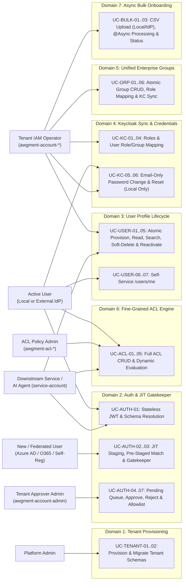

> **ARCHIVED SPECIFICATION (`v2.0`)**  
> This document is a historical archive of the initial `/accounts/v2` use cases specification prior to the independent security & architectural review.  
> **Active Authoritative Specification:** [USE_CASES.md](../../USE_CASES.md) (`v2.1` — Security-Hardened)

---

# Use Cases Specification: `awgment-app-account` (`v2`)

**Service:** `awgment-app-account` (Headless Multi-Tenant IAM API)  
**API Base Path:** `/accounts/v2`  
**Target Stack:** Java 21 LTS · Spring Boot 3.3.5 · PostgreSQL 16 (JPA + Flyway) · Keycloak 26.0.5 (Quarkus)  
**Configuration Mode:** Standalone (`application.yml` + environment variables; Spring Cloud Config removed)  
**Related Specifications:**
* [GEMINI.md](../../../GEMINI.md) — Modernization boundaries & migration checklist
* [SERVICE_RATIONALIZATION.md](../../../SERVICE_RATIONALIZATION.md) — Service pruning, schema consolidation, and database simplification
* [JIT_ONBOARDING_APPROVAL_ARCHITECTURE.md](../../../JIT_ONBOARDING_APPROVAL_ARCHITECTURE.md) — Just-In-Time (JIT) user staging & admin approval gatekeeper

---

## 1. Locked-In Architectural Decisions

The following decisions govern all use cases in this specification:

| # | Decision Area | Finalized Design |
| :--- | :--- | :--- |
| **1** | **Dual Identity Model** | Support both **Type 1 (`EXTERNAL_IDP`)** users (Azure AD / Entra ID / Microsoft 365 / Okta / Google brokered via Keycloak) and **Type 2 (`KEYCLOAK_LOCAL`)** users (managed directly in Keycloak). Tracked via `tp_user.identity_source`. |
| **2** | **Provisioning & Registration** | **Atomic admin provisioning + JIT for everyone else.** Admin creation (`POST /accounts/v2/users`) atomically provisions `tp_user` (`ACTIVE`) and Keycloak (for `KEYCLOAK_LOCAL`) or pre-stages `tp_user` (`ACTIVE`, awaiting `keycloak_sub` binding on first SSO login for `EXTERNAL_IDP`). Unstaged SSO & self-registered users go through JIT auto-staging. **Legacy RSA-4096 `POST /internal/v1/users/create` SPI callback is retired.** |
| **3** | **Enterprise IdP (`EXTERNAL_IDP`) Sync & Guard** | Refresh mutable profile claims (`firstName`, `lastName`, `email`, `department`/groups) on login from JWT/Keycloak. Reject password-reset / change-password requests for `EXTERNAL_IDP` users (`HTTP 400`). Rely on IdP/Keycloak token revocation & local deactivation for deprovisioning. |
| **4** | **Local (`KEYCLOAK_LOCAL`) Credential Policy** | **Keycloak invite/reset email only.** Provision local users with `UPDATE_PASSWORD` + `VERIFY_EMAIL` required actions and invoke Keycloak `execute-actions-email`. Never generate, log, or return plaintext passwords in API responses. |
| **5** | **User Deletion Semantics** | **Soft delete + Keycloak disable & session revoke.** `DELETE /accounts/v2/users/{id}` sets `status = DISABLED`, disables the user in Keycloak, and revokes active sessions (preserving audit & ACL history). Supports reactivation (`POST /accounts/v2/users/{id}/reactivate`). |
| **6** | **Unified Atomic Groups** | Retire `/accounts/v1/keycloak/groups`. `/accounts/v2/groups` atomically synchronizes create, rename, role assignment, and delete across PostgreSQL `tp_group` and Keycloak 26, plus `POST /accounts/v2/groups/sync` to import existing Keycloak/IdP groups. |
| **7** | **Bulk User Onboarding** | Spring `@Async` (zero Camunda BPMN). Pre-approved `ACTIVE` provisioning for both identity types: defaults to `KEYCLOAK_LOCAL` (`ACTIVE` + Keycloak user + invite email + groups/roles) and supports `identitySource=EXTERNAL_IDP` (pre-stages `ACTIVE` `tp_user` matched by `email_id` on first SSO login, bypassing quarantine). |
| **8** | **Clean RESTful API Surface** | Adopt clean RESTful paths under **`/accounts/v2`** (no legacy `/accounts/v1` path aliases). |
| **9** | **Strict Separation of Duties & Service Accounts** | **`awgment-account-admin`** is strictly separate from `awgment-account-all`: only `awgment-account-admin` can manage JIT approvals (`/pending`, `/approve`, `/reject`) and `/domain-allowlist`. Retain granular CRUD roles (`awgment-account-*`, `awgment-acl-*`). Allow any `ACTIVE` user to access `/users/me`, self-service `change-password` (if `KEYCLOAK_LOCAL`), and ACL evaluation. `service-account-*` tokens bypass the JIT Gatekeeper filter. |
| **10** | **Multi-Tenant Provisioning & Stateless JWT** | Drop Spring Cloud Config. Maintain a tenant registry (`public.tp_tenant`), run Flyway migrations across all registered tenant schemas on startup, and expose platform-admin `POST /accounts/v2/tenants` to provision new schemas. Extract roles/groups statelessly from validated Keycloak 26 JWT claims (no per-request `/userinfo` HTTP calls) and support full ACL CRUD including `DELETE /accounts/v2/acl/{id}`. |

---

## 2. Actors & Security Authorities

| Actor | Description | Required Authority / Auth Mechanism |
| :--- | :--- | :--- |
| **Platform Administrator** | Provisions and manages tenant schemas across the Awgment platform. | `awgment-platform-admin` (validated OIDC JWT) |
| **Tenant Approver Admin** | Approves/rejects JIT-staged users and manages tenant domain auto-approval allowlists (**strict separation of duties**). | `awgment-account-admin` |
| **Tenant IAM Operator** | Manages users, groups, Keycloak role sync, and bulk CSV imports within their tenant realm. | `awgment-account-all`, `awgment-account-create-or-update`, `awgment-account-read`, `awgment-account-delete` |
| **ACL Policy Administrator** | Creates, updates, reads, and deletes fine-grained resource ACL policies. | `awgment-acl-create-or-update`, `awgment-acl-read` |
| **Authenticated Active User** | `ACTIVE` tenant user (`EXTERNAL_IDP` or `KEYCLOAK_LOCAL`) managing their own profile, triggering password email (local only), or undergoing ACL checks. | Valid Tenant OIDC Bearer JWT (`status = ACTIVE`) |
| **New / Federated User** | First-time Enterprise IdP (Azure AD / O365) or self-registered Keycloak user without an active bound `tp_user` record. | Valid Tenant OIDC Bearer JWT (intercepted by Gatekeeper Filter) |
| **Downstream Service / AI Agent** | Internal microservice, Apache Camel route, or autonomous agent (`service-account-*` or RFC 8693 delegated token) querying users or evaluating ACLs. | Valid OIDC Bearer JWT (`service-account-*` bypasses JIT Gatekeeper) |

---

## 3. Data Model Impact Summary (PostgreSQL 16)

* **Shared Control Schema (`public`):**
  * `public.tp_tenant`: `id`, `tenant_id` (unique realm/schema name), `display_name`, `status` (`ACTIVE`, `SUSPENDED`), `created_on`, `updated_on` — drives startup Flyway migration across all tenants.
* **Per-Tenant Isolated Schema (`<tenant_schema>`):**
  * `tp_user`: `id` (Snowflake `BIGINT`), `keycloak_sub` (`VARCHAR(64)` nullable until bound, partial `UNIQUE` index where `keycloak_sub IS NOT NULL`), `user_name` (`UNIQUE`, lowercase), `email_id` (`UNIQUE`, case-insensitive), `first_name`, `last_name`, `mobile_number`, `department`, `identity_source` (`KEYCLOAK_LOCAL` | `EXTERNAL_IDP`), `status` (`PENDING_APPROVAL` | `ACTIVE` | `REJECTED` | `DISABLED`), `approved_by_id`, `approved_on`, `rejection_reason`, `attributes` (`JSONB` + GIN index), audit columns.
  * `tp_domain_allowlist`: `id`, `domain_name` (`UNIQUE`), `auto_approve`, `default_roles` (`JSONB`), audit columns.
  * `tp_group`: `id`, `name` (`UNIQUE`), `description`, `group_id` (Keycloak Group UUID, `UNIQUE`), audit columns.
  * `tp_acl`: `id`, `name` (`UNIQUE`), `read_permissions` (`JSONB`), `update_permissions` (`JSONB`), `delete_permissions` (`JSONB`), audit columns.
  * `tp_bulk_user`: `id`, `document_id`, `identity_source`, `user_data` (`JSONB`), `status` (`CREATED` | `IN_PROGRESS` | `COMPLETED` | `FAILED`), `error_message`, audit columns.

---

## 4. High-Level Use Case Map

---

## 5. Detailed Use Cases

---

### Domain 1: Tenant Provisioning & Multi-Tenant Infrastructure (`UC-TENANT`)

#### `UC-TENANT-01`: Provision New Tenant Schema & Seed Defaults
* **Primary Actor:** Platform Administrator
* **Required Authority:** `awgment-platform-admin`
* **Endpoint:** `POST /accounts/v2/tenants`
* **Preconditions:** Corresponding Keycloak 26 tenant realm exists (or is being paired); `tenantId` is a valid PostgreSQL schema identifier (lowercase alphanumeric + underscores).
* **Main Flow:**
  1. Validates `tenantId` format and verifies it is not already registered in `public.tp_tenant`.
  2. Executes `CREATE SCHEMA IF NOT EXISTS <tenant_schema>` in PostgreSQL 16.
  3. Runs Flyway migrations programmatically targeting `<tenant_schema>` (`tp_user`, `tp_domain_allowlist`, `tp_group`, `tp_acl`, `tp_bulk_user`).
  4. Seeds tenant defaults (e.g., `SYSTEM` service-account profile record).
  5. Inserts the tenant metadata record into `public.tp_tenant` with `status = 'ACTIVE'`.
  6. Returns `201 Created` with tenant summary.
* **Alternate / Exception Flows:**
  * **Invalid Schema Name / SQL Injection Attempt:** Rejected with `400 Bad Request` via strict regex allowlist (`^[a-z][a-z0-9_]{1,62}$`).
  * **Duplicate Tenant ID:** Returns `409 Conflict`.
* **Postconditions:** The new tenant schema is migrated, seeded, and immediately ready to serve JWT traffic for its Keycloak realm.

---

#### `UC-TENANT-02`: List Registered Tenants & Run Startup Flyway Migrations
* **Primary Actor:** Platform Administrator / Application Startup Lifecycle
* **Required Authority:** `awgment-platform-admin` (for `GET /accounts/v2/tenants`)
* **Endpoint:** `GET /accounts/v2/tenants` (and automated `ApplicationRunner` on boot)
* **Main Flow:**
  1. On application startup, Flyway migrates the `public` schema first (`public.tp_tenant`), then iterates over all `ACTIVE` tenants in `public.tp_tenant` and executes pending tenant Flyway migrations for each schema.
  2. `GET /accounts/v2/tenants` returns the paginated list of registered tenants and their statuses.

---

### Domain 2: Authentication, Stateless Claims & JIT Onboarding Gatekeeper (`UC-AUTH`)

#### `UC-AUTH-01`: Stateless Multi-Tenant JWT Authentication & Schema Resolution
* **Primary Actor:** Any API Caller (User, Admin, Downstream Service / AI Agent)
* **Endpoint Scope:** All `/accounts/v2/**` endpoints
* **Preconditions:** Caller supplies `Authorization: Bearer <JWT>` issued by a registered Keycloak 26 realm.
* **Main Flow:**
  1. `TenantAuthenticationManagerResolver` extracts the tenant realm from the JWT `iss` claim, validates it against active registered tenants, and authenticates the JWT signature/claims via the realm's OIDC JWKS issuer URI.
  2. `JWTRoleConverter` extracts roles **statelessly** directly from validated JWT claims (`realm_access.roles`, `resource_access.<client>.roles`, and/or `clientRoles` mapper) — **zero per-request HTTP calls to Keycloak `/userinfo`**.
  3. Tenant filter binds the validated tenant schema to `TenantContext` for Hibernate 6 (`CurrentTenantIdentifierResolver` + `MultiTenantConnectionProvider` executing `SET search_path TO <tenant_schema>`).
  4. Clears `TenantContext` in a `finally` block after request completion.
* **Alternate / Exception Flows:**
  * **Missing/Expired/Invalid JWT:** Returns `401 Unauthorized`.
  * **Unregistered / Suspended Tenant:** Returns `403 Forbidden`.

---

#### `UC-AUTH-02`: JIT User Auto-Staging, Pre-Staged Matching & On-Login Claim Sync
* **Primary Actor:** New or Returning Federated User (Azure AD / O365 / Okta / Google) or Self-Registered Keycloak User
* **Endpoint Scope:** Any authenticated `/accounts/v2/**` request (excluding `/actuator/**`, `/swagger-ui/**`, `/v3/api-docs/**`, `/accounts/v2/tenants/**`)
* **Preconditions:** Valid tenant JWT containing `sub`, `preferred_username`, `email`, `given_name`, `family_name` (and optional IdP broker claim / `identity_provider` mapper).
* **Main Flow:**
  1. **Service-Account Bypass:** If `preferred_username` starts with `service-account` (or token represents client-credentials), bypasses `UserApprovalGatekeeperFilter` immediately.
  2. **Primary Lookup by `keycloak_sub`:** Queries `<tenant_schema>.tp_user` by `keycloak_sub = jwt.getSubject()`.
  3. **Returning `EXTERNAL_IDP` Claim Sync:** If found and `identity_source == 'EXTERNAL_IDP'` and `status == 'ACTIVE'`, refreshes mutable profile fields (`first_name`, `last_name`, `email_id`, `department`, synced IdP group claims) when changed in the token, updating `updated_on`.
  4. **Pre-Staged User Binding (First SSO Login for Admin/Bulk Pre-Staged `EXTERNAL_IDP` User):** If not found by `keycloak_sub`, searches `tp_user` by case-insensitive `email_id` where `keycloak_sub IS NULL` and `identity_source = 'EXTERNAL_IDP'`.
     * If found: binds `keycloak_sub = jwt.getSubject()`, refreshes OIDC claims, syncs configured roles in Keycloak if needed, and proceeds (already `ACTIVE`, skipping quarantine).
  5. **First-Time Unstaged User (JIT Ingestion):** If still not found:
     * Determines `identity_source` (`EXTERNAL_IDP` if brokered via external IdP claim, otherwise `KEYCLOAK_LOCAL`).
     * Extracts email domain and checks `<tenant_schema>.tp_domain_allowlist`.
     * **Branch A — Allowlisted (`auto_approve = TRUE`):** Inserts `tp_user` with Snowflake `id`, `keycloak_sub`, OIDC claims, `identity_source`, and `status = 'ACTIVE'`; calls Keycloak 26 Admin Client to map `default_roles`; lets request proceed.
     * **Branch B — Approval Required:** Inserts `tp_user` with `status = 'PENDING_APPROVAL'`; returns `403 Forbidden` with `{ "code": "ACCESS_PENDING_APPROVAL", "message": "...", "status": 403 }`.
* **Alternate / Exception Flows:**
  * **Concurrent First Requests:** Unique constraint on `keycloak_sub` prevents duplicates; catches constraint violation and re-reads existing record.

---

#### `UC-AUTH-03`: Quarantine, Rejection & Disabled Status Enforcement
* **Primary Actor:** Quarantined, Rejected, or Disabled User
* **Endpoint Scope:** All gatekeeper-protected `/accounts/v2/**` endpoints
* **Main Flow:**
  1. Evaluates `user.status` from `tp_user`:
     * `ACTIVE` → allows request through `filterChain`.
     * `PENDING_APPROVAL` → returns `403 Forbidden` (`code = "ACCESS_PENDING_APPROVAL"`).
     * `REJECTED` → returns `403 Forbidden` (`code = "ACCESS_REJECTED"`).
     * `DISABLED` → returns `403 Forbidden` (`code = "ACCESS_DISABLED"`).
* **Postconditions:** Unapproved, rejected, and deactivated users hold zero API access.

---

#### `UC-AUTH-04`: View Pending User Approval Queue
* **Primary Actor:** Tenant Approver Admin
* **Required Authority:** `awgment-account-admin` *(strictly separated from `awgment-account-all`)*
* **Endpoint:** `GET /accounts/v2/users/pending`
* **Main Flow:**
  1. Queries `<tenant_schema>.tp_user` where `status = 'PENDING_APPROVAL'` with pagination and sorting.
  2. Returns staged user details (`id`, `keycloakSub`, `userName`, `emailId`, `firstName`, `lastName`, `identitySource`, `createdOn`).

---

#### `UC-AUTH-05`: Approve Pending User & Synchronize Keycloak Roles
* **Primary Actor:** Tenant Approver Admin
* **Required Authority:** `awgment-account-admin`
* **Endpoint:** `POST /accounts/v2/users/{id}/approve`
* **Main Flow:**
  1. Loads `tp_user` by `{id}` and validates current status is `PENDING_APPROVAL` (or `REJECTED` if re-evaluating).
  2. Updates `tp_user`: sets `status = 'ACTIVE'`, `approved_by_id = <approverId>`, `approved_on = NOW()`, `rejection_reason = NULL`, `updated_on = NOW()`.
  3. Calls Keycloak 26 Admin Client (in current tenant realm) to ensure user is enabled (`enabled = true`) and assign requested initial `roles` (or tenant defaults).
  4. Returns `200 OK` with updated user record.

---

#### `UC-AUTH-06`: Reject Pending User Registration
* **Primary Actor:** Tenant Approver Admin
* **Required Authority:** `awgment-account-admin`
* **Endpoint:** `POST /accounts/v2/users/{id}/reject`
* **Preconditions:** Request body provides a non-blank `reason`.
* **Main Flow:**
  1. Updates `tp_user`: sets `status = 'REJECTED'`, `rejection_reason = <reason>`, `updated_by_id = <approverId>`, `updated_on = NOW()`.
  2. Disables user / revokes sessions in Keycloak if `keycloak_sub` is bound.
  3. Returns `200 OK`.

---

#### `UC-AUTH-07`: Manage Tenant Domain Auto-Approval Allowlist
* **Primary Actor:** Tenant Approver Admin
* **Required Authority:** `awgment-account-admin`
* **Endpoints:**
  * `GET /accounts/v2/domain-allowlist` — List allowlisted domains for current tenant
  * `POST /accounts/v2/domain-allowlist` — Add or update domain policy (`domainName`, `autoApprove`, `defaultRoles`)
  * `DELETE /accounts/v2/domain-allowlist/{id}` — Remove domain policy
* **Main Flow:**
  1. Normalizes `domainName` to lowercase (e.g., `company.com`), enforces uniqueness within tenant schema, validates `defaultRoles` exist in Keycloak, and persists to `tp_domain_allowlist`.

---

### Domain 3: User Profile Lifecycle Management (`UC-USER`)

#### `UC-USER-01`: Atomically Provision or Update User Profile
* **Primary Actor:** Tenant IAM Operator
* **Required Authority:** `awgment-account-create-or-update` or `awgment-account-all`
* **Endpoints:**
  * `POST /accounts/v2/users` (Create)
  * `PUT /accounts/v2/users/{id}` (Update)
* **Main Flow (Create — `POST /accounts/v2/users`):**
  1. Validates `userName` (must not start with `service-account`; normalized to lowercase) and uniqueness of `userName` and `emailId` in `tp_user`.
  2. Reads `identitySource` (defaults to `KEYCLOAK_LOCAL`; accepts `EXTERNAL_IDP`).
  3. Generates Snowflake `id` via `lib-id-generator`, sets `status = 'ACTIVE'`, `approved_by_id = <operatorId>`, `approved_on = NOW()`, and audit fields.
  4. **If `identitySource == KEYCLOAK_LOCAL`:**
     * Atomically creates the user in Keycloak 26 (current tenant realm) with `enabled = true`, custom attribute `userId = <snowflakeId>`, `requiredActions = ["UPDATE_PASSWORD", "VERIFY_EMAIL"]`, and optional initial roles/groups.
     * Captures returned Keycloak UUID as `keycloak_sub`.
     * Triggers Keycloak `execute-actions-email` so the user sets their own password securely (**zero plaintext password generation or logging**).
     * Persists `tp_user` (compensates/rolls back Keycloak user if PostgreSQL insert fails).
  5. **If `identitySource == EXTERNAL_IDP`:**
     * Pre-stages `tp_user` with `status = 'ACTIVE'`, `identity_source = 'EXTERNAL_IDP'`, and `keycloak_sub = NULL` (no local Keycloak password/invite email created; bound automatically on first SSO login in `UC-AUTH-02`).
  6. Stores any custom key-value fields inside PostgreSQL `JSONB` `attributes`.
* **Main Flow (Update — `PUT /accounts/v2/users/{id}`):**
  1. Loads existing `tp_user` (`404` if missing).
  2. Enforces immutability of `userName`, `emailId`, and `identitySource` (`400 Bad Request` on attempt to alter).
  3. Updates mutable fields (`firstName`, `lastName`, `mobileNumber`, `department`, `attributes` JSONB) and update audit fields.
  4. For `KEYCLOAK_LOCAL` users with bound `keycloak_sub`, synchronizes updated `firstName`/`lastName` to Keycloak 26.

---

#### `UC-USER-02`: Fetch User Profile by ID
* **Primary Actor:** Tenant IAM Operator / Downstream Service
* **Required Authority:** `awgment-account-read` or `awgment-account-all`
* **Endpoint:** `GET /accounts/v2/users/{id}?onlyMandatoryFields={true|false}`
* **Main Flow:**
  1. Fetches `tp_user` by Snowflake `{id}` (`404` if not found).
  2. Returns full profile (including `identitySource`, `status`, `attributes` JSONB) or core fields only if `onlyMandatoryFields=true`.

---

#### `UC-USER-03`: Search, Filter, Sort & Paginate Users
* **Primary Actor:** Tenant IAM Operator / Downstream Service
* **Required Authority:** `awgment-account-read` or `awgment-account-all`
* **Endpoint:** `GET /accounts/v2/users`
  * Query Params: `q`, `status`, `identitySource`, `department`, `loginId`, `onlyMandatoryFields`, `page`, `size`, `sort`
* **Main Flow:**
  1. Executes JPA `Specification` queries against `tp_user` (leveraging composite B-tree index and PostgreSQL GIN index on `attributes`).
  2. Special `loginId` rule: if `loginId` starts with `service-account`, resolves and returns the tenant's `SYSTEM` user record; otherwise matches `userName` or `emailId` (case-insensitive).
  3. Supports filtering by `status` (`ACTIVE`, `PENDING_APPROVAL`, `REJECTED`, `DISABLED`), `identitySource` (`KEYCLOAK_LOCAL`, `EXTERNAL_IDP`), free-text `q`, sorting, and pagination.

---

#### `UC-USER-04`: Soft-Delete (Deactivate) User & Revoke Keycloak Access
* **Primary Actor:** Tenant IAM Operator
* **Required Authority:** `awgment-account-delete` or `awgment-account-all`
* **Endpoint:** `DELETE /accounts/v2/users/{id}`
* **Main Flow:**
  1. Loads `tp_user` by `{id}` (`404` if not found).
  2. Updates `tp_user`: sets `status = 'DISABLED'`, `updated_by_id = <operatorId>`, `updated_on = NOW()` (row is retained to preserve audit trails and ACL/foreign-key integrity).
  3. If `keycloak_sub` is present, invokes Keycloak 26 Admin Client to set `enabled = false` and invoke `logout()` to revoke all active SSO/refresh sessions.
  4. Returns `204 No Content` / success response.

---

#### `UC-USER-05`: Reactivate Disabled User
* **Primary Actor:** Tenant IAM Operator (or Tenant Approver Admin)
* **Required Authority:** `awgment-account-create-or-update`, `awgment-account-all`, or `awgment-account-admin`
* **Endpoint:** `POST /accounts/v2/users/{id}/reactivate`
* **Main Flow:**
  1. Verifies user `{id}` exists and is currently `DISABLED` (`400 Bad Request` if `PENDING_APPROVAL` or `REJECTED`, which must go through `UC-AUTH-05`).
  2. Sets `status = 'ACTIVE'`, `updated_by_id`, `updated_on = NOW()`.
  3. Re-enables user in Keycloak 26 (`enabled = true`) if `keycloak_sub` is bound.

---

#### `UC-USER-06`: View Logged-In User's Own Profile
* **Primary Actor:** Authenticated Active User
* **Required Authority:** Any `ACTIVE` authenticated tenant user
* **Endpoint:** `GET /accounts/v2/users/me`
* **Main Flow:**
  1. Resolves caller from validated JWT `sub` (`keycloak_sub`) — falling back to `userId` claim or `preferred_username`.
  2. Returns the caller's full profile including `identitySource`, `status`, roles/groups from JWT, and `attributes`.

---

#### `UC-USER-07`: Self-Service Update of Logged-In User Profile
* **Primary Actor:** Authenticated Active User
* **Required Authority:** Any `ACTIVE` authenticated tenant user
* **Endpoint:** `PUT /accounts/v2/users/me`
* **Main Flow:**
  1. Resolves caller strictly from the JWT security context (no user ID in URL; cannot target another user).
  2. Rejects or ignores attempts to mutate protected fields (`userName`, `emailId`, `status`, `identitySource`, `roles`, `groups`).
  3. For `EXTERNAL_IDP` users, allows updating local extension fields (`mobileNumber`, custom `attributes` JSONB) while keeping IdP-mastered identity fields synchronized from IdP claims.
  4. For `KEYCLOAK_LOCAL` users, updates mutable profile fields + `attributes` and syncs name changes to Keycloak 26.

---

### Domain 4: Keycloak Role, Membership & Credential Synchronization (`UC-KC`)

> All Keycloak integrations use the official **`keycloak-admin-client:26.0.5`** scoped to the active tenant realm (`TenantContext.getTenantId()`).

#### `UC-KC-01`: List All Realm & Configured Client Roles
* **Primary Actor:** Tenant IAM Operator
* **Required Authority:** `awgment-account-read` or `awgment-account-all`
* **Endpoint:** `GET /accounts/v2/keycloak/roles`
* **Main Flow:**
  1. Queries Keycloak 26 Admin Client for all realm roles and all roles belonging to configured target clients (`clients` property).
  2. Returns combined list of `RolesSchema` (`roleId`, `roleName`, `scope`, `clientName`).

---

#### `UC-KC-02`: Create a New Client Role in Keycloak
* **Primary Actor:** Tenant IAM Operator
* **Required Authority:** `awgment-account-create-or-update` or `awgment-account-all` *(hardened; legacy endpoint lacked `@PreAuthorize`)*
* **Endpoint:** `POST /accounts/v2/keycloak/{clientName}/roles`
* **Main Flow:**
  1. Resolves `clientName` (`clientId`) to its internal Keycloak UUID within the tenant realm.
  2. Creates the new role under that client via Keycloak 26 Admin Client.

---

#### `UC-KC-03`: Assign / Synchronize Roles to a User
* **Primary Actor:** Tenant IAM Operator
* **Required Authority:** `awgment-account-create-or-update` or `awgment-account-all`
* **Endpoint:** `PUT /accounts/v2/keycloak/users/{userId}/roles`
* **Main Flow:**
  1. Resolves target user's `keycloak_sub` from `tp_user` (or accepts Keycloak UUID).
  2. Diffs and replaces the user's non-default realm roles and configured client roles in Keycloak 26 so they match the requested role list idempotently.

---

#### `UC-KC-04`: Assign / Synchronize Groups to a User
* **Primary Actor:** Tenant IAM Operator
* **Required Authority:** `awgment-account-create-or-update` or `awgment-account-all`
* **Endpoint:** `PUT /accounts/v2/keycloak/users/{userId}/groups`
* **Main Flow:**
  1. Validates every requested group exists in the tenant's Keycloak realm (`GroupsNotFoundException` if any is unknown).
  2. Replaces the user's non-default Keycloak group memberships to match the target set idempotently.

---

#### `UC-KC-05`: Self-Service Password Change Email (`KEYCLOAK_LOCAL` Only)
* **Primary Actor:** Authenticated Active User (`KEYCLOAK_LOCAL`)
* **Required Authority:** Any `ACTIVE` authenticated tenant user
* **Endpoint:** `POST /accounts/v2/keycloak/users/change-password`
* **Main Flow:**
  1. Resolves the logged-in user from `tp_user`.
  2. **IdP Credential Guard:** If `user.identitySource == EXTERNAL_IDP`, rejects with `400 Bad Request` (`PASSWORD_MANAGED_BY_EXTERNAL_IDP`).
  3. Invokes Keycloak 26 `executeActionsEmail(["UPDATE_PASSWORD"], emailValidity)` for the user's `keycloak_sub`.
* **Alternate / Exception Flows:**
  * **SMTP / Keycloak Mail Failure:** Throws `MailException` (`502` / `500`).

---

#### `UC-KC-06`: Administrative Password Reset Email (`KEYCLOAK_LOCAL` Only)
* **Primary Actor:** Tenant IAM Operator
* **Required Authority:** `awgment-account-create-or-update` or `awgment-account-all`
* **Endpoint:** `POST /accounts/v2/keycloak/users/{userId}/password-reset`
* **Main Flow:**
  1. Looks up target user in `tp_user`.
  2. **IdP Credential Guard:** If `user.identitySource == EXTERNAL_IDP`, rejects with `400 Bad Request` (`PASSWORD_MANAGED_BY_EXTERNAL_IDP`).
  3. Invokes Keycloak 26 `executeActionsEmail(["UPDATE_PASSWORD"], emailValidity)` (never generates, logs, or returns a plaintext password).
  4. Returns `200 OK` confirming reset email dispatch.

---

### Domain 5: Unified Enterprise Group Management (`UC-GRP`)

> Legacy `/accounts/v1/keycloak/groups` is retired; `/accounts/v2/groups` atomically keeps `tp_group` and Keycloak 26 in sync.

#### `UC-GRP-01`: Create or Update Enterprise Group (Atomic PG + Keycloak)
* **Primary Actor:** Tenant IAM Operator
* **Required Authority:** `awgment-account-create-or-update` or `awgment-account-all`
* **Endpoints:**
  * `POST /accounts/v2/groups` (Create)
  * `PUT /accounts/v2/groups/{id}` (Update)
* **Main Flow (Create):**
  1. Verifies group `name` does not already exist in `tp_group` or Keycloak 26.
  2. Creates the group in Keycloak 26 via Admin Client and captures the generated Keycloak Group UUID (`group_id`).
  3. Persists `GroupDefinition` (`id` = Snowflake ID, `name`, `description`, `groupId`, audit fields) in `<tenant_schema>.tp_group`. Compensates by deleting the Keycloak group if DB persistence fails.
* **Main Flow (Update):**
  1. Validates target `{id}` exists and new `name` does not collide with another group.
  2. Updates group name in Keycloak 26 via `group_id` UUID and updates `tp_group`.

---

#### `UC-GRP-02`: List, Search, Filter & Paginate Groups
* **Primary Actor:** Tenant IAM Operator / Downstream Service
* **Required Authority:** `awgment-account-read` or `awgment-account-all`
* **Endpoint:** `GET /accounts/v2/groups`
  * Query Params: `q`, `ids` (comma-separated group IDs), `page`, `size`, `sort`
* **Main Flow:**
  1. If `ids` is supplied, returns matching `tp_group` records by `id IN (...)`.
  2. Otherwise queries `tp_group` with JPA Specifications matching `q` across `name` and `description`, with sorting and pagination.

---

#### `UC-GRP-03`: Fetch Group Details with Enriched Keycloak Roles
* **Primary Actor:** Tenant IAM Operator
* **Required Authority:** `awgment-account-read` or `awgment-account-all`
* **Endpoint:** `GET /accounts/v2/groups/{id}`
* **Main Flow:**
  1. Loads `GroupDefinition` from `tp_group` by `{id}`.
  2. Queries Keycloak 26 Admin Client using `group_id` UUID for assigned realm and configured client roles.
  3. Returns group metadata enriched with live `roles`.

---

#### `UC-GRP-04`: Delete Enterprise Group (Atomic PG + Keycloak)
* **Primary Actor:** Tenant IAM Operator
* **Required Authority:** `awgment-account-delete` or `awgment-account-all`
* **Endpoint:** `DELETE /accounts/v2/groups/{id}`
* **Main Flow:**
  1. Loads `GroupDefinition` from `tp_group` (`404` if missing).
  2. Deletes the linked group from Keycloak 26 using `group_id` UUID (tolerates `404` if already absent in Keycloak).
  3. Deletes the record from `tp_group`.

---

#### `UC-GRP-05`: Assign Realm & Client Roles to a Group
* **Primary Actor:** Tenant IAM Operator
* **Required Authority:** `awgment-account-create-or-update` or `awgment-account-all`
* **Endpoint:** `PUT /accounts/v2/groups/{id}/roles`
* **Main Flow:**
  1. Resolves Keycloak `group_id` UUID from `tp_group`.
  2. Replaces the group's realm-level and configured client-level role mappings in Keycloak 26 so all group members inherit the target role set.

---

#### `UC-GRP-06`: Synchronize Pre-Existing Keycloak / IdP Groups into PostgreSQL
* **Primary Actor:** Tenant IAM Operator
* **Required Authority:** `awgment-account-create-or-update` or `awgment-account-all`
* **Endpoint:** `POST /accounts/v2/groups/sync`
* **Main Flow:**
  1. Fetches all non-default groups from the tenant's Keycloak 26 realm (including groups mapped from Azure AD / Entra ID / O365).
  2. Upserts missing groups into `<tenant_schema>.tp_group` (generating Snowflake IDs and linking `group_id` UUID) and updates renamed groups.
  3. Returns sync summary (`created`, `updated`, `total`).

---

### Domain 6: Fine-Grained Access Control Lists (`UC-ACL`)

#### `UC-ACL-01`: Create or Update ACL Policy
* **Primary Actor:** ACL Policy Administrator
* **Required Authority:** `awgment-acl-create-or-update`
* **Endpoints:**
  * `POST /accounts/v2/acl` (Create)
  * `PUT /accounts/v2/acl/{id}` (Update)
* **Main Flow:**
  1. Validates unique policy `name` and ordered `ACLEntry` arrays (`read`, `update`, `delete`), where each entry specifies `decision` (`allow`/`deny`), `ruleType` (`USERS`, `GROUPS`, `ROLES`, `SYSTEM`, `ALL`), `data`, and optional StringTemplate `additionalDetails`.
  2. Generates Snowflake `id` on create, sets audit fields, and persists rule arrays as native PostgreSQL `JSONB` columns in `tp_acl`.
  3. Throws `409 Conflict` / `DuplicateKeyException` on duplicate policy `name`.

---

#### `UC-ACL-02`: List All ACL Policies
* **Primary Actor:** ACL Policy Administrator
* **Required Authority:** `awgment-acl-read`
* **Endpoint:** `GET /accounts/v2/acl?page=0&size=200`
* **Main Flow:**
  1. Returns paginated `ACLDefinition` policies from `<tenant_schema>.tp_acl`.

---

#### `UC-ACL-03`: Fetch ACL Policy by ID
* **Primary Actor:** ACL Policy Administrator
* **Required Authority:** `awgment-acl-read`
* **Endpoint:** `GET /accounts/v2/acl/{id}`
* **Main Flow:**
  1. Loads `ACLDefinition` by Snowflake `{id}` (`404` if missing) and returns `ACLSchema`.

---

#### `UC-ACL-04`: Delete ACL Policy
* **Primary Actor:** ACL Policy Administrator
* **Required Authority:** `awgment-acl-create-or-update`
* **Endpoint:** `DELETE /accounts/v2/acl/{id}`
* **Main Flow:**
  1. Verifies ACL `{id}` exists in `tp_acl` (`404` if missing).
  2. Deletes the ACL policy from `tp_acl` and returns `204 No Content`.

---

#### `UC-ACL-05`: Dynamically Evaluate Resource ACL Permissions
* **Primary Actor:** Authenticated Active User / Downstream Service / AI Agent
* **Required Authority:** Any `ACTIVE` authenticated caller or `service-account-*`
* **Endpoint:** `POST /accounts/v2/acl/{id}/evaluate`
* **Main Flow:**
  1. Extracts caller identity **statelessly** from validated JWT claims (`preferred_username`, `groups`, roles) and enriches with the caller's `tp_user` profile & `attributes` JSONB (if present).
  2. Builds `RequestProperties` combining `userInfo`, `user`, `userId`, `username`, and caller-supplied runtime `context`.
  3. Loads `ACLDefinition` by `{id}` (`404` if missing).
  4. Evaluates `read`, `update`, and `delete` rule lists using **first-match wins** semantics across `USERS`, `GROUPS`, `ROLES`, `SYSTEM`, and `ALL` rules (defaulting to `decision = "undefined"` when no rule matches).
  5. Renders StringTemplate v4 expressions (`<request...>`) inside matched `additionalDetails`.
  6. Returns `ACLValidate` with evaluated `read`, `update`, and `delete` decisions.

---

### Domain 7: Asynchronous Bulk User Onboarding (`UC-BULK`)

#### `UC-BULK-01`: Upload CSV for Asynchronous Batch User Onboarding
* **Primary Actor:** Tenant IAM Operator
* **Required Authority:** `awgment-account-create-or-update` or `awgment-account-all`
* **Endpoint:** `POST /accounts/v2/bulk-users/upload` (`multipart/form-data`)
* **Main Flow:**
  1. Validates non-empty file, valid single-dot filename, and `.csv` extension.
  2. Parses CSV headers and rows; validates no empty required cells.
  3. Validates optional `identitySource` column (`KEYCLOAK_LOCAL` default, or `EXTERNAL_IDP`).
  4. Validates all referenced `groups` and `roles` exist in the tenant's Keycloak 26 realm (`NoDataFoundException` if any is unknown).
  5. Generates a shared Snowflake `documentId` and persists staging rows into `<tenant_schema>.tp_bulk_user` with `status = 'CREATED'`.
  6. Dispatches a Spring `@Async` task (explicitly propagating `TenantContext` and operator auditor ID — **zero Camunda BPMN**) that processes each row:
     * Transitions row to `IN_PROGRESS`.
     * **For `KEYCLOAK_LOCAL`:** Creates `ACTIVE` `tp_user` + Keycloak user + assigns groups/roles + dispatches Keycloak `execute-actions-email` (`UPDATE_PASSWORD`, `VERIFY_EMAIL`).
     * **For `EXTERNAL_IDP`:** Pre-stages `ACTIVE` `tp_user` (`keycloak_sub = NULL`) with configured profile/attributes/intended roles so first SSO login binds automatically without quarantine.
     * Marks row `COMPLETED`, or `FAILED` with diagnostic `error_message` (isolating per-row failures so one bad row does not abort the batch).
  7. Immediately returns `202 Accepted` with `{ "documentId": "..." }` for status polling.

---

#### `UC-BULK-02`: Monitor Bulk Onboarding Batch Status & Row Errors
* **Primary Actor:** Tenant IAM Operator
* **Required Authority:** `awgment-account-read` or `awgment-account-all`
* **Endpoints:**
  * `GET /accounts/v2/bulk-users/{documentId}/status` (Aggregated counts: `total`, `created`, `inProgress`, `completed`, `failed` + paginated row details)
  * `GET /accounts/v2/bulk-users` (Searchable/filterable list across batches by `q`, `status`, `documentId`, pagination & sorting)
* **Main Flow:**
  1. Queries `<tenant_schema>.tp_bulk_user` and returns batch progress summary and per-row `status`, `identitySource`, `userData`, and `errorMessage`.

---

#### `UC-BULK-03`: Delete Bulk Staging Record
* **Primary Actor:** Tenant IAM Operator
* **Required Authority:** `awgment-account-delete` or `awgment-account-all`
* **Endpoint:** `DELETE /accounts/v2/bulk-users/{id}`
* **Main Flow:**
  1. Verifies staging record `{id}` exists in `tp_bulk_user` (`404` if absent) and deletes it.

---

## 6. Decommissioned / Out-of-Scope Legacy Capabilities

| Legacy Capability | Legacy Artifact | Disposition | Rationale |
| :--- | :--- | :--- | :--- |
| UI Navigation Sidebar Menus | `MenuController` / `MenuService` | **Removed** | Frontend UIs deprecated; navigation belongs in client apps. |
| Role-to-Menu Mapping | `MenuRoleAssignController` / `MenuRoleAssignService` | **Removed** | Obsolete without UI menus. |
| UI CSS Themes & Import/Export | `ThemesController` / `ThemesService` | **Removed** | Client styling has zero backend IAM responsibility. |
| User Theme Preferences & Avatars | `UserPreferencesController` / `UserPreferencesThemeService` | **Removed** | Themes obsolete; avatars live in profile attributes or IdP. |
| Custom SMS / Email OTP | `OtpController` / `OtpService` | **Removed** | Replaced by Keycloak 26 native 2FA/MFA, OTP & WebAuthn. |
| Separate FormIO Form Collection | `tp_formdata_user` (`UserFormDataDefinition`) | **Consolidated** | Merged into `tp_user.attributes` (`JSONB`). |
| Camunda BPMN Bulk Workflow | `WORKFLOW_START_URL` (`Process_i8koxaq1`) | **Replaced** | Replaced by Spring `@Async` batch processor. |
| RSA-4096 Registration SPI Callback | `POST /internal/v1/users/create` (`InternalController`) | **Retired** | Replaced by JIT auto-staging (`UC-AUTH-02`) + atomic admin provisioning (`UC-USER-01`). |
| Separate Raw Keycloak Group API | `/accounts/v1/keycloak/groups` (`GroupsController`) | **Consolidated** | Replaced by atomic `/accounts/v2/groups` + `/sync`. |
| Spring Cloud Config Server | `bootstrap.yml` / `spring-cloud-starter-config` | **Removed** | Replaced by standalone `application.yml` + environment variables. |
| Per-Request `/userinfo` Calls | `TokenUtils.getClientRoles` HTTP lookup | **Replaced** | Replaced by stateless Keycloak 26 JWT claim extraction. |
| Plaintext Password Generation/Logs | `UserManagementInKeyCloakImpl.generatePassword` | **Removed** | Replaced by Keycloak `execute-actions-email` invite/reset flow. |

---

## 7. Complete Use Case Traceability Matrix (`/accounts/v2`)

| Use Case ID | Name | Endpoint(s) | Authority / Auth | Persistence / Integration |
| :--- | :--- | :--- | :--- | :--- |
| `UC-TENANT-01` | Provision New Tenant Schema | `POST /accounts/v2/tenants` | `awgment-platform-admin` | `public.tp_tenant` + PG Schema + Flyway |
| `UC-TENANT-02` | List Tenants & Startup Migrate | `GET /accounts/v2/tenants` (+ Boot) | `awgment-platform-admin` | `public.tp_tenant` + Flyway |
| `UC-AUTH-01` | Stateless JWT & Schema Resolution | All `/accounts/v2/**` | Valid Tenant OIDC JWT | Keycloak 26 JWKS + PG Tenant Schema |
| `UC-AUTH-02` | JIT Auto-Staging, Binding & Claim Sync | Gatekeeper Filter | Valid Tenant OIDC JWT | `tp_user`, `tp_domain_allowlist`, KC 26 |
| `UC-AUTH-03` | Quarantine / Rejection / Disabled Guard | Gatekeeper Filter | Valid Tenant OIDC JWT | `tp_user` (`403` error codes) |
| `UC-AUTH-04` | View Pending Approval Queue | `GET /accounts/v2/users/pending` | `awgment-account-admin` | `tp_user` |
| `UC-AUTH-05` | Approve Pending User & Sync KC | `POST /accounts/v2/users/{id}/approve` | `awgment-account-admin` | `tp_user` + Keycloak 26 Admin SDK |
| `UC-AUTH-06` | Reject Pending User | `POST /accounts/v2/users/{id}/reject` | `awgment-account-admin` | `tp_user` + Keycloak 26 Admin SDK |
| `UC-AUTH-07` | Manage Domain Allowlist | `GET/POST/DELETE /accounts/v2/domain-allowlist` | `awgment-account-admin` | `tp_domain_allowlist` + KC 26 validation |
| `UC-USER-01` | Atomic Provision / Update User | `POST /accounts/v2/users`, `PUT /accounts/v2/users/{id}` | Create / All | `tp_user` + KC 26 (`KEYCLOAK_LOCAL` email) |
| `UC-USER-02` | Fetch User Profile by ID | `GET /accounts/v2/users/{id}` | Read / All | `tp_user` |
| `UC-USER-03` | Search, Filter & Paginate Users | `GET /accounts/v2/users` | Read / All | `tp_user` (JPA Spec + GIN) |
| `UC-USER-04` | Soft-Delete User & Revoke KC | `DELETE /accounts/v2/users/{id}` | Delete / All | `tp_user` (`DISABLED`) + KC 26 disable/logout |
| `UC-USER-05` | Reactivate Disabled User | `POST /accounts/v2/users/{id}/reactivate` | Create / All / Admin | `tp_user` (`ACTIVE`) + KC 26 enable |
| `UC-USER-06` | View Own Profile | `GET /accounts/v2/users/me` | Any `ACTIVE` User | `tp_user` + JWT claims |
| `UC-USER-07` | Self-Service Update Own Profile | `PUT /accounts/v2/users/me` | Any `ACTIVE` User | `tp_user` (+ KC 26 if `KEYCLOAK_LOCAL`) |
| `UC-KC-01` | List Realm & Client Roles | `GET /accounts/v2/keycloak/roles` | Read / All | Keycloak 26 Admin SDK |
| `UC-KC-02` | Create Client Role | `POST /accounts/v2/keycloak/{clientName}/roles` | Create / All | Keycloak 26 Admin SDK |
| `UC-KC-03` | Assign / Sync User Roles | `PUT /accounts/v2/keycloak/users/{userId}/roles` | Create / All | Keycloak 26 Admin SDK |
| `UC-KC-04` | Assign / Sync User Groups | `PUT /accounts/v2/keycloak/users/{userId}/groups` | Create / All | Keycloak 26 Admin SDK |
| `UC-KC-05` | Self-Service Password Email | `POST /accounts/v2/keycloak/users/change-password` | Any `ACTIVE` (`KEYCLOAK_LOCAL`) | Keycloak 26 `execute-actions-email` |
| `UC-KC-06` | Admin Password Reset Email | `POST /accounts/v2/keycloak/users/{userId}/password-reset` | Create / All (`KEYCLOAK_LOCAL`) | Keycloak 26 `execute-actions-email` |
| `UC-GRP-01` | Atomic Create / Update Group | `POST /accounts/v2/groups`, `PUT /accounts/v2/groups/{id}` | Create / All | `tp_group` + Keycloak 26 Admin SDK |
| `UC-GRP-02` | List, Search & Paginate Groups | `GET /accounts/v2/groups` | Read / All | `tp_group` |
| `UC-GRP-03` | Fetch Group with Live KC Roles | `GET /accounts/v2/groups/{id}` | Read / All | `tp_group` + Keycloak 26 Admin SDK |
| `UC-GRP-04` | Atomic Delete Group | `DELETE /accounts/v2/groups/{id}` | Delete / All | `tp_group` + Keycloak 26 Admin SDK |
| `UC-GRP-05` | Assign Roles to Group | `PUT /accounts/v2/groups/{id}/roles` | Create / All | `tp_group` + Keycloak 26 Admin SDK |
| `UC-GRP-06` | Sync Pre-Existing KC/IdP Groups | `POST /accounts/v2/groups/sync` | Create / All | `tp_group` + Keycloak 26 Admin SDK |
| `UC-ACL-01` | Create / Update ACL Policy | `POST /accounts/v2/acl`, `PUT /accounts/v2/acl/{id}` | `awgment-acl-create-or-update` | `tp_acl` (`JSONB`) |
| `UC-ACL-02` | List All ACL Policies | `GET /accounts/v2/acl` | `awgment-acl-read` | `tp_acl` |
| `UC-ACL-03` | Fetch ACL Policy by ID | `GET /accounts/v2/acl/{id}` | `awgment-acl-read` | `tp_acl` |
| `UC-ACL-04` | Delete ACL Policy | `DELETE /accounts/v2/acl/{id}` | `awgment-acl-create-or-update` | `tp_acl` |
| `UC-ACL-05` | Dynamic ACL Evaluation | `POST /accounts/v2/acl/{id}/evaluate` | Any `ACTIVE` User / `service-account` | `tp_acl` + `tp_user` + Stateless JWT |
| `UC-BULK-01` | Upload CSV for `@Async` Import | `POST /accounts/v2/bulk-users/upload` | Create / All | `tp_bulk_user` + `@Async` + KC 26 |
| `UC-BULK-02` | Monitor Bulk Batch Status | `GET /accounts/v2/bulk-users/{documentId}/status`, `GET /accounts/v2/bulk-users` | Read / All | `tp_bulk_user` |
| `UC-BULK-03` | Delete Bulk Staging Record | `DELETE /accounts/v2/bulk-users/{id}` | Delete / All | `tp_bulk_user` |
