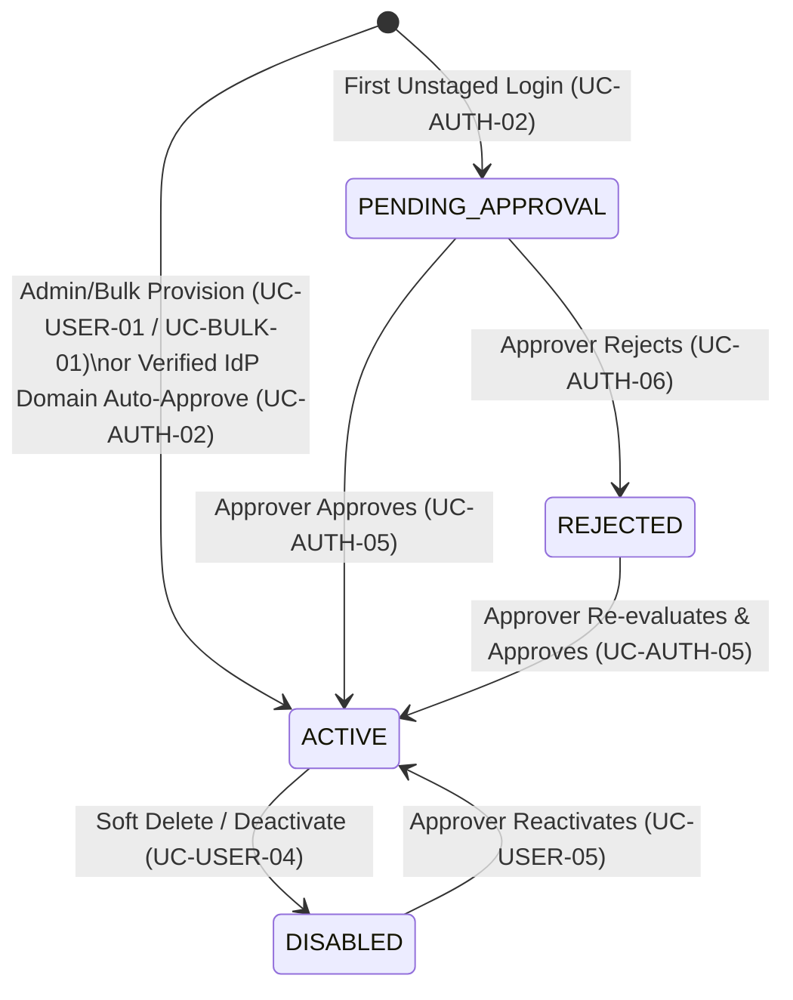
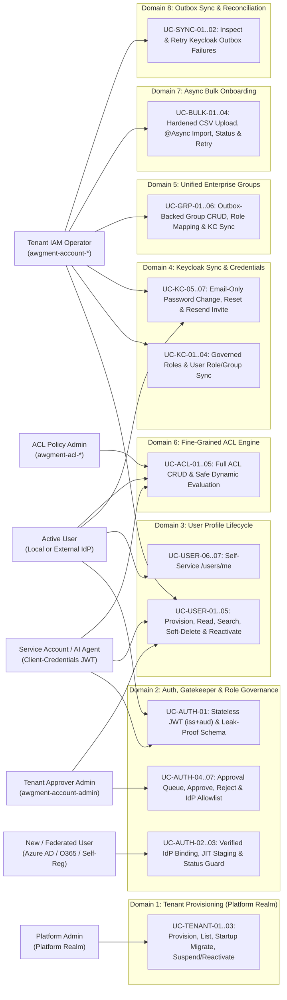

> **ARCHIVED SPECIFICATION (`v2.1`)**  
> This document is a verbatim archive of the `v2.1` `/accounts/v2` use cases specification prior to the Round 2 security, concurrency, and durability review.  
> **Active Authoritative Specification:** [USE_CASES.md](../../USE_CASES.md) (`v2.2` — Production-Hardened)

---

# Use Cases Specification: `awgment-app-account` (`v2.1` — Security-Hardened)

**Service:** `awgment-app-account` (Headless Multi-Tenant IAM API)  
**API Base Path:** `/accounts/v2`  
**Target Stack:** Java 21 LTS · Spring Boot 3.3.5 · PostgreSQL 16 (JPA + Flyway) · Keycloak 26.0.5 (Quarkus)  
**Configuration Mode:** Standalone (`application.yml` + environment variables; Spring Cloud Config removed)  
**Previous Version Archive:** [USE_CASES_v2.0_archive.md](./USE_CASES_v2.0_archive.md)  
**Related Specifications:**
* [GEMINI.md](../../../GEMINI.md) — Mandatory engineering/security rules & migration checklist
* [SERVICE_RATIONALIZATION.md](../../../SERVICE_RATIONALIZATION.md) — Service pruning, schema consolidation, and database simplification
* [JIT_ONBOARDING_APPROVAL_ARCHITECTURE.md](../../../JIT_ONBOARDING_APPROVAL_ARCHITECTURE.md) — Just-In-Time (JIT) user staging & admin approval gatekeeper

---

## 1. Locked-In Architectural & Security Decisions

| # | Decision Area | Finalized Design (`v2.1`) |
| :--- | :--- | :--- |
| **1** | **Dual Identity Model** | Support both **Type 1 (`EXTERNAL_IDP`)** users (Azure AD / Entra ID / Microsoft 365 / Okta / Google brokered via Keycloak) and **Type 2 (`KEYCLOAK_LOCAL`)** users (managed directly in Keycloak). Tracked via `tp_user.identity_source` and `tp_user.idp_alias`. |
| **2** | **Verified Email & Trusted IdP Binding** | Pre-staged `EXTERNAL_IDP` email binding and `tp_domain_allowlist` auto-approval **MUST** verify BOTH `email_verified == true` AND an unforgeable Keycloak session-note claim `identity_provider` matching the expected `idp_alias` (never matching `KEYCLOAK_LOCAL` or unverified emails). |
| **3** | **Unforgeable Service-Account Detection** | **Never trust `preferred_username` prefix.** Service accounts are identified strictly by `ServiceAccountPrincipalDetector` using unforgeable Keycloak client-credentials claims (`client_id` emitted exclusively on client-credentials tokens, `azp` matching a configured confidential client allowlist, and/or protocol mapper `token_kind=service_account`). Shared across Gatekeeper, ACL `SYSTEM` rule, and `loginId` lookup. |
| **4** | **Role Governance & Anti-Escalation** | A central **`RoleGovernancePolicy`** governs every role/group assignment and allowlist write: `awgment-platform-admin` exists exclusively in the Platform Control Realm and is never assignable/creatable via tenant APIs; `awgment-account-admin` can only be granted by `awgment-platform-admin` (or tenant bootstrap); reserved `awgment-*` roles cannot be created via `UC-KC-02`; callers can never assign roles they do not hold (including transitively via group membership). `JWTRoleConverter` extracts Awgment authorities strictly from the configured trusted client (`resource_access.<awgment-client>.roles`). |
| **5** | **Strict Multi-Tenant Isolation & Platform Control Realm** | `/accounts/v2/tenants/**` accepts tokens exclusively from a dedicated **Platform Control Realm** (`awgment.security.platform-realm`) operating on `public`. Tenant realms are validated against `public.tp_tenant`, exact `<keycloak-base-url>/realms/<tenantId>` issuer prefix (zero SSRF), and mandatory **`aud` (Audience)** validation. Tenant IDs match `^[a-z][a-z0-9_]{1,50}$` + reserved denylist (`public`, `master`, `platform`, `information_schema`, `^pg_.*`, `admin`, `system`) and map internally to PostgreSQL schema **`tenant_<tenantId>`**. HikariCP `MultiTenantConnectionProvider` executes `SET search_path TO tenant_<id>` (no `, public` fallback) and unconditionally runs `RESET search_path` on release (evicting the connection if reset fails). |
| **6** | **Platform-Wide Enforcement for Pending/Rejected/Disabled Users** | Quarantine is enforced **platform-wide** via a 3-layer **Keycloak 26 Realm Security Contract**: (a) zero default application roles in Keycloak on first broker login / self-registration; (b) `awgment_status` user attribute synced by `awgment-app-account` and mapped into JWTs so the API Gateway and sibling microservices enforce `awgment_status == ACTIVE` statelessly; (c) short access-token TTL (`<= 5 min`) + immediate Keycloak `enabled=false` and `logout()` on `REJECTED` / `DISABLED`. |
| **7** | **Transactional Outbox (Zero PG ↔ Keycloak Drift)** | Cross-system writes between PostgreSQL and Keycloak never rely on best-effort in-memory rollback. Domain state + an idempotent command in **`tp_keycloak_outbox`** commit in one local PostgreSQL ACID transaction, followed by immediate post-commit dispatch for low-latency UX and background exponential-backoff retry + dead-letter reconciliation (`UC-SYNC-01..02`). |
| **8** | **Email-Only Local Credentials & IdP Guard** | `KEYCLOAK_LOCAL` users are provisioned with `UPDATE_PASSWORD` + `VERIFY_EMAIL` required actions via Keycloak `execute-actions-email`. Plaintext passwords are **never** generated, logged, or returned. Password change/reset/resend-invite endpoints reject `EXTERNAL_IDP` users (`400 PASSWORD_MANAGED_BY_EXTERNAL_IDP`). |
| **9** | **Soft Delete, Reactivation & Canonical IDs** | `DELETE /accounts/v2/users/{id}` soft-deletes (`status = DISABLED`) and enqueues Keycloak disable + session revocation. All `/accounts/v2` user endpoints use canonical Snowflake `{id}` (`tp_user.id`). `DELETE` endpoints return `204 No Content` with an empty body; errors follow RFC 7807 `ProblemDetail`. |
| **10** | **Separation of Duties & Clean `/accounts/v2` Surface** | All modernized REST endpoints live under `/accounts/v2` (retiring `/internal/v1/users/create` and `/accounts/v1/keycloak/groups`). `awgment-account-admin` is strictly separate from `awgment-account-all` and exclusively governs JIT approvals (`GET /users/approvals`, `approve`, `reject`), `reactivate`, and `domain-allowlist`. Trusted IAM operators (`awgment-account-create-or-update`/`all`) perform direct user/group/bulk CRUD within `RoleGovernancePolicy` bounds (audited with `provisioning_mode = DIRECT_OPERATOR`). |

---

## 2. Actors & Security Authorities

| Actor | Realm Scope | Required Authority / Auth Mechanism | Responsibilities |
| :--- | :--- | :--- | :--- |
| **Platform Administrator** | Platform Control Realm (`awgment.security.platform-realm`) | `awgment-platform-admin` | Provisions, lists, suspends, and reactivates tenants (`/accounts/v2/tenants/**`); bootstraps initial tenant approvers. |
| **Tenant Approver Admin** | Tenant Realm | `awgment-account-admin` *(strictly separate from `awgment-account-all`)* | Reviews JIT approval queue (`PENDING_APPROVAL` & `REJECTED`), approves/rejects users, reactivates `DISABLED` users, and manages `tp_domain_allowlist`. |
| **Tenant IAM Operator** | Tenant Realm | `awgment-account-all`, `awgment-account-create-or-update`, `awgment-account-read`, `awgment-account-delete` | Direct user/group/bulk CRUD, non-escalating role & group assignment, Keycloak group sync, and outbox retry/inspection. |
| **ACL Policy Administrator** | Tenant Realm | `awgment-acl-create-or-update`, `awgment-acl-read` | Creates, updates, lists, reads, and deletes fine-grained resource ACL policies. |
| **Authenticated Active User** | Tenant Realm | Valid Tenant OIDC JWT (`status = ACTIVE`, valid `aud`) | Self-service profile (`/users/me`), self-service password email (local only), and ACL evaluation. |
| **New / Federated User** | Tenant Realm | Valid Tenant OIDC JWT (valid `aud`) | First-time Enterprise IdP (Azure AD / O365) or self-registered Keycloak user routed through `UserApprovalGatekeeperFilter`. |
| **Downstream Service / AI Agent** | Tenant Realm | Client-Credentials OIDC JWT verified by `ServiceAccountPrincipalDetector` | Bypasses JIT Gatekeeper; requires `@PreAuthorize` authorities on protected endpoints; matches `SYSTEM` ACL rules. |

---

## 3. Keycloak 26 Realm Security Contract (Prerequisites)

To guarantee platform-wide quarantine and unforgeable claims, every tenant realm in Keycloak 26 MUST configure:

1. **Zero Default Application Roles:** Newly brokered (Azure AD / Entra ID / O365 / Okta / Google) and self-registered users MUST receive **zero** Awgment functional roles by default. Functional roles are granted solely by `awgment-app-account` upon domain auto-approve (`UC-AUTH-02`) or admin approval (`UC-AUTH-05`).
2. **Audience (`aud`) Mapper:** Include the configured `awgment-account` audience in access tokens issued to authorized clients.
3. **Unforgeable Identity Provider Mapper:** Add a `User Session Note` protocol mapper stamping `identity_provider` (the Keycloak IdP alias, e.g., `azure-ad-acme`, `microsoft-365`) into access tokens for brokered logins (absent for `KEYCLOAK_LOCAL` logins; never mapped from user-editable profile attributes).
4. **Verified Email Claim:** Standard `email_verified` boolean claim included in access tokens (configured as trusted only for enterprise IdPs that enforce domain-verified emails).
5. **Platform-Wide Status Claim (`awgment_status`):** Map read-only user attribute `awgment_status` (`PENDING_APPROVAL`, `ACTIVE`, `REJECTED`, `DISABLED`) into access tokens so API Gateways and sibling microservices reject non-`ACTIVE` users statelessly.
6. **Client-Credentials Service-Account Mapper:** Standard `client_id` claim (and optional static `token_kind = "service_account"` mapper on confidential service clients) so `ServiceAccountPrincipalDetector` never depends on `preferred_username`.
7. **Short Access-Token Lifespan:** Set access-token TTL `<= 5 minutes` so Keycloak session revocation (`logout()`) on disable/reject takes effect platform-wide within minutes.

---

## 4. PostgreSQL 16 Data Model & User Lifecycle State Machine

### 4.1 Schema Layout

* **Shared Control Schema (`public` — `@Table(schema = "public")`):**
  * `public.tp_tenant`: `id` (Snowflake `BIGINT`), `tenant_id` (`VARCHAR(50) UNIQUE`), `schema_name` (`VARCHAR(63) UNIQUE`, always `tenant_<tenant_id>`), `display_name`, `status` (`ACTIVE` | `SUSPENDED`), `created_by_id`, `created_on`, `updated_by_id`, `updated_on`.
* **Per-Tenant Isolated Schema (`tenant_<tenant_id>`):**
  * `tp_user`:
    * `id` (`BIGINT PK` Snowflake)
    * `keycloak_sub` (`VARCHAR(64)`, nullable until bound; partial `UNIQUE` index `WHERE keycloak_sub IS NOT NULL`)
    * `user_name` (`VARCHAR(100) NOT NULL UNIQUE`, lowercase)
    * `email_id` (`VARCHAR(255) NOT NULL UNIQUE`, case-insensitive unique index on `LOWER(email_id)`)
    * `first_name`, `last_name`, `mobile_number`, `department`
    * `identity_source` (`VARCHAR(30) NOT NULL`: `KEYCLOAK_LOCAL` | `EXTERNAL_IDP`)
    * `idp_alias` (`VARCHAR(100)`, `NULL` for `KEYCLOAK_LOCAL`, required for `EXTERNAL_IDP`)
    * `provisioning_mode` (`VARCHAR(30) NOT NULL`: `JIT_AUTO_APPROVED` | `JIT_ADMIN_APPROVED` | `JIT_PENDING` | `DIRECT_OPERATOR` | `BULK_IMPORT`)
    * `status` (`VARCHAR(30) NOT NULL`: `PENDING_APPROVAL` | `ACTIVE` | `REJECTED` | `DISABLED`)
    * `sync_status` (`VARCHAR(30) NOT NULL DEFAULT 'SYNCED'`: `SYNCED` | `PENDING_SYNC` | `SYNC_FAILED`)
    * `pre_assigned_roles` (`JSONB DEFAULT '[]'::jsonb` — applied & cleared on first verified SSO binding)
    * `pre_assigned_groups` (`JSONB DEFAULT '[]'::jsonb` — applied & cleared on first verified SSO binding)
    * `approved_by_id`, `approved_on`, `rejection_reason`
    * `attributes` (`JSONB NOT NULL DEFAULT '{}'::jsonb` + GIN index)
    * `created_by_id`, `created_on`, `updated_by_id`, `updated_on`
  * `tp_domain_allowlist`: `id`, `domain_name` (lowercase), `idp_alias` (`VARCHAR(100) NOT NULL`), `auto_approve` (`BOOLEAN`), `default_roles` (`JSONB`), audit columns; `UNIQUE (domain_name, idp_alias)`.
  * `tp_group`: `id`, `name` (`UNIQUE`), `description`, `group_id` (Keycloak Group UUID, nullable until synced; partial `UNIQUE` index), `sync_status` (`SYNCED` | `PENDING_SYNC` | `SYNC_FAILED`), audit columns.
  * `tp_acl`: `id`, `name` (`UNIQUE`), `read_permissions` (`JSONB`), `update_permissions` (`JSONB`), `delete_permissions` (`JSONB`), audit columns.
  * `tp_bulk_user`: `id`, `document_id`, `row_number`, `identity_source`, `idp_alias`, `user_data` (`JSONB`), `status` (`CREATED` | `IN_PROGRESS` | `COMPLETED` | `FAILED`), `error_message`, audit columns.
  * `tp_keycloak_outbox`: `id`, `aggregate_type` (`USER` | `GROUP`), `aggregate_id`, `event_type` (`CREATE_USER`, `UPDATE_USER`, `SYNC_USER_STATUS`, `ASSIGN_USER_ROLES`, `ASSIGN_USER_GROUPS`, `DISABLE_AND_REVOKE_USER`, `ENABLE_USER`, `SEND_ACTION_EMAIL`, `CREATE_GROUP`, `UPDATE_GROUP`, `DELETE_GROUP`, `ASSIGN_GROUP_ROLES`), `payload` (`JSONB`), `status` (`PENDING` | `IN_PROGRESS` | `COMPLETED` | `FAILED`), `retry_count`, `next_retry_at`, `last_error`, `created_on`, `updated_on`.
  * `tp_security_audit_log`: `id`, `actor_id`, `actor_sub`, `action`, `target_type`, `target_id`, `outcome` (`SUCCESS` | `DENIED` | `FAILURE`), `metadata` (`JSONB` — strictly zero PII/secrets), `created_on`.

### 4.2 User Lifecycle State Machine

| From State | To State | Allowed Trigger | Required Authority | Keycloak Outbox Effect |
| :--- | :--- | :--- | :--- | :--- |
| *(none)* | `PENDING_APPROVAL` | `UC-AUTH-02` (unstaged login) | Authenticated JWT | Set `awgment_status=PENDING_APPROVAL` (zero app roles) |
| *(none)* | `ACTIVE` | `UC-AUTH-02` (verified IdP allowlist) | Authenticated JWT | Set `awgment_status=ACTIVE` + assign `default_roles` |
| *(none)* | `ACTIVE` | `UC-USER-01` / `UC-BULK-01` | Operator (`Create`/`All`) | `KEYCLOAK_LOCAL`: create + `awgment_status=ACTIVE` + roles/groups + invite email; `EXTERNAL_IDP`: deferred until verified SSO bind |
| `PENDING_APPROVAL` | `ACTIVE` | `UC-AUTH-05` | `awgment-account-admin` | Enable + `awgment_status=ACTIVE` + assign initial roles |
| `PENDING_APPROVAL` | `REJECTED` | `UC-AUTH-06` | `awgment-account-admin` | `awgment_status=REJECTED` + `enabled=false` + `logout()` |
| `REJECTED` | `ACTIVE` | `UC-AUTH-05` | `awgment-account-admin` | Enable + `awgment_status=ACTIVE` + assign initial roles |
| `ACTIVE` | `DISABLED` | `UC-USER-04` | Operator (`Delete`/`All`) | `awgment_status=DISABLED` + `enabled=false` + `logout()` |
| `DISABLED` | `ACTIVE` | `UC-USER-05` | `awgment-account-admin` | Enable + `awgment_status=ACTIVE` |

---

## 5. High-Level Use Case Map

---

## 6. Detailed Use Cases

---

### Domain 1: Tenant Provisioning & Multi-Tenant Infrastructure (`UC-TENANT`)

> **Realm Isolation Rule:** All `/accounts/v2/tenants/**` endpoints accept JWTs **exclusively** from the configured Platform Control Realm (`awgment.security.platform-realm`), execute against `public`, and bypass `public.tp_tenant` lookup and `UserApprovalGatekeeperFilter`. Tokens issued by any tenant realm are unconditionally rejected (`403 Forbidden`).

#### `UC-TENANT-01`: Provision New Tenant Schema, Migrate & Seed Defaults
* **Primary Actor:** Platform Administrator
* **Required Authority:** `awgment-platform-admin` (Platform Control Realm)
* **Endpoint:** `POST /accounts/v2/tenants`
* **Response Status:** `201 Created`
* **Main Flow:**
  1. Validates `tenantId` against strict allowlist regex `^[a-z][a-z0-9_]{1,50}$` AND rejects reserved names (`public`, `master`, `platform`, `information_schema`, `admin`, `system`, or anything matching `^pg_.*`).
  2. Derives internal PostgreSQL schema name as `tenant_<tenantId>` and checks uniqueness in `public.tp_tenant` (`409 Conflict` if exists).
  3. Executes `CREATE SCHEMA IF NOT EXISTS tenant_<tenantId>` using validated identifier quoting.
  4. Runs Flyway migrations programmatically against `tenant_<tenantId>` (`tp_user`, `tp_domain_allowlist`, `tp_group`, `tp_acl`, `tp_bulk_user`, `tp_keycloak_outbox`, `tp_security_audit_log`).
  5. Seeds tenant defaults: `SYSTEM` service-account profile record and optional bootstrap `awgment-account-admin` approver (if supplied in provisioning payload).
  6. Persists tenant record in `public.tp_tenant` (`status = 'ACTIVE'`, `schema_name = 'tenant_<tenantId>'`) and writes audit log entry.
  7. Returns `201 Created` with tenant summary.

---

#### `UC-TENANT-02`: List Registered Tenants & Execute Startup Flyway Migrations
* **Primary Actor:** Platform Administrator / Application Startup Lifecycle
* **Required Authority:** `awgment-platform-admin` (Platform Control Realm, for `GET /accounts/v2/tenants`)
* **Endpoint:** `GET /accounts/v2/tenants` (paginated) + automated `ApplicationRunner` on boot
* **Main Flow:**
  1. On startup, Flyway migrates `public` first (`public.tp_tenant`), then loads all `ACTIVE` tenants from `public.tp_tenant` and runs pending Flyway migrations for each `schema_name`.
  2. `GET /accounts/v2/tenants` returns paginated registered tenants (`tenantId`, `displayName`, `status`, `createdOn`).

---

#### `UC-TENANT-03`: Suspend or Reactivate Tenant
* **Primary Actor:** Platform Administrator
* **Required Authority:** `awgment-platform-admin` (Platform Control Realm)
* **Endpoint:** `PATCH /accounts/v2/tenants/{tenantId}/status`
* **Main Flow:**
  1. Validates target `tenantId` exists in `public.tp_tenant` (`404 Not Found` if missing).
  2. Transitions `status` between `ACTIVE` and `SUSPENDED` and evicts cached `AuthenticationManager` / tenant metadata for `{tenantId}`.
  3. While `SUSPENDED`, all tenant-realm requests immediately receive `403 TENANT_SUSPENDED`.

---

### Domain 2: Stateless Authentication, Gatekeeper & Role Governance (`UC-AUTH`)

#### `UC-AUTH-01`: Stateless Multi-Tenant JWT Validation & Leak-Proof Schema Resolution
* **Primary Actor:** Any API Caller (User, Admin, Service Account / AI Agent)
* **Endpoint Scope:** All `/accounts/v2/**` endpoints
* **Main Flow:**
  1. `TenantAuthenticationManagerResolver` parses the JWT `iss` claim **before** creating any decoder and verifies exact prefix match against `<keycloak-base-url>/realms/<realm>`:
     * For `/accounts/v2/tenants/**`: requires `<realm> == awgment.security.platform-realm`; binds `TenantContext` to `public`.
     * For all other `/accounts/v2/**`: verifies `<realm>` exists in `public.tp_tenant` with `status == ACTIVE` (zero SSRF; unregistered/suspended realms rejected with `403 TENANT_NOT_ACTIVE`).
  2. Validates JWT signature against cached realm JWKS, checks `exp`/`nbf`, AND validates **`aud` (Audience)** via Spring Security `OAuth2TokenValidator<Jwt>` requiring configured `awgment-account` audience (`401` on invalid token/audience).
  3. `JWTRoleConverter` extracts Awgment authorities **statelessly** strictly from the configured trusted client (`resource_access.<awgment-client-id>.roles`) — never calling `/userinfo` and never flattening arbitrary third-party client roles into Awgment authorities.
  4. Tenant filter binds `tenant_<tenantId>` to `TenantContext`. Hibernate `MultiTenantConnectionProvider` executes `SET search_path TO tenant_<tenantId>` (without `, public` fallback) on connection checkout and **unconditionally executes `RESET search_path`** in `releaseConnection` (evicting/closing the pooled connection if reset throws).
  5. `TenantContext.clear()` always runs in a `finally` block.

---

#### `UC-AUTH-02`: Verified IdP Pre-Staged Binding, JIT Auto-Staging & On-Login Claim Sync
* **Primary Actor:** New or Returning Federated User (Azure AD / O365 / Okta / Google) or Self-Registered Keycloak User
* **Endpoint Scope:** All tenant `/accounts/v2/**` requests (excluding `/actuator/health/**`, `/accounts/v2/tenants/**`)
* **Preconditions:** Validated tenant JWT (`UC-AUTH-01`).
* **Main Flow:**
  1. **Unforgeable Service-Account Bypass:** Evaluates `ServiceAccountPrincipalDetector.isServiceAccount(jwt)` (verifies client-credentials `client_id` claim + allowlisted confidential `azp` / `token_kind=service_account`; **never checks `preferred_username` prefix**). If true, bypasses Gatekeeper immediately.
  2. **Extract Verified Identity Context:** Reads `sub`, `email`, `email_verified` (boolean), `identity_provider` (Keycloak session-note IdP alias, nullable), `given_name`, `family_name`, `preferred_username`.
     * Determines `identitySource = (identity_provider != null) ? EXTERNAL_IDP : KEYCLOAK_LOCAL`.
  3. **Primary Lookup by `keycloak_sub`:** Queries `tp_user` by `keycloak_sub = jwt.getSubject()`.
     * **Returning `EXTERNAL_IDP` Claim Sync:** If found, `identity_source == EXTERNAL_IDP`, `idp_alias == jwt.identity_provider`, and `status == ACTIVE`: refreshes mutable profile fields (`first_name`, `last_name`, `department`). Updates `email_id` **only if** `email_verified == true` and no other `tp_user` already owns the new email (on email collision, logs a security warning and skips email overwrite rather than crashing).
  4. **Pre-Staged `EXTERNAL_IDP` User Binding:** If not found by `keycloak_sub`, ONLY attempts pre-staged email binding if **`identitySource == EXTERNAL_IDP` AND `email_verified == true` AND `identity_provider` is non-blank**:
     * Searches `tp_user` by `LOWER(email_id) = LOWER(jwt.email)` WHERE `keycloak_sub IS NULL AND identity_source = 'EXTERNAL_IDP' AND idp_alias = jwt.identity_provider`.
     * If matched: binds `keycloak_sub = jwt.getSubject()`, refreshes verified claims, moves `pre_assigned_roles` & `pre_assigned_groups` into `tp_keycloak_outbox` (`SYNC_USER_STATUS(ACTIVE)` + role/group assignment) and clears `pre_assigned_*` in the same DB transaction, then dispatches outbox sync.
  5. **First-Time Unstaged User (JIT Ingestion):** If still not found:
     * Derives collision-safe `user_name` (lowercased `preferred_username`, falling back to `email` or `<idp_alias>:<sub_prefix>` if already taken in `tp_user`, always rejecting `service-account*`).
     * Checks `tp_domain_allowlist` **ONLY if `identitySource == EXTERNAL_IDP` AND `email_verified == true` AND `identity_provider` is non-blank**, querying by `(LOWER(emailDomain), jwt.identity_provider)`:
       * **Branch A — Verified Allowlist Match (`auto_approve == TRUE`):** Inserts `tp_user` (`status = 'ACTIVE'`, `provisioning_mode = 'JIT_AUTO_APPROVED'`, `sync_status = 'PENDING_SYNC'`) + outbox event (`SYNC_USER_STATUS(ACTIVE)` + `ASSIGN_USER_ROLES(default_roles)`) in one DB transaction; dispatches outbox sync; lets request proceed.
       * **Branch B — No Verified Allowlist Match (including all `KEYCLOAK_LOCAL` self-registrations and unverified emails):** Inserts `tp_user` (`status = 'PENDING_APPROVAL'`, `provisioning_mode = 'JIT_PENDING'`) + outbox event (`SYNC_USER_STATUS(PENDING_APPROVAL)`); returns `403 Forbidden` with RFC 7807 `ProblemDetail` (`errorCode = "ACCESS_PENDING_APPROVAL"`).
* **Alternate / Exception Flows:**
  * **Concurrent First Requests:** Unique constraint on `keycloak_sub` catches collision and re-reads existing record.
  * **Unverified Email Attempting Pre-Staged Bind:** Never binds; falls through to `PENDING_APPROVAL` quarantine and records a security audit event (`UNVERIFIED_EMAIL_BIND_BLOCKED`).

---

#### `UC-AUTH-03`: Quarantine, Rejection & Disabled Status Enforcement
* **Primary Actor:** Quarantined, Rejected, or Disabled User
* **Endpoint Scope:** All gatekeeper-protected tenant `/accounts/v2/**` endpoints
* **Main Flow:**
  1. Evaluates `user.status` from `tp_user`:
     * `ACTIVE` → passes through `filterChain`.
     * `PENDING_APPROVAL` → `403 Forbidden` (`ACCESS_PENDING_APPROVAL`).
     * `REJECTED` → `403 Forbidden` (`ACCESS_REJECTED`).
     * `DISABLED` → `403 Forbidden` (`ACCESS_DISABLED`).
  2. Combined with the Keycloak 26 Realm Security Contract (Section 3: zero default roles + `awgment_status` claim + session revocation), non-`ACTIVE` users have zero access across both `awgment-app-account` and sibling platform microservices.

---

#### `UC-AUTH-04`: View Approval Queue (Pending & Rejected Users)
* **Primary Actor:** Tenant Approver Admin
* **Required Authority:** `awgment-account-admin` *(strictly separated from `awgment-account-all`)*
* **Endpoint:** `GET /accounts/v2/users/approvals?status={PENDING_APPROVAL|REJECTED}&page=0&size=20`
  *(Defaults to `status=PENDING_APPROVAL`; rejects any status other than `PENDING_APPROVAL` or `REJECTED` with `400`.)*
* **Main Flow:**
  1. Queries `tp_user` in the caller's tenant schema filtered by the requested approval queue status with pagination and sorting.
  2. Returns staged/rejected user summaries (`id`, `userName`, `emailId`, `firstName`, `lastName`, `identitySource`, `idpAlias`, `status`, `rejectionReason`, `createdOn`).

---

#### `UC-AUTH-05`: Approve Pending or Rejected User & Sync Keycloak
* **Primary Actor:** Tenant Approver Admin
* **Required Authority:** `awgment-account-admin`
* **Endpoint:** `POST /accounts/v2/users/{id}/approve`
* **Main Flow:**
  1. Loads `tp_user` by Snowflake `{id}` (`404` if missing) and verifies status is `PENDING_APPROVAL` or `REJECTED` (`409 Conflict` if already `ACTIVE` or `DISABLED`).
  2. Validates requested initial `roles` (and optional `groups`) through **`RoleGovernancePolicy`** (`403 ROLE_ESCALATION_FORBIDDEN` if any role is reserved or exceeds approver delegation bounds).
  3. In one PostgreSQL transaction: updates `tp_user` (`status = 'ACTIVE'`, `provisioning_mode = 'JIT_ADMIN_APPROVED'`, `approved_by_id = <approverId>`, `approved_on = NOW()`, `rejection_reason = NULL`, `sync_status = 'PENDING_SYNC'`), enqueues `tp_keycloak_outbox` (`ENABLE_USER` + `SYNC_USER_STATUS(ACTIVE)` + `ASSIGN_USER_ROLES`), and writes `tp_security_audit_log`.
  4. Immediately dispatches the outbox command to Keycloak 26 (setting `enabled = true`, `awgment_status = ACTIVE`, and assigning validated roles); marks `sync_status = 'SYNCED'` on success or leaves pending for automatic retry on transient failure.
  5. Returns `200 OK` with updated user record (including `syncStatus`).

---

#### `UC-AUTH-06`: Reject Pending User Registration
* **Primary Actor:** Tenant Approver Admin
* **Required Authority:** `awgment-account-admin`
* **Endpoint:** `POST /accounts/v2/users/{id}/reject`
* **Preconditions:** Request body provides non-blank `reason` (`<= 500` chars).
* **Main Flow:**
  1. Loads `tp_user` by `{id}` and validates current status is `PENDING_APPROVAL` (`409 Conflict` otherwise).
  2. In one PostgreSQL transaction: sets `status = 'REJECTED'`, `rejection_reason = <reason>`, `sync_status = 'PENDING_SYNC'`, enqueues `tp_keycloak_outbox` (`DISABLE_AND_REVOKE_USER` + `SYNC_USER_STATUS(REJECTED)`), and writes `tp_security_audit_log`.
  3. Dispatches outbox command immediately to disable user and revoke active Keycloak sessions.
  4. Returns `200 OK`.

---

#### `UC-AUTH-07`: Manage Tenant Domain Auto-Approval Allowlist (IdP-Bound)
* **Primary Actor:** Tenant Approver Admin
* **Required Authority:** `awgment-account-admin`
* **Endpoints:**
  * `GET /accounts/v2/domain-allowlist` (paginated list)
  * `POST /accounts/v2/domain-allowlist` (`201 Created`)
  * `PUT /accounts/v2/domain-allowlist/{id}` (`200 OK`)
  * `DELETE /accounts/v2/domain-allowlist/{id}` (`204 No Content`)
* **Main Flow:**
  1. Requires both `domainName` (normalized lowercase valid domain) AND **`idpAlias`** (validated against configured brokered Identity Providers in the tenant's Keycloak 26 realm — cannot be empty or local).
  2. Validates `defaultRoles` exist in Keycloak AND pass **`RoleGovernancePolicy`** (`403 ROLE_ESCALATION_FORBIDDEN` if any privileged/reserved role is included).
  3. Enforces unique `(domain_name, idp_alias)` (`409 Conflict` on duplicate), persists to `tp_domain_allowlist`, and writes `tp_security_audit_log`.

---

### Domain 3: User Profile Lifecycle Management (`UC-USER`)

#### `UC-USER-01`: Provision or Update User Profile (Outbox-Backed)
* **Primary Actor:** Tenant IAM Operator
* **Required Authority:** `awgment-account-create-or-update` or `awgment-account-all`
* **Endpoints:**
  * `POST /accounts/v2/users` (`201 Created`)
  * `PUT /accounts/v2/users/{id}` (`200 OK`)
* **Main Flow (Create — `POST /accounts/v2/users`):**
  1. Validates `userName` (must not start with `service-account`, normalized lowercase), `emailId`, and uniqueness of `userName` and `LOWER(emailId)` in `tp_user` (`409 Conflict` on duplicate).
  2. Validates `identitySource` (`KEYCLOAK_LOCAL` default, or `EXTERNAL_IDP`):
     * If `EXTERNAL_IDP`, **`idpAlias` is mandatory** and must match an existing brokered IdP in the tenant's Keycloak realm.
  3. Validates any requested initial `roles` and `groups` against Keycloak existence AND **`RoleGovernancePolicy`** (including checking target groups' inherited roles).
  4. Generates Snowflake `id`, sets `status = 'ACTIVE'`, `provisioning_mode = 'DIRECT_OPERATOR'`, `created_by_id = <operatorId>` (`approved_by_id = NULL` to distinguish operator provisioning from JIT approval).
  5. **In one PostgreSQL ACID transaction:**
     * **If `KEYCLOAK_LOCAL`:** Inserts `tp_user` (`sync_status = 'PENDING_SYNC'`) + enqueues `tp_keycloak_outbox` (`CREATE_USER` with `userId` attribute, `awgment_status=ACTIVE`, `UPDATE_PASSWORD` + `VERIFY_EMAIL`, initial roles/groups, and `execute-actions-email` dispatch — **zero plaintext passwords**).
     * **If `EXTERNAL_IDP`:** Inserts pre-staged `tp_user` (`keycloak_sub = NULL`, `idp_alias`, `pre_assigned_roles`, `pre_assigned_groups`, `sync_status = 'SYNCED'` — bound upon first verified SSO login in `UC-AUTH-02`).
     * Writes `tp_security_audit_log`.
  6. For `KEYCLOAK_LOCAL`, immediately executes the outbox command post-commit (updating `keycloak_sub` and `sync_status = 'SYNCED'`); transient Keycloak errors remain queued for automatic idempotent retry.
  7. Returns `201 Created`.
* **Main Flow (Update — `PUT /accounts/v2/users/{id}`):**
  1. Loads `tp_user` by Snowflake `{id}` (`404` if missing).
  2. Enforces immutability of `userName`, `emailId`, `identitySource`, and `idpAlias` via REST (`400 Bad Request` on attempt to mutate).
  3. Updates mutable fields (`firstName`, `lastName`, `mobileNumber`, `department`, `attributes` JSONB).
  4. For `KEYCLOAK_LOCAL` users with bound `keycloak_sub`, enqueues `UPDATE_USER` in `tp_keycloak_outbox` and dispatches immediately.

---

#### `UC-USER-02`: Fetch User Profile by ID
* **Primary Actor:** Tenant IAM Operator / Downstream Service
* **Required Authority:** `awgment-account-read` or `awgment-account-all`
* **Endpoint:** `GET /accounts/v2/users/{id}?onlyMandatoryFields={true|false}`
* **Main Flow:**
  1. Fetches `tp_user` by Snowflake `{id}` (`404` if not found).
  2. Returns full profile (including `identitySource`, `idpAlias`, `status`, `syncStatus`, `attributes` JSONB) or core fields only if `onlyMandatoryFields=true`.

---

#### `UC-USER-03`: Search, Filter, Sort & Paginate Users
* **Primary Actor:** Tenant IAM Operator / Downstream Service
* **Required Authority:** `awgment-account-read` or `awgment-account-all`
* **Endpoint:** `GET /accounts/v2/users`
  * Query Params: `q`, `status`, `identitySource`, `idpAlias`, `department`, `loginId`, `onlyMandatoryFields`, `page` (default `0`), `size` (default `20`, max `200`), `sort`
* **Main Flow:**
  1. Executes indexed JPA `Specification` queries against `tp_user` (always paginated to bound memory/time complexity).
  2. `loginId` filter: matches `LOWER(user_name)` or `LOWER(email_id)` (case-insensitive). Returns tenant `SYSTEM` record only when the caller itself is a verified service account requesting `SYSTEM` or explicitly querying `loginId=system`.

---

#### `UC-USER-04`: Soft-Delete (Deactivate) User & Revoke Keycloak Sessions
* **Primary Actor:** Tenant IAM Operator
* **Required Authority:** `awgment-account-delete` or `awgment-account-all`
* **Endpoint:** `DELETE /accounts/v2/users/{id}`
* **Response Status:** `204 No Content` (empty response body)
* **Main Flow:**
  1. Loads `tp_user` by Snowflake `{id}` (`404` if missing; prevents operator from disabling themselves or disabling a user holding `awgment-account-admin` without approver/platform privileges).
  2. In one PostgreSQL transaction: sets `status = 'DISABLED'`, `sync_status = 'PENDING_SYNC'`, enqueues `DISABLE_AND_REVOKE_USER` + `SYNC_USER_STATUS(DISABLED)` in `tp_keycloak_outbox` (if `keycloak_sub != null`), and logs to `tp_security_audit_log`.
  3. Immediately dispatches outbox command to set Keycloak `enabled = false`, `awgment_status = DISABLED`, and invoke `logout()`.
  4. Returns `204 No Content`.

---

#### `UC-USER-05`: Reactivate Disabled User
* **Primary Actor:** Tenant Approver Admin
* **Required Authority:** `awgment-account-admin` *(consistent with access-gating separation of duties)*
* **Endpoint:** `POST /accounts/v2/users/{id}/reactivate`
* **Main Flow:**
  1. Loads `tp_user` by `{id}` and validates current status is `DISABLED` (`409 Conflict` if `PENDING_APPROVAL`, `REJECTED`, or already `ACTIVE`).
  2. In one PostgreSQL transaction: sets `status = 'ACTIVE'`, `sync_status = 'PENDING_SYNC'`, enqueues `ENABLE_USER` + `SYNC_USER_STATUS(ACTIVE)` in `tp_keycloak_outbox`, and writes `tp_security_audit_log`.
  3. Dispatches outbox command immediately and returns `200 OK`.

---

#### `UC-USER-06`: View Logged-In User's Own Profile
* **Primary Actor:** Authenticated Active User
* **Required Authority:** Any `ACTIVE` authenticated tenant user
* **Endpoint:** `GET /accounts/v2/users/me`
* **Main Flow:**
  1. Resolves caller **strictly by `keycloak_sub = jwt.getSubject()`** (zero fallback to mutable `preferred_username`).
  2. Returns the caller's profile (`id`, `userName`, `emailId`, `firstName`, `lastName`, `mobileNumber`, `department`, `identitySource`, `idpAlias`, `status`, `attributes`, plus effective JWT roles/groups).

---

#### `UC-USER-07`: Self-Service Update of Logged-In User Profile
* **Primary Actor:** Authenticated Active User
* **Required Authority:** Any `ACTIVE` authenticated tenant user
* **Endpoint:** `PUT /accounts/v2/users/me`
* **Main Flow:**
  1. Resolves caller strictly by `keycloak_sub = jwt.getSubject()` (cannot target any other user).
  2. Uses an explicit self-service request DTO containing ONLY mutable fields (`firstName`, `lastName`, `mobileNumber`, `department`, `attributes`); rejects unknown/protected properties (`userName`, `emailId`, `status`, `identitySource`, `roles`, `groups`).
  3. For `EXTERNAL_IDP` users, allows updating local extension fields (`mobileNumber`, custom `attributes` JSONB) while keeping IdP-mastered fields (`firstName`, `lastName`, `emailId`) governed by IdP claim sync.
  4. For `KEYCLOAK_LOCAL` users, updates mutable profile fields + `attributes` and enqueues `UPDATE_USER` to Keycloak 26.

---

### Domain 4: Governed Keycloak Roles, Memberships & Credentials (`UC-KC`)

> All user-scoped endpoints accept canonical Snowflake `{id}` (`tp_user.id`). All role/group mutations are strictly validated by **`RoleGovernancePolicy`** and dispatched via `tp_keycloak_outbox`.

#### `UC-KC-01`: List Realm & Tenant-Manageable Client Roles
* **Primary Actor:** Tenant IAM Operator
* **Required Authority:** `awgment-account-read` or `awgment-account-all`
* **Endpoint:** `GET /accounts/v2/keycloak/roles`
* **Main Flow:**
  1. Queries Keycloak 26 Admin Client for realm roles and roles belonging to configured tenant-manageable clients (`clients` allowlist), flagging reserved/system roles (`assignable: boolean`) for caller visibility.

---

#### `UC-KC-02`: Create Application Client Role in Keycloak (Governed)
* **Primary Actor:** Tenant IAM Operator
* **Required Authority:** `awgment-account-create-or-update` or `awgment-account-all`
* **Endpoint:** `POST /accounts/v2/keycloak/{clientName}/roles`
* **Response Status:** `201 Created`
* **Main Flow:**
  1. Validates `clientName` is in the configured **tenant-manageable application client allowlist** (NEVER the trusted Awgment system-authority client; `403 FORBIDDEN_CLIENT` otherwise).
  2. Rejects any role name starting with reserved prefix `awgment-` (`403 RESERVED_ROLE_NAME`).
  3. Creates the role under `{clientName}` in Keycloak 26 and writes `tp_security_audit_log`.

---

#### `UC-KC-03`: Assign / Synchronize Roles to a User (Anti-Escalation Enforced)
* **Primary Actor:** Tenant IAM Operator
* **Required Authority:** `awgment-account-create-or-update` or `awgment-account-all`
* **Endpoint:** `PUT /accounts/v2/keycloak/users/{id}/roles`
* **Main Flow:**
  1. Loads `tp_user` by canonical Snowflake `{id}` (`404` if missing).
  2. Validates requested roles exist in Keycloak AND passes **`RoleGovernancePolicy`** (blocks `awgment-platform-admin`, blocks `awgment-account-admin`, blocks any role the caller does not hold, blocks removing protected roles the caller cannot manage; `403 ROLE_ESCALATION_FORBIDDEN` on violation).
  3. **If `keycloak_sub IS NULL` (pre-staged `EXTERNAL_IDP`):** Persists validated roles into `tp_user.pre_assigned_roles` (applied upon first verified SSO bind in `UC-AUTH-02`).
  4. **If `keycloak_sub IS NOT NULL`:** Enqueues `ASSIGN_USER_ROLES` in `tp_keycloak_outbox` + `tp_security_audit_log` in one DB transaction, then executes idempotent set-diff replacement (`Set<String>` in $O(R)$ time) against Keycloak 26.

---

#### `UC-KC-04`: Assign / Synchronize Groups to a User (Transitive Anti-Escalation Enforced)
* **Primary Actor:** Tenant IAM Operator
* **Required Authority:** `awgment-account-create-or-update` or `awgment-account-all`
* **Endpoint:** `PUT /accounts/v2/keycloak/users/{id}/groups`
* **Main Flow:**
  1. Loads `tp_user` by Snowflake `{id}` (`404` if missing) and validates all requested groups exist (`404`/`400` if unknown).
  2. **Transitive Escalation Check:** Inspects all roles mapped to every added/removed group in Keycloak and validates them through **`RoleGovernancePolicy`** (prevents escalating via membership in a privileged group; `403 ROLE_ESCALATION_FORBIDDEN`).
  3. If `keycloak_sub IS NULL` (pre-staged `EXTERNAL_IDP`), stores validated group IDs in `tp_user.pre_assigned_groups`; otherwise enqueues `ASSIGN_USER_GROUPS` in `tp_keycloak_outbox`, dispatches immediately, and writes `tp_security_audit_log`.

---

#### `UC-KC-05`: Self-Service Password Change Email (`KEYCLOAK_LOCAL` Only)
* **Primary Actor:** Authenticated Active User (`KEYCLOAK_LOCAL`)
* **Required Authority:** Any `ACTIVE` authenticated tenant user
* **Endpoint:** `POST /accounts/v2/keycloak/users/change-password`
* **Main Flow:**
  1. Resolves caller strictly by `keycloak_sub = jwt.getSubject()`.
  2. **IdP Credential Guard:** Rejects `EXTERNAL_IDP` users with `400 Bad Request` (`PASSWORD_MANAGED_BY_EXTERNAL_IDP`).
  3. Invokes Keycloak 26 `executeActionsEmail(["UPDATE_PASSWORD"], emailValidity)` and returns `202 Accepted`.

---

#### `UC-KC-06`: Administrative Password Reset Email (`KEYCLOAK_LOCAL` Only)
* **Primary Actor:** Tenant IAM Operator
* **Required Authority:** `awgment-account-create-or-update` or `awgment-account-all`
* **Endpoint:** `POST /accounts/v2/keycloak/users/{id}/password-reset`
* **Main Flow:**
  1. Loads `tp_user` by canonical Snowflake `{id}` (`404` if missing).
  2. **IdP Credential Guard:** Rejects `EXTERNAL_IDP` users with `400 Bad Request` (`PASSWORD_MANAGED_BY_EXTERNAL_IDP`).
  3. Rejects `DISABLED`/`REJECTED` users (`409 Conflict`).
  4. Enqueues/dispatches `SEND_ACTION_EMAIL(["UPDATE_PASSWORD"])` to Keycloak 26 (`execute-actions-email`), writes `tp_security_audit_log`, and returns `202 Accepted`.

---

#### `UC-KC-07`: Resend Initial Invite / Verification Email (`KEYCLOAK_LOCAL` Only)
* **Primary Actor:** Tenant IAM Operator
* **Required Authority:** `awgment-account-create-or-update` or `awgment-account-all`
* **Endpoint:** `POST /accounts/v2/users/{id}/resend-invite`
* **Main Flow:**
  1. Loads `tp_user` by Snowflake `{id}` (`404` if missing); rejects `EXTERNAL_IDP` (`400 PASSWORD_MANAGED_BY_EXTERNAL_IDP`) and non-`ACTIVE` users (`409`).
  2. Invokes Keycloak 26 `executeActionsEmail(["UPDATE_PASSWORD", "VERIFY_EMAIL"], emailValidity)` for `keycloak_sub` and returns `202 Accepted`.

---

### Domain 5: Unified Enterprise Group Management (`UC-GRP`)

> Legacy `/accounts/v1/keycloak/groups` is retired; `/accounts/v2/groups` keeps `tp_group` and Keycloak 26 synchronized via `tp_keycloak_outbox`.

#### `UC-GRP-01`: Create or Update Enterprise Group (Outbox-Backed)
* **Primary Actor:** Tenant IAM Operator
* **Required Authority:** `awgment-account-create-or-update` or `awgment-account-all`
* **Endpoints:**
  * `POST /accounts/v2/groups` (`201 Created`)
  * `PUT /accounts/v2/groups/{id}` (`200 OK`)
* **Main Flow (Create):**
  1. Validates unique group `name` in `tp_group` (`409 Conflict` if duplicate).
  2. In one PostgreSQL transaction: persists `tp_group` (`id` = Snowflake ID, `sync_status = 'PENDING_SYNC'`) + `CREATE_GROUP` event in `tp_keycloak_outbox` + audit log.
  3. Immediately dispatches outbox event to create the group in Keycloak 26 (idempotent lookup by name if retry), storing returned `group_id` UUID and marking `sync_status = 'SYNCED'`.
* **Main Flow (Update):**
  1. Validates `{id}` exists and new `name` does not collide with another group.
  2. Commits `tp_group` update + `UPDATE_GROUP` outbox event and dispatches to Keycloak 26.

---

#### `UC-GRP-02`: List, Search, Filter & Paginate Groups
* **Primary Actor:** Tenant IAM Operator / Downstream Service
* **Required Authority:** `awgment-account-read` or `awgment-account-all`
* **Endpoint:** `GET /accounts/v2/groups` (`q`, `ids`, `page`, `size` max 200, `sort`)
* **Main Flow:**
  1. Queries `tp_group` via indexed JPA Specifications (supporting `ids` batch lookup via `IN` clause or `q` search across `name`/`description`), always paginated.

---

#### `UC-GRP-03`: Fetch Group Details with Enriched Keycloak Roles
* **Primary Actor:** Tenant IAM Operator
* **Required Authority:** `awgment-account-read` or `awgment-account-all`
* **Endpoint:** `GET /accounts/v2/groups/{id}`
* **Main Flow:**
  1. Loads `tp_group` by Snowflake `{id}` (`404` if missing).
  2. Queries Keycloak 26 Admin Client using `group_id` UUID for assigned realm and configured client roles and returns enriched group DTO (including `syncStatus`).

---

#### `UC-GRP-04`: Delete Enterprise Group (Outbox-Backed)
* **Primary Actor:** Tenant IAM Operator
* **Required Authority:** `awgment-account-delete` or `awgment-account-all`
* **Endpoint:** `DELETE /accounts/v2/groups/{id}`
* **Response Status:** `204 No Content` (empty response body)
* **Main Flow:**
  1. Loads `tp_group` (`404` if missing) and validates via `RoleGovernancePolicy` that deleting the group does not tamper with protected system roles the caller cannot manage.
  2. In one PostgreSQL transaction: deletes `tp_group` row, enqueues `DELETE_GROUP(group_id)` in `tp_keycloak_outbox`, and writes `tp_security_audit_log`.
  3. Immediately dispatches deletion to Keycloak 26 (idempotent; tolerates `404` if already removed) and returns `204 No Content`.

---

#### `UC-GRP-05`: Assign Realm & Client Roles to a Group (Anti-Escalation Enforced)
* **Primary Actor:** Tenant IAM Operator
* **Required Authority:** `awgment-account-create-or-update` or `awgment-account-all`
* **Endpoint:** `PUT /accounts/v2/groups/{id}/roles`
* **Main Flow:**
  1. Loads `tp_group` (`404` if missing; `409` if `group_id` not yet synced).
  2. Validates requested roles exist in Keycloak AND pass **`RoleGovernancePolicy`** (`403 ROLE_ESCALATION_FORBIDDEN` on any reserved or non-delegable role).
  3. Commits `ASSIGN_GROUP_ROLES` in `tp_keycloak_outbox` + `tp_security_audit_log`, then dispatches idempotent $O(R)$ set-diff update to Keycloak 26.

---

#### `UC-GRP-06`: Synchronize Pre-Existing Keycloak / IdP Groups into PostgreSQL
* **Primary Actor:** Tenant IAM Operator
* **Required Authority:** `awgment-account-create-or-update` or `awgment-account-all`
* **Endpoint:** `POST /accounts/v2/groups/sync`
* **Main Flow:**
  1. Fetches all non-default groups from the tenant's Keycloak 26 realm (including groups mapped from Azure AD / Entra ID / O365) and loads existing `tp_group` rows into an in-memory `Map<String, GroupDefinition>` keyed by `group_id` ($O(G)$ time, zero N+1 queries).
  2. Batch-upserts missing groups and name updates in PostgreSQL (`sync_status = 'SYNCED'`).
  3. Returns sync summary (`created`, `updated`, `total`).

---

### Domain 6: Fine-Grained Access Control Lists (`UC-ACL`)

#### `UC-ACL-01`: Create or Update ACL Policy
* **Primary Actor:** ACL Policy Administrator
* **Required Authority:** `awgment-acl-create-or-update`
* **Endpoints:**
  * `POST /accounts/v2/acl` (`201 Created`)
  * `PUT /accounts/v2/acl/{id}` (`200 OK`)
* **Main Flow:**
  1. Validates unique policy `name` (`409 Conflict` on duplicate) and ordered `ACLEntry` lists (`read`, `update`, `delete`), validating `decision` (`allow`/`deny`), `ruleType` (`USERS`, `GROUPS`, `ROLES`, `SYSTEM`, `ALL`), and bounded template length/syntax on `additionalDetails`.
  2. Persists rule arrays as native PostgreSQL `JSONB` columns in `tp_acl` with Snowflake `id` and audit metadata.

---

#### `UC-ACL-02`: List All ACL Policies
* **Primary Actor:** ACL Policy Administrator
* **Required Authority:** `awgment-acl-read`
* **Endpoint:** `GET /accounts/v2/acl?page=0&size=50` (max size `200`)
* **Main Flow:**
  1. Returns paginated `ACLDefinition` policies from `tp_acl`.

---

#### `UC-ACL-03`: Fetch ACL Policy by ID
* **Primary Actor:** ACL Policy Administrator
* **Required Authority:** `awgment-acl-read`
* **Endpoint:** `GET /accounts/v2/acl/{id}`
* **Main Flow:**
  1. Loads `ACLDefinition` by Snowflake `{id}` (`404` if missing).

---

#### `UC-ACL-04`: Delete ACL Policy
* **Primary Actor:** ACL Policy Administrator
* **Required Authority:** `awgment-acl-create-or-update`
* **Endpoint:** `DELETE /accounts/v2/acl/{id}`
* **Response Status:** `204 No Content` (empty response body)
* **Main Flow:**
  1. Verifies `{id}` exists (`404` if missing), deletes from `tp_acl`, writes `tp_security_audit_log`, and returns `204 No Content`.

---

#### `UC-ACL-05`: Dynamically Evaluate Resource ACL Permissions (Injection-Hardened)
* **Primary Actor:** Authenticated Active User / Service Account / AI Agent
* **Required Authority:** Any `ACTIVE` authenticated caller or verified Service Account
* **Endpoint:** `POST /accounts/v2/acl/{id}/evaluate`
* **Main Flow:**
  1. Extracts caller identity **statelessly** from validated JWT claims (`sub`, `preferred_username`, `groups`, roles) and checks `ServiceAccountPrincipalDetector.isServiceAccount(jwt)` — **zero `/userinfo` calls**.
  2. Loads `tp_user` by `keycloak_sub` (if human user) and constructs a minimal, read-only, allowlisted `AclEvaluationView` DTO (`userId`, `username`, `department`, `attributes`, `context`) — **never exposing raw JWTs, secrets, or arbitrary Java object graphs**.
  3. Loads `ACLDefinition` by `{id}` (`404` if missing).
  4. Evaluates `read`, `update`, and `delete` rule lists using **first-match wins** semantics with $O(1)$ `Set` lookups:
     * `USERS`: matches `preferred_username` or `keycloak_sub`.
     * `GROUPS`: matches normalized Keycloak group paths (leading `/` stripped).
     * `ROLES`: matches caller's validated roles.
     * `SYSTEM`: matches **strictly via `ServiceAccountPrincipalDetector.isServiceAccount(jwt)`** (never username prefix!).
     * `ALL`: unconditionally matches.
  5. **SSTI / Template Injection Guard:** Renders StringTemplate v4 expressions (`<request...>`) **only** from admin-authored `ACLEntry.additionalDetails` templates against the allowlisted `AclEvaluationView` — never re-parsing caller-supplied `context` values as templates.
  6. Defaults unmatched operations to `ACLDecision(decision = "undefined", additionalDetails = null)` and returns `ACLValidate`.

---

### Domain 7: Hardened Asynchronous Bulk User Onboarding (`UC-BULK`)

#### `UC-BULK-01`: Upload CSV for Asynchronous Batch User Onboarding
* **Primary Actor:** Tenant IAM Operator
* **Required Authority:** `awgment-account-create-or-update` or `awgment-account-all`
* **Endpoint:** `POST /accounts/v2/bulk-users/upload` (`multipart/form-data`)
* **Response Status:** `202 Accepted`
* **Main Flow:**
  1. **Upload Hardening:** Enforces non-empty file, configurable max file size (default `5 MB`), max row count (default `5,000` rows), sanitized single-dot `.csv` filename (no path traversal), and `text/csv` content check.
  2. **Streaming Parse & Sanitization:** Streams CSV rows in bounded chunks (preventing unbounded heap growth); rejects empty required columns, detects intra-file duplicate `userName`/`emailId`, and neutralizes CSV formula injection (`=`, `+`, `-`, `@` leading characters in text cells).
  3. **Upfront Validation ($O(1)$ Set Lookups):**
     * Fetches tenant Keycloak roles, groups, and brokered IdP aliases **once per batch** into `Set<String>` (eliminating per-row HTTP calls).
     * Validates `identitySource` (`KEYCLOAK_LOCAL` default or `EXTERNAL_IDP` + required `idpAlias`).
     * Validates all referenced `roles` and `groups` exist AND pass **`RoleGovernancePolicy`** (preventing privilege escalation via CSV).
  4. Persists staging rows in `tp_bulk_user` under shared Snowflake `documentId` (`status = 'CREATED'`) in batched inserts and writes `tp_security_audit_log`.
  5. Dispatches a Spring `@Async` task on a bounded executor (explicitly propagating `TenantContext`, operator ID, and validated operator authority snapshot — **zero Camunda BPMN**):
     * Processes each row independently (`IN_PROGRESS` → `COMPLETED` or `FAILED` with diagnostic `error_message`), reusing `UC-USER-01`'s outbox-backed provisioning logic for both `KEYCLOAK_LOCAL` (invite email) and `EXTERNAL_IDP` (pre-staged `ACTIVE` with `idp_alias` + `pre_assigned_roles`/`groups`).
  6. Returns `202 Accepted` with `{ "documentId": "...", "totalRows": N }`.

---

#### `UC-BULK-02`: Monitor Bulk Onboarding Batch Status & Row Errors
* **Primary Actor:** Tenant IAM Operator
* **Required Authority:** `awgment-account-read` or `awgment-account-all`
* **Endpoints:**
  * `GET /accounts/v2/bulk-users/{documentId}/status` (aggregated counts: `total`, `created`, `inProgress`, `completed`, `failed` + paginated rows)
  * `GET /accounts/v2/bulk-users` (paginated/filtered search across batches)

---

#### `UC-BULK-03`: Delete Bulk Staging Record
* **Primary Actor:** Tenant IAM Operator
* **Required Authority:** `awgment-account-delete` or `awgment-account-all`
* **Endpoint:** `DELETE /accounts/v2/bulk-users/{id}`
* **Response Status:** `204 No Content` (empty response body)

---

#### `UC-BULK-04`: Retry Failed Rows in a Bulk Batch
* **Primary Actor:** Tenant IAM Operator
* **Required Authority:** `awgment-account-create-or-update` or `awgment-account-all`
* **Endpoint:** `POST /accounts/v2/bulk-users/{documentId}/retry-failed`
* **Response Status:** `202 Accepted`
* **Main Flow:**
  1. Re-validates operator permissions against `RoleGovernancePolicy`, resets only `FAILED` rows under `{documentId}` to `CREATED` (clearing `error_message`), and re-dispatches `@Async` processing.

---

### Domain 8: Keycloak Outbox Sync & Reconciliation (`UC-SYNC`)

#### `UC-SYNC-01`: Inspect Pending & Failed Keycloak Outbox Events
* **Primary Actor:** Tenant IAM Operator / Tenant Approver Admin
* **Required Authority:** `awgment-account-read`, `awgment-account-all`, or `awgment-account-admin`
* **Endpoint:** `GET /accounts/v2/sync/outbox?status={PENDING|FAILED}&page=0&size=50`
* **Main Flow:**
  1. Returns paginated `tp_keycloak_outbox` events for the active tenant (`id`, `aggregateType`, `aggregateId`, `eventType`, `status`, `retryCount`, `nextRetryAt`, `lastError`, `createdOn` — sanitizing any sensitive fields).

---

#### `UC-SYNC-02`: Manually Retry Failed Outbox Sync Event
* **Primary Actor:** Tenant IAM Operator / Tenant Approver Admin
* **Required Authority:** `awgment-account-create-or-update`, `awgment-account-all`, or `awgment-account-admin`
* **Endpoint:** `POST /accounts/v2/sync/outbox/{id}/retry`
* **Main Flow:**
  1. Loads `FAILED` outbox event `{id}` (`404` if missing, `409` if already `COMPLETED`), resets `status = 'PENDING'`, `retry_count = 0`, `next_retry_at = NOW()`, triggers immediate idempotent execution against Keycloak 26, and updates `tp_user.sync_status` / `tp_group.sync_status`.

---

## 7. Standardized API, Error Catalog & Operational Security Contract

### 7.1 HTTP Status & Envelope Conventions
* **Creates (`POST`):** `201 Created` (with `Location` header) or `202 Accepted` for async/email-dispatch operations.
* **Reads/Updates (`GET`/`PUT`/`PATCH`):** `200 OK`.
* **Deletes (`DELETE`):** `204 No Content` with **empty response body**.
* **Errors:** Standard Spring Boot 3 **RFC 7807 `ProblemDetail`** (`application/problem+json`) with extension properties `errorCode` and `timestamp` (never exposing stack traces or SQL/Keycloak internals).

### 7.2 Standard Error Code Catalog

| HTTP Status | `errorCode` | Trigger |
| :--- | :--- | :--- |
| `400` | `INVALID_TENANT_ID` | Tenant ID violates `^[a-z][a-z0-9_]{1,50}$` or hits reserved schema denylist |
| `400` | `PASSWORD_MANAGED_BY_EXTERNAL_IDP` | Password change/reset/invite requested for `EXTERNAL_IDP` user |
| `400` | `IMMUTABLE_FIELD_MODIFICATION` | Attempt to modify `userName`, `emailId`, `identitySource`, or `idpAlias` via REST `PUT` |
| `400` | `INVALID_CSV_UPLOAD` | Invalid file type/name, size/row limit exceeded, empty required cell, or duplicate row |
| `401` | `INVALID_TOKEN` | Missing, expired, bad signature, or invalid `aud` claim |
| `403` | `TENANT_NOT_ACTIVE` / `TENANT_SUSPENDED` | Unregistered or suspended tenant realm, or tenant token calling `/accounts/v2/tenants/**` |
| `403` | `ACCESS_PENDING_APPROVAL` | Gatekeeper quarantine for `PENDING_APPROVAL` user |
| `403` | `ACCESS_REJECTED` | Gatekeeper denial for `REJECTED` user |
| `403` | `ACCESS_DISABLED` | Gatekeeper denial for `DISABLED` user |
| `403` | `ROLE_ESCALATION_FORBIDDEN` | Violation of `RoleGovernancePolicy` (reserved role, unheld role, or privileged group membership) |
| `403` | `RESERVED_ROLE_NAME` / `FORBIDDEN_CLIENT` | Attempting to create `awgment-*` role or target non-allowlisted client |
| `404` | `RESOURCE_NOT_FOUND` | Entity not found in current tenant schema |
| `409` | `DUPLICATE_RESOURCE` | Duplicate `tenantId`, `userName`, `emailId`, `(domainName, idpAlias)`, `group.name`, or `acl.name` |
| `409` | `INVALID_STATE_TRANSITION` | Disallowed user/outbox status transition (e.g., reactivating a `REJECTED` user) |

### 7.3 Actuator, OpenAPI & Audit Boundaries
* **Public Endpoints (Unauthenticated):** Strictly limited to `/actuator/health/liveness` and `/actuator/health/readiness`.
* **Restricted Endpoints:** `/actuator/metrics` and `/actuator/info` require platform/ops auth; `/actuator/env`, `/actuator/beans`, and `/actuator/configprops` are disabled; Swagger UI (`/swagger-ui/**`, `/v3/api-docs/**`) is enabled in `dev`/`local` profiles and disabled or auth-protected in `prod`.
* **Immutable Security Audit Log (`tp_security_audit_log`):** Records every tenant lifecycle change, approval, rejection, allowlist write, user disable/reactivate, role/group assignment, ACL mutation, and blocked escalation/unverified-bind attempt (strictly zero JWTs, passwords, or PII in audit metadata).

---

## 8. Decommissioned / Out-of-Scope Legacy Capabilities

| Legacy Capability | Legacy Artifact | Disposition | Rationale |
| :--- | :--- | :--- | :--- |
| UI Navigation Sidebar Menus | `MenuController` / `MenuService` | **Removed** | Frontend UIs deprecated; navigation belongs in client apps. |
| Role-to-Menu Mapping | `MenuRoleAssignController` / `MenuRoleAssignService` | **Removed** | Obsolete without UI menus. |
| UI CSS Themes & Import/Export | `ThemesController` / `ThemesService` | **Removed** | Client styling has zero backend IAM responsibility. |
| User Theme Preferences & Avatars | `UserPreferencesController` / `UserPreferencesThemeService` | **Removed** | Themes obsolete; avatars live in profile attributes or IdP. |
| Custom SMS / Email OTP | `OtpController` / `OtpService` | **Removed** | Replaced by Keycloak 26 native 2FA/MFA, OTP & WebAuthn. |
| Separate FormIO Form Collection | `tp_formdata_user` (`UserFormDataDefinition`) | **Consolidated** | Merged into `tp_user.attributes` (`JSONB`). |
| Camunda BPMN Bulk Workflow | `WORKFLOW_START_URL` (`Process_i8koxaq1`) | **Replaced** | Replaced by hardened Spring `@Async` batch processor. |
| RSA-4096 Registration SPI Callback | `POST /internal/v1/users/create` (`InternalController`) | **Retired** | Replaced by verified JIT auto-staging (`UC-AUTH-02`) + outbox provisioning (`UC-USER-01`). |
| Separate Raw Keycloak Group API | `/accounts/v1/keycloak/groups` (`GroupsController`) | **Consolidated** | Replaced by unified outbox-backed `/accounts/v2/groups` + `/sync`. |
| Spring Cloud Config Server | `bootstrap.yml` / `spring-cloud-starter-config` | **Removed** | Replaced by standalone `application.yml` + environment variables. |
| Per-Request `/userinfo` Calls | `TokenUtils.getClientRoles` HTTP lookup | **Replaced** | Replaced by stateless scoped JWT claim extraction. |
| Plaintext Password Generation/Logs | `UserManagementInKeyCloakImpl.generatePassword` | **Removed** | Replaced by Keycloak `execute-actions-email` invite/reset flow. |

---

## 9. Complete Use Case Traceability Matrix (`/accounts/v2`)

| Use Case ID | Name | Endpoint(s) | Authority / Realm | Persistence / Integration |
| :--- | :--- | :--- | :--- | :--- |
| `UC-TENANT-01` | Provision New Tenant Schema | `POST /accounts/v2/tenants` | `awgment-platform-admin` (Platform Realm) | `public.tp_tenant` + `tenant_<id>` + Flyway |
| `UC-TENANT-02` | List Tenants & Startup Migrate | `GET /accounts/v2/tenants` (+ Boot) | `awgment-platform-admin` (Platform Realm) | `public.tp_tenant` + Flyway |
| `UC-TENANT-03` | Suspend / Reactivate Tenant | `PATCH /accounts/v2/tenants/{tenantId}/status` | `awgment-platform-admin` (Platform Realm) | `public.tp_tenant` + auth cache eviction |
| `UC-AUTH-01` | Stateless JWT (`iss`+`aud`) & Schema Resolution | All `/accounts/v2/**` | Valid OIDC JWT | Keycloak 26 JWKS + `tenant_<id>` + `RESET search_path` |
| `UC-AUTH-02` | Verified IdP Bind, JIT Stage & Claim Sync | Gatekeeper Filter | Valid Tenant JWT (`email_verified` + `idp_alias`) | `tp_user`, `tp_domain_allowlist`, `tp_keycloak_outbox` |
| `UC-AUTH-03` | Quarantine / Rejection / Disabled Guard | Gatekeeper Filter + KC Contract | Valid Tenant JWT | `tp_user` + KC `awgment_status` claim |
| `UC-AUTH-04` | View Approval Queue (Pending / Rejected) | `GET /accounts/v2/users/approvals` | `awgment-account-admin` | `tp_user` |
| `UC-AUTH-05` | Approve Pending / Rejected User | `POST /accounts/v2/users/{id}/approve` | `awgment-account-admin` | `tp_user` + `RoleGovernancePolicy` + Outbox → KC 26 |
| `UC-AUTH-06` | Reject Pending User | `POST /accounts/v2/users/{id}/reject` | `awgment-account-admin` | `tp_user` + Outbox (`disable`+`logout`) → KC 26 |
| `UC-AUTH-07` | Manage IdP-Bound Domain Allowlist | `GET/POST/PUT/DELETE /accounts/v2/domain-allowlist` | `awgment-account-admin` | `tp_domain_allowlist` + `RoleGovernancePolicy` |
| `UC-USER-01` | Provision / Update User (Outbox) | `POST /accounts/v2/users`, `PUT /accounts/v2/users/{id}` | Create / All | `tp_user` + `RoleGovernancePolicy` + Outbox → KC 26 |
| `UC-USER-02` | Fetch User Profile by ID | `GET /accounts/v2/users/{id}` | Read / All | `tp_user` |
| `UC-USER-03` | Search, Filter & Paginate Users | `GET /accounts/v2/users` | Read / All | `tp_user` (Indexed JPA Spec + GIN) |
| `UC-USER-04` | Soft-Delete User & Revoke KC | `DELETE /accounts/v2/users/{id}` (`204`) | Delete / All | `tp_user` (`DISABLED`) + Outbox (`disable`+`logout`) |
| `UC-USER-05` | Reactivate Disabled User | `POST /accounts/v2/users/{id}/reactivate` | `awgment-account-admin` | `tp_user` (`ACTIVE`) + Outbox (`enable`) |
| `UC-USER-06` | View Own Profile (Strict `sub`) | `GET /accounts/v2/users/me` | Any `ACTIVE` User | `tp_user` (`keycloak_sub`) + JWT claims |
| `UC-USER-07` | Self-Service Update Own Profile | `PUT /accounts/v2/users/me` | Any `ACTIVE` User | `tp_user` (+ Outbox if `KEYCLOAK_LOCAL`) |
| `UC-KC-01` | List Realm & Client Roles | `GET /accounts/v2/keycloak/roles` | Read / All | Keycloak 26 Admin SDK |
| `UC-KC-02` | Create Application Client Role | `POST /accounts/v2/keycloak/{clientName}/roles` | Create / All | `RoleGovernancePolicy` + Keycloak 26 Admin SDK |
| `UC-KC-03` | Assign / Sync User Roles | `PUT /accounts/v2/keycloak/users/{id}/roles` | Create / All | `RoleGovernancePolicy` + `tp_user` / Outbox → KC 26 |
| `UC-KC-04` | Assign / Sync User Groups | `PUT /accounts/v2/keycloak/users/{id}/groups` | Create / All | Transitive `RoleGovernancePolicy` + `tp_user` / Outbox |
| `UC-KC-05` | Self-Service Password Email | `POST /accounts/v2/keycloak/users/change-password` | Any `ACTIVE` (`KEYCLOAK_LOCAL`) | IdP Guard + KC 26 `execute-actions-email` |
| `UC-KC-06` | Admin Password Reset Email | `POST /accounts/v2/keycloak/users/{id}/password-reset` | Create / All (`KEYCLOAK_LOCAL`) | IdP Guard + Outbox → KC 26 `execute-actions-email` |
| `UC-KC-07` | Resend Initial Invite Email | `POST /accounts/v2/users/{id}/resend-invite` | Create / All (`KEYCLOAK_LOCAL`) | IdP Guard + KC 26 `execute-actions-email` |
| `UC-GRP-01` | Create / Update Group (Outbox) | `POST /accounts/v2/groups`, `PUT /accounts/v2/groups/{id}` | Create / All | `tp_group` + Outbox → KC 26 |
| `UC-GRP-02` | List, Search & Paginate Groups | `GET /accounts/v2/groups` | Read / All | `tp_group` |
| `UC-GRP-03` | Fetch Group with Live KC Roles | `GET /accounts/v2/groups/{id}` | Read / All | `tp_group` + Keycloak 26 Admin SDK |
| `UC-GRP-04` | Delete Group (Outbox) | `DELETE /accounts/v2/groups/{id}` (`204`) | Delete / All | `tp_group` + `RoleGovernancePolicy` + Outbox → KC 26 |
| `UC-GRP-05` | Assign Roles to Group | `PUT /accounts/v2/groups/{id}/roles` | Create / All | `RoleGovernancePolicy` + Outbox → KC 26 |
| `UC-GRP-06` | Sync Pre-Existing KC/IdP Groups | `POST /accounts/v2/groups/sync` | Create / All | `tp_group` ($O(G)$ map upsert) + KC 26 |
| `UC-ACL-01` | Create / Update ACL Policy | `POST /accounts/v2/acl`, `PUT /accounts/v2/acl/{id}` | `awgment-acl-create-or-update` | `tp_acl` (`JSONB`) |
| `UC-ACL-02` | List All ACL Policies | `GET /accounts/v2/acl` | `awgment-acl-read` | `tp_acl` |
| `UC-ACL-03` | Fetch ACL Policy by ID | `GET /accounts/v2/acl/{id}` | `awgment-acl-read` | `tp_acl` |
| `UC-ACL-04` | Delete ACL Policy | `DELETE /accounts/v2/acl/{id}` (`204`) | `awgment-acl-create-or-update` | `tp_acl` |
| `UC-ACL-05` | Safe Dynamic ACL Evaluation | `POST /accounts/v2/acl/{id}/evaluate` | Any `ACTIVE` User / Verified Service Account | `tp_acl` + `tp_user` + Stateless JWT + SSTI Guard |
| `UC-BULK-01` | Hardened CSV `@Async` Import | `POST /accounts/v2/bulk-users/upload` (`202`) | Create / All | `tp_bulk_user` + `RoleGovernancePolicy` + `@Async` + Outbox |
| `UC-BULK-02` | Monitor Bulk Batch Status | `GET /accounts/v2/bulk-users/{documentId}/status`, `GET /accounts/v2/bulk-users` | Read / All | `tp_bulk_user` |
| `UC-BULK-03` | Delete Bulk Staging Record | `DELETE /accounts/v2/bulk-users/{id}` (`204`) | Delete / All | `tp_bulk_user` |
| `UC-BULK-04` | Retry Failed Bulk Rows | `POST /accounts/v2/bulk-users/{documentId}/retry-failed` (`202`) | Create / All | `tp_bulk_user` + `@Async` |
| `UC-SYNC-01` | Inspect Keycloak Outbox Events | `GET /accounts/v2/sync/outbox` | Read / All / Admin | `tp_keycloak_outbox` |
| `UC-SYNC-02` | Retry Failed Outbox Sync Event | `POST /accounts/v2/sync/outbox/{id}/retry` | Create / All / Admin | `tp_keycloak_outbox` + KC 26 idempotent replay |
