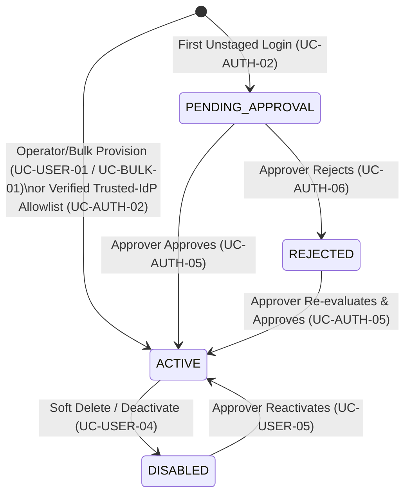
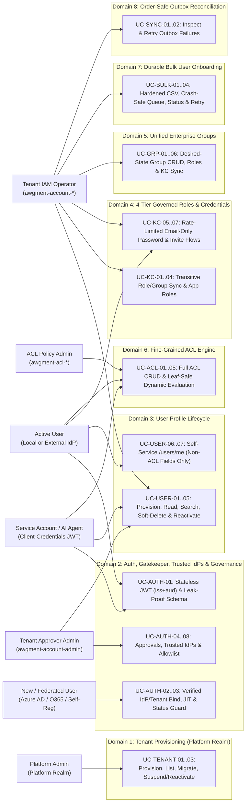

> **ARCHIVED SPECIFICATION (`v2.2`)**  
> This document is a verbatim archive of the `v2.2` `/accounts/v2` use cases specification prior to the Round 3 distributed-systems, revocation-SLA, gateway-routing, and ACL-delegation review.  
> **Active Authoritative Specification:** [USE_CASES.md](../../USE_CASES.md) (`v2.3` — Implementation Contract)

---

# Use Cases Specification: `awgment-app-account` (`v2.2` — Production-Hardened)

**Service:** `awgment-app-account` (Headless Multi-Tenant IAM API)  
**API Base Path:** `/accounts/v2`  
**Target Stack:** Java 21 LTS · Spring Boot 3.3.5 · PostgreSQL 16 (JPA + Flyway) · Keycloak 26.0.5 (Quarkus)  
**Configuration Mode:** Standalone (`application.yml` + environment variables; Spring Cloud Config removed)  
**Version History / Archives:**
* [USE_CASES_v2.1_archive.md](./USE_CASES_v2.1_archive.md) (`v2.1` — archived prior to Round 2 hardening)
* [USE_CASES_v2.0_archive.md](./USE_CASES_v2.0_archive.md) (`v2.0` — initial `/accounts/v2` baseline)

**Related Specifications:**
* [GEMINI.md](../../../GEMINI.md) — Mandatory TDD, complexity, security, and migration rules
* [MIGRATION_GUIDE.md](../../../MIGRATION_GUIDE.md) — Dependent application impact assessment & 5-phase migration pathway (`v1` → `v2.2`)
* [SERVICE_RATIONALIZATION.md](../../../SERVICE_RATIONALIZATION.md) — Service pruning & database consolidation
* [JIT_ONBOARDING_APPROVAL_ARCHITECTURE.md](../../../JIT_ONBOARDING_APPROVAL_ARCHITECTURE.md) — JIT user staging & approval gatekeeper

---

## 1. Locked-In Architectural & Security Decisions (`v2.2`)

| # | Decision Area | Finalized Production Design |
| :--- | :--- | :--- |
| **1** | **Dual Identity Model & Trusted IdP Registry** | Support **Type 1 (`EXTERNAL_IDP`)** users (Azure AD / Entra ID / Microsoft 365 / Okta / Google Workspace brokered via Keycloak) and **Type 2 (`KEYCLOAK_LOCAL`)** users (directly managed in Keycloak). Each tenant maintains **`tp_trusted_idp`** (`idp_alias`, `external_tenant_id`, `tenant_claim_name`, `enabled`) pinning cloud IdPs to a single corporate tenant (preventing Entra `/common` multi-tenant abuse). |
| **2** | **Squatting-Proof Verified Email Binding & Allowlist** | Pre-staged `EXTERNAL_IDP` binding and `tp_domain_allowlist` auto-approval **MUST** verify ALL FOUR: (a) `email_verified == true`, (b) unforgeable Keycloak session-note `identity_provider` matches `idp_alias`, (c) `idp_alias` is enabled in `tp_trusted_idp`, and (d) `jwt[tenant_claim_name] == external_tenant_id` (when configured). Keycloak's built-in First Broker Login email-linking is **disabled**. `tp_user` uses a **partial unique index** `UNIQUE (LOWER(email_id)) WHERE status IN ('ACTIVE', 'DISABLED')` so unverified `PENDING_APPROVAL`/`REJECTED` signups can never squat on or DoS an employee's email. |
| **3** | **Unforgeable Service-Account Detection** | **Never trust `preferred_username` prefix.** `ServiceAccountPrincipalDetector` identifies service accounts strictly via unforgeable Keycloak client-credentials claims (`client_id` emitted exclusively by client-credentials grants + `azp` matching an allowlisted confidential service client list + optional `token_kind=service_account` mapper). Shared across Gatekeeper bypass, ACL `SYSTEM` rule, and `loginId` lookup. |
| **4** | **4-Tier Role Governance + Full Transitive Closure** | **`RoleGovernancePolicy`** enforces 4 explicit tiers (resolving the Approver vs. subset-rule conflict) and ALWAYS expands **recursive Keycloak composite roles** AND **full ancestor group hierarchies** (group → parent → root): • **Tier 0 (`awgment-platform-admin`):** Platform Control Realm only; never assignable/creatable in tenant APIs. • **Tier 1 (`awgment-account-admin`):** Granted only by `awgment-platform-admin` / tenant bootstrap. • **Tier 2 (`awgment-account-*`, `awgment-acl-*`):** Strict subset rule (caller must already hold the exact role; forbidden in `tp_domain_allowlist.default_roles`). • **Tier 3 (Standard App Roles + `awgment-user` with zero Tier 0/1/2 composites):** Assignable by both Approvers (`awgment-account-admin`) and IAM Operators without needing to hold each app role. `JWTRoleConverter` extracts Awgment authorities strictly from the single trusted Awgment client; operators cannot disable, reset, or modify users holding higher privilege tiers or themselves. |
| **5** | **Strict Multi-Tenant Isolation & Platform Control Realm** | `/accounts/v2/tenants/**` accepts tokens exclusively from `awgment.security.platform-realm` (operates on `public`, rejects tenant tokens). Tenant IDs match `^[a-z][a-z0-9_]{1,50}$` + reserved denylist (`public`, `master`, `platform`, `information_schema`, `^pg_.*`, `admin`, `system`) and map internally to PostgreSQL schema **`tenant_<tenantId>`**. Exact `<keycloak-base-url>/realms/<tenantId>` issuer validation (zero SSRF) + mandatory **`aud`** validation. `MultiTenantConnectionProvider` runs `SET search_path TO tenant_<id>` (no `, public` fallback) and unconditionally runs `RESET search_path` on release (evicting the connection if reset fails). Background workers wrap every tenant tick in `try/finally TenantContext.clear()`, and all caches are strictly tenant-keyed with bounded TTL. |
| **6** | **Platform-Wide Fail-Closed Quarantine** | Enforced via the **Keycloak 26 Realm Security Contract (Section 3)**: (a) zero default app roles on first login; (b) `awgment_status` & `userId` locked as **admin-only edit** (`permissions.edit = ["admin"]`) in Keycloak 26 Declarative User Profile (unmanaged attributes disabled); (c) **Fail-Closed** enforcement at the API Gateway and all sibling microservices (missing/null or non-`ACTIVE` `awgment_status` → `403 ACCESS_PENDING_APPROVAL`); (d) short access-token TTL (`<= 5 min`) + immediate `enabled=false` + `logout()` on `REJECTED`/`DISABLED`; (e) `X-Awgment-Token-Refresh-Required: true` header on JIT auto-approve/bind. |
| **7** | **Order-Safe Desired-State Outbox (`sync_version`)** | Eliminates PG ↔ Keycloak drift **and** out-of-order resurrection bugs: `tp_user` and `tp_group` store authoritative desired state (`status`, `desired_roles`, `desired_groups`, monotonic `sync_version`, `@Version` optimistic lock, plus `status = ACTIVE\|DELETED` tombstone on `tp_group`). Outbox jobs (`RECONCILE_USER`, `RECONCILE_GROUP`) run with per-aggregate serialization (`FOR UPDATE SKIP LOCKED`), always converge Keycloak to the **latest committed PostgreSQL row**, and supersede stale jobs where `job.aggregate_version < entity.sync_version`. `SEND_ACTION_EMAIL` verifies `tp_user.status == ACTIVE` before sending and auto-cancels if disabled/rejected. |
| **8** | **Tamper-Proof ACL Evaluation & Attribute Separation** | Admin-managed `department` & `attributes` (read-only to users) are strictly separated from user-editable self-service fields (`mobileNumber`, `locale`, `timezone`, `selfServicePreferences` — **excluded from `AclEvaluationView`**). StringTemplate v4 renders **leaf-by-leaf on individual string values** (never over serialized JSON, eliminating JSON structural injection). Caller-supplied `context` in `POST /acl/{id}/evaluate` is accepted **only** from verified service accounts (ignored/rejected on direct end-user calls) with depth/size bounds. |
| **9** | **Crash-Safe Durable Bulk Queue (No Lost Jobs)** | `tp_bulk_batch` + `tp_bulk_user` act as a **durable PostgreSQL work queue** (not fire-and-forget in-memory `@Async`): workers claim bounded batches via `SELECT ... FOR UPDATE SKIP LOCKED` with a lease (`locked_at`, `locked_by`, 5-minute lease recovery on restart/crash). Safe across restarts and multi-replica deployments; re-checks `RoleGovernancePolicy` composite closures at row execution time. |
| **10** | **Email-Only Local Credentials, Rate Limits & REST Standards** | Local users use Keycloak `execute-actions-email` (`UPDATE_PASSWORD`, `VERIFY_EMAIL`) with per-user cooldown rate limiting (`429 Too Many Requests`). Zero plaintext passwords ever generated, logged, or returned. `EXTERNAL_IDP` password endpoints return `400 PASSWORD_MANAGED_BY_EXTERNAL_IDP`. Canonical Snowflake `{id}` on all `/accounts/v2` user endpoints; `DELETE` returns `204 No Content` (empty body); errors follow RFC 7807 `ProblemDetail`. |

---

## 2. Actors & Security Authorities

| Actor | Realm Scope | Required Authority / Auth Mechanism | Responsibilities |
| :--- | :--- | :--- | :--- |
| **Platform Administrator** | Platform Control Realm (`awgment.security.platform-realm`) | `awgment-platform-admin` | Provisions, lists, suspends, and reactivates tenants (`/accounts/v2/tenants/**`); bootstraps initial tenant approvers. |
| **Tenant Approver Admin** | Tenant Realm | `awgment-account-admin` *(strictly separate from `awgment-account-all`)* | Reviews JIT approval queue (`PENDING_APPROVAL` & `REJECTED`), approves/rejects users, reactivates `DISABLED` users, and manages `tp_trusted_idp` and `tp_domain_allowlist`. |
| **Tenant IAM Operator** | Tenant Realm | `awgment-account-all`, `awgment-account-create-or-update`, `awgment-account-read`, `awgment-account-delete` | Direct user/group/bulk CRUD, governed role & group assignment, Keycloak group sync, and outbox inspection/retry. |
| **ACL Policy Administrator** | Tenant Realm | `awgment-acl-create-or-update`, `awgment-acl-read` | Creates, updates, lists, reads, and deletes fine-grained resource ACL policies. |
| **Authenticated Active User** | Tenant Realm | Valid Tenant OIDC JWT (`status = ACTIVE`, valid `aud`) | Self-service profile (`/users/me` non-security fields), self-service password email (local only), and ACL evaluation (without untrusted `context`). |
| **New / Federated User** | Tenant Realm | Valid Tenant OIDC JWT (valid `aud`) | First-time Enterprise IdP (Azure AD / O365) or self-registered Keycloak user routed through `UserApprovalGatekeeperFilter`. |
| **Downstream Service / AI Agent** | Tenant Realm | Client-Credentials OIDC JWT verified by `ServiceAccountPrincipalDetector` | Bypasses JIT Gatekeeper; requires `@PreAuthorize` authorities on protected endpoints; matches `SYSTEM` ACL rules; trusted to pass `context` to ACL evaluation. |

---

## 3. Keycloak 26 Realm Security Contract (Mandatory Prerequisites)

Every tenant realm in Keycloak 26 **MUST** satisfy all 9 controls below before onboarding traffic:

1. **Zero Default Application Roles:** Newly brokered (Azure AD / Entra ID / O365 / Okta / Google) and self-registered users receive **zero** Awgment functional roles by default.
2. **Single-Tenant Enterprise IdP Configuration:** Enterprise IdPs MUST use single-tenant/org-restricted issuers (e.g., specific Entra ID tenant UUID `https://login.microsoftonline.com/<tid>/v2.0`, NEVER `/common` or `/organizations`; Google Workspace restricted by `hd`) AND map the IdP's organization/tenant identifier (`tid` / `hd`) into an unforgeable session-note claim (`idp_tenant_id`).
3. **Disable Automatic Email Account Linking:** Keycloak's `First Broker Login` authentication flow MUST disable automatic email-based linking (`Review Profile` / `Automatically Set Existing User` by email) so an unverified or local account can never hijack or link to an Enterprise IdP login.
4. **Local Self-Registration Email Verification:** If local self-registration is enabled on a realm, Keycloak MUST require `Verify Email` before issuing usable tokens (`email_verified = true`).
5. **Admin-Only Declarative User Profile Attributes:** Register `awgment_status` and `userId` in Keycloak 26's **Declarative User Profile** with **`permissions.edit = ["admin"]`** (read-only to end users; never editable via Keycloak Account Console or Account REST API) and set **`unmanagedAttributesPolicy = DISABLED`** (or `ADMIN_EDIT`).
6. **Fail-Closed Sibling Service & Gateway Enforcement:** Map `awgment_status` into access tokens. API Gateways and **all sibling microservices** MUST fail-closed: reject any human JWT where `awgment_status` is **absent/null OR `!= "ACTIVE"`** (`403 ACCESS_PENDING_APPROVAL`). Only `awgment-app-account`'s own `UserApprovalGatekeeperFilter` accepts tokens with missing `awgment_status` to perform `UC-AUTH-02` JIT ingestion.
7. **Unforgeable Identity Provider Mapper:** Configure a `User Session Note` protocol mapper stamping `identity_provider` (the Keycloak IdP alias) into access tokens for brokered logins (absent for `KEYCLOAK_LOCAL` logins).
8. **Audience (`aud`) & Client-Credentials Mappers:** Include `awgment-account` in the `aud` claim for authorized clients; emit standard `client_id` (and optional `token_kind = "service_account"`) strictly on confidential service-account clients.
9. **Short Access-Token Lifespan:** Configure access-token TTL `<= 5 minutes` so Keycloak `logout()` session revocation takes effect platform-wide within minutes.

---

## 4. PostgreSQL 16 Data Model, Outbox Ordering & State Machine

### 4.1 Schema Layout

* **Shared Control Schema (`public` — `@Table(schema = "public")`):**
  * `public.tp_tenant`: `id` (Snowflake `BIGINT`), `tenant_id` (`VARCHAR(50) UNIQUE`), `schema_name` (`VARCHAR(63) UNIQUE`, always `tenant_<tenant_id>`), `display_name`, `status` (`ACTIVE` | `SUSPENDED`), `opt_lock_version` (`BIGINT`), audit columns.
* **Per-Tenant Isolated Schema (`tenant_<tenant_id>`):**
  * `tp_trusted_idp`: `id`, `idp_alias` (`VARCHAR(100) UNIQUE`), `external_tenant_id` (`VARCHAR(128)` nullable only for single-org non-multi-tenant IdPs; required for Entra ID/O365/Google Workspace), `tenant_claim_name` (`VARCHAR(64) DEFAULT 'idp_tenant_id'`), `enabled` (`BOOLEAN NOT NULL DEFAULT TRUE`), `opt_lock_version`, audit columns.
  * `tp_domain_allowlist`: `id`, `domain_name` (lowercase), `idp_alias` (`VARCHAR(100) NOT NULL REFERENCES tp_trusted_idp(idp_alias)`), `auto_approve` (`BOOLEAN`), `default_roles` (`JSONB DEFAULT '[]'::jsonb`), `opt_lock_version`, audit columns; `UNIQUE (domain_name, idp_alias)`.
  * `tp_user`:
    * `id` (`BIGINT PK` Snowflake)
    * `keycloak_sub` (`VARCHAR(64)`, nullable until bound; partial `UNIQUE` index `WHERE keycloak_sub IS NOT NULL`)
    * `user_name` (`VARCHAR(100) NOT NULL`, lowercase; partial `UNIQUE` index `WHERE status IN ('ACTIVE', 'DISABLED')`)
    * `email_id` (`VARCHAR(255) NOT NULL`; **partial `UNIQUE` index on `LOWER(email_id) WHERE status IN ('ACTIVE', 'DISABLED')`** — prevents unverified `PENDING_APPROVAL`/`REJECTED` signups from squatting on active emails!)
    * `first_name`, `last_name`, `mobile_number`, `department` *(admin/IdP-managed; read-only via `/users/me`)*
    * `locale`, `timezone`, `self_service_preferences` (`JSONB DEFAULT '{}'::jsonb` — *user-editable via `/users/me`; strictly excluded from ACL evaluation*)
    * `attributes` (`JSONB NOT NULL DEFAULT '{}'::jsonb` + GIN index — *admin-managed only; read-only via `/users/me`; safe for ACL templates*)
    * `identity_source` (`KEYCLOAK_LOCAL` | `EXTERNAL_IDP`), `idp_alias` (`VARCHAR(100)`, `NULL` for local, FK to `tp_trusted_idp` for external)
    * `provisioning_mode` (`JIT_AUTO_APPROVED` | `JIT_ADMIN_APPROVED` | `JIT_PENDING` | `DIRECT_OPERATOR` | `BULK_IMPORT`)
    * `status` (`PENDING_APPROVAL` | `ACTIVE` | `REJECTED` | `DISABLED`)
    * `desired_roles` (`JSONB` — nullable until explicitly managed by Awgment; authoritative target for `RECONCILE_USER`)
    * `desired_groups` (`JSONB` — nullable until explicitly managed by Awgment; authoritative target for `RECONCILE_USER`)
    * `sync_version` (`BIGINT NOT NULL DEFAULT 1` — monotonic counter incremented on every Keycloak-relevant mutation)
    * `synced_version` (`BIGINT NOT NULL DEFAULT 0`), `sync_status` (`SYNCED` | `PENDING_SYNC` | `SYNC_FAILED`)
    * `opt_lock_version` (`BIGINT NOT NULL DEFAULT 0` — JPA `@Version` optimistic lock)
    * `approved_by_id`, `approved_on`, `rejection_reason`, `last_action_email_at` (rate-limit timestamp), audit columns.
  * `tp_group`:
    * `id` (`BIGINT PK`), `name` (`VARCHAR(100) NOT NULL`; partial `UNIQUE` index `WHERE status = 'ACTIVE'`), `description`
    * `group_id` (Keycloak Group UUID, nullable until synced; partial `UNIQUE` index `WHERE group_id IS NOT NULL`)
    * `status` (`ACTIVE` | `DELETED` — soft-delete tombstone prevents out-of-order group resurrection!)
    * `desired_roles` (`JSONB` — nullable until managed; authoritative target for `RECONCILE_GROUP`)
    * `sync_version` (`BIGINT NOT NULL DEFAULT 1`), `synced_version` (`BIGINT NOT NULL DEFAULT 0`), `sync_status` (`SYNCED` | `PENDING_SYNC` | `SYNC_FAILED`), `opt_lock_version`, audit columns.
  * `tp_acl`: `id`, `name` (`UNIQUE`), `read_permissions` (`JSONB`), `update_permissions` (`JSONB`), `delete_permissions` (`JSONB`), `opt_lock_version`, audit columns.
  * `tp_bulk_batch`: `document_id` (`BIGINT PK`), `file_name`, `total_rows`, `operator_id`, `operator_authorities` (`JSONB`), `status` (`QUEUED` | `IN_PROGRESS` | `COMPLETED` | `COMPLETED_WITH_ERRORS`), audit columns.
  * `tp_bulk_user`: `id`, `document_id` (`FK → tp_bulk_batch`), `row_number`, `identity_source`, `idp_alias`, `user_data` (`JSONB`), `status` (`CREATED` | `IN_PROGRESS` | `COMPLETED` | `FAILED`), `locked_at` (`TIMESTAMPTZ`), `locked_by` (`VARCHAR(100)`), `attempt_count` (`INT DEFAULT 0`), `error_message`, audit columns.
  * `tp_keycloak_outbox`: `id`, `aggregate_type` (`USER` | `GROUP`), `aggregate_id`, `aggregate_version` (`BIGINT NOT NULL`), `job_type` (`RECONCILE_USER` | `RECONCILE_GROUP` | `SEND_ACTION_EMAIL`), `payload` (`JSONB`), `status` (`PENDING` | `IN_PROGRESS` | `COMPLETED` | `SUPERSEDED` | `CANCELLED` | `FAILED`), `locked_at`, `locked_by`, `retry_count`, `next_retry_at`, `last_error`, `created_on`, `updated_on`.
    * Index: `(aggregate_type, aggregate_id, status, aggregate_version)` and `(status, next_retry_at)`.
  * `tp_security_audit_log`: `id`, `actor_id`, `actor_sub`, `action`, `target_type`, `target_id`, `outcome` (`SUCCESS` | `DENIED` | `FAILURE`), `metadata` (`JSONB` — strictly zero PII/secrets), `created_on`.

### 4.2 Order-Safe Outbox Execution Algorithm (Zero Resurrection Guarantee)

1. Every Keycloak-relevant domain mutation increments `entity.sync_version` (`+1`), marks `sync_status = 'PENDING_SYNC'`, and inserts a `RECONCILE_USER` / `RECONCILE_GROUP` job stamped with `aggregate_version = entity.sync_version` **in the same local PostgreSQL ACID transaction**.
2. Workers claim jobs using per-aggregate serialization (`SELECT ... FOR UPDATE SKIP LOCKED` ensuring no two workers execute jobs for the same `(aggregate_type, aggregate_id)` concurrently, with 5-minute lease recovery via `locked_at`).
3. **Desired-State Convergence & Coalescing:**
   * Before calling Keycloak, the worker loads the **latest committed row** from `tp_user` or `tp_group`.
   * If `job.aggregate_version < entity.sync_version` and a newer `PENDING` reconcile job exists (or `entity.synced_version >= entity.sync_version`), mark the stale job `SUPERSEDED` without calling Keycloak.
   * Otherwise, reconcile Keycloak to the **current authoritative PostgreSQL row** (e.g., if `tp_user.status` is `DISABLED` or `REJECTED`, enforce `enabled=false`, `awgment_status=DISABLED|REJECTED`, and `logout()`; if `tp_group.status == DELETED`, delete from Keycloak idempotently; if `ACTIVE`, ensure created/enabled, `awgment_status=ACTIVE`, profile synced, and `desired_roles`/`desired_groups` converged via $O(R)$ set-diff).
   * Atomically update `entity.synced_version = reconciledVersion` and mark `sync_status = 'SYNCED'` only if `entity.sync_version == reconciledVersion` (leaving `PENDING_SYNC` if another mutation arrived concurrently!).
4. **Side-Effect Guard (`SEND_ACTION_EMAIL`):** Before dispatching `execute-actions-email`, verifies `tp_user.status == ACTIVE` and `identity_source == KEYCLOAK_LOCAL`; if the user was disabled/rejected while queued, marks the job `CANCELLED`.

### 4.3 User Lifecycle State Machine

---

## 5. High-Level Use Case Map

---

## 6. Detailed Use Cases

---

### Domain 1: Tenant Provisioning & Multi-Tenant Infrastructure (`UC-TENANT`)

> **Realm Isolation Rule:** All `/accounts/v2/tenants/**` endpoints accept JWTs **exclusively** from `awgment.security.platform-realm`, run against `public`, and bypass `public.tp_tenant` lookup and `UserApprovalGatekeeperFilter`. Tenant realm tokens are rejected (`403 TENANT_NOT_ACTIVE`).

#### `UC-TENANT-01`: Provision New Tenant Schema, Migrate & Seed Defaults
* **Primary Actor:** Platform Administrator (`awgment-platform-admin`, Platform Control Realm)
* **Endpoint:** `POST /accounts/v2/tenants` (`201 Created`)
* **Main Flow:**
  1. Validates `tenantId` against `^[a-z][a-z0-9_]{1,50}$` and rejects reserved names (`public`, `master`, `platform`, `information_schema`, `admin`, `system`, `^pg_.*`).
  2. Derives internal PostgreSQL schema `tenant_<tenantId>`; checks uniqueness in `public.tp_tenant` (`409 Conflict` if exists).
  3. Executes `CREATE SCHEMA IF NOT EXISTS tenant_<tenantId>` and runs Flyway migrations programmatically against `tenant_<tenantId>`.
  4. Seeds `SYSTEM` service-account record and optional bootstrap `awgment-account-admin` approver.
  5. Inserts `public.tp_tenant` (`status = 'ACTIVE'`, `schema_name = 'tenant_<tenantId>'`), writes audit log, and returns `201 Created`.

---

#### `UC-TENANT-02`: List Registered Tenants & Startup Flyway Migrations
* **Primary Actor:** Platform Administrator / Application Startup
* **Endpoint:** `GET /accounts/v2/tenants` (`awgment-platform-admin`, paginated) + boot `ApplicationRunner`
* **Main Flow:**
  1. On startup, Flyway migrates `public` first, then iterates over all `ACTIVE` tenants in `public.tp_tenant` to apply pending tenant migrations.
  2. `GET /accounts/v2/tenants` returns paginated registered tenants.

---

#### `UC-TENANT-03`: Suspend or Reactivate Tenant
* **Primary Actor:** Platform Administrator (`awgment-platform-admin`)
* **Endpoint:** `PATCH /accounts/v2/tenants/{tenantId}/status` (`200 OK`)
* **Main Flow:**
  1. Transitions `public.tp_tenant.status` between `ACTIVE` and `SUSPENDED` (with `@Version` check) and evicts tenant-scoped `AuthenticationManager` and metadata caches.
  2. While `SUSPENDED`, tenant HTTP requests fail with `403 TENANT_SUSPENDED` and background outbox/bulk workers skip the tenant.

---

### Domain 2: Stateless Auth, Gatekeeper, Trusted IdPs & Role Governance (`UC-AUTH`)

#### `UC-AUTH-01`: Stateless Multi-Tenant JWT Validation & Leak-Proof Schema Resolution
* **Primary Actor:** Any API Caller
* **Endpoint Scope:** All `/accounts/v2/**` endpoints
* **Main Flow:**
  1. Parses `iss` **before** creating any decoder and verifies exact prefix `<keycloak-base-url>/realms/<realm>`:
     * `/accounts/v2/tenants/**` requires `<realm> == awgment.security.platform-realm` (`public` schema).
     * All other paths require `<realm>` to exist in `public.tp_tenant` with `status == ACTIVE` (zero SSRF).
  2. Validates signature (tenant-keyed JWKS cache), `exp`/`nbf`, and mandatory **`aud`** claim (`awgment-account`) via `OAuth2TokenValidator<Jwt>`.
  3. `JWTRoleConverter` extracts Awgment authorities **statelessly** strictly from `resource_access.<awgment-client-id>.roles`.
  4. Binds `tenant_<tenantId>` to `TenantContext`; `MultiTenantConnectionProvider` runs `SET search_path TO tenant_<tenantId>` (no `, public` fallback) on checkout and **unconditionally executes `RESET search_path`** on release (evicting/closing the connection if reset throws).
  5. Clears `TenantContext` in a `finally` block.

---

#### `UC-AUTH-02`: Verified Trusted-IdP Binding, JIT Auto-Staging & Claim Sync
* **Primary Actor:** New or Returning Federated User (Azure AD / O365 / Okta / Google) or Self-Registered Keycloak User
* **Endpoint Scope:** All tenant `/accounts/v2/**` endpoints (excluding `/actuator/health/**`, `/accounts/v2/tenants/**`)
* **Main Flow:**
  1. **Unforgeable Service-Account Bypass:** Checks `ServiceAccountPrincipalDetector.isServiceAccount(jwt)` (`client_id` + allowlisted confidential `azp` / `token_kind=service_account`; never `preferred_username` prefix). If true, bypasses Gatekeeper.
  2. **Extract Verified Identity Claims:** Reads `sub`, `email`, `email_verified`, `identity_provider` (Keycloak session-note IdP alias), `given_name`, `family_name`, `preferred_username`. Sets `identitySource = (identity_provider != null) ? EXTERNAL_IDP : KEYCLOAK_LOCAL`.
  3. **Trusted-IdP & External Tenant Verification Helper (`isVerifiedTrustedIdp(jwt)`):** True ONLY when ALL hold:
     * `identitySource == EXTERNAL_IDP`, AND
     * `email_verified == true`, AND
     * `identity_provider` exists in `tp_trusted_idp` with `enabled == true`, AND
     * if `tp_trusted_idp.external_tenant_id` is non-null, `jwt[tenant_claim_name]` strictly equals `tp_trusted_idp.external_tenant_id` (prevents Entra `/common` cross-org abuse!).
  4. **Primary Lookup by `keycloak_sub`:** Queries `tp_user` by `keycloak_sub = jwt.getSubject()`.
     * **Returning `EXTERNAL_IDP` Claim Sync:** If found, `identity_source == EXTERNAL_IDP`, `idp_alias == jwt.identity_provider`, and `status == ACTIVE`: refreshes `first_name`, `last_name`, `department` (when changed). Updates `email_id` ONLY if `isVerifiedTrustedIdp(jwt)` is true and no other `ACTIVE`/`DISABLED` user holds the new email (logging a security warning on collision).
  5. **Pre-Staged `EXTERNAL_IDP` Binding:** If not found by `keycloak_sub` AND `isVerifiedTrustedIdp(jwt)` is true:
     * Searches `tp_user` by `LOWER(email_id) = LOWER(jwt.email)` WHERE `keycloak_sub IS NULL AND status = 'ACTIVE' AND identity_source = 'EXTERNAL_IDP' AND idp_alias = jwt.identity_provider`.
     * If matched: binds `keycloak_sub = jwt.getSubject()`, increments `sync_version`, enqueues `RECONCILE_USER` (which syncs `awgment_status=ACTIVE` and `desired_roles`/`desired_groups` to Keycloak), dispatches immediately, sets response header `X-Awgment-Token-Refresh-Required: true`, and proceeds.
  6. **First-Time Unstaged User (JIT Ingestion):** If still not found:
     * Derives collision-safe `user_name` (lowercased `preferred_username`, falling back to `email` or `<idp_alias>:<sub_prefix>` if colliding with an `ACTIVE`/`DISABLED` user; always rejecting `service-account*`).
     * Checks `tp_domain_allowlist` **ONLY if `isVerifiedTrustedIdp(jwt)` is true**, querying by `(LOWER(emailDomain), jwt.identity_provider)`:
       * **Branch A — Verified Allowlist Match (`auto_approve == TRUE`):** Inserts `tp_user` (`status = 'ACTIVE'`, `provisioning_mode = 'JIT_AUTO_APPROVED'`, `desired_roles = allowlist.default_roles`, `sync_version = 1`) + `RECONCILE_USER` outbox job in one DB transaction; dispatches immediately; sets `X-Awgment-Token-Refresh-Required: true`; lets request proceed.
       * **Branch B — No Verified Allowlist Match (including all `KEYCLOAK_LOCAL` self-signups, unverified emails, or mismatched `external_tenant_id`):** Inserts `tp_user` (`status = 'PENDING_APPROVAL'`, `provisioning_mode = 'JIT_PENDING'`, `sync_version = 1` — note partial unique index ensures this row NEVER squats on or blocks a verified employee's email!) + `RECONCILE_USER` outbox job (`awgment_status = PENDING_APPROVAL`); logs audit event if an unverified/untrusted bind was blocked; returns `403 ACCESS_PENDING_APPROVAL`.

---

#### `UC-AUTH-03`: Platform-Wide Quarantine, Rejection & Disabled Status Enforcement
* **Primary Actor:** Quarantined, Rejected, or Disabled User
* **Endpoint Scope:** All gatekeeper-protected tenant `/accounts/v2/**` endpoints (+ API Gateway / sibling services via Section 3)
* **Main Flow:**
  1. `ACTIVE` → proceeds; `PENDING_APPROVAL` → `403 ACCESS_PENDING_APPROVAL`; `REJECTED` → `403 ACCESS_REJECTED`; `DISABLED` → `403 ACCESS_DISABLED`.
  2. Sibling microservices enforce fail-closed `jwt.awgment_status == "ACTIVE"` (rejecting missing or non-`ACTIVE` claims).

---

#### `UC-AUTH-04`: View Approval Queue (Pending & Rejected Users)
* **Primary Actor:** Tenant Approver Admin (`awgment-account-admin`)
* **Endpoint:** `GET /accounts/v2/users/approvals?status={PENDING_APPROVAL|REJECTED}&page=0&size=20`
* **Main Flow:**
  1. Returns paginated `PENDING_APPROVAL` or `REJECTED` users for the active tenant (rejects other statuses with `400`).

---

#### `UC-AUTH-05`: Approve Pending or Rejected User & Sync Keycloak
* **Primary Actor:** Tenant Approver Admin (`awgment-account-admin`)
* **Endpoint:** `POST /accounts/v2/users/{id}/approve` (`200 OK`)
* **Main Flow:**
  1. Loads `tp_user` by `{id}` (`404` if missing) and validates status is `PENDING_APPROVAL` or `REJECTED` (`409 INVALID_STATE_TRANSITION` otherwise).
  2. Verifies no `ACTIVE`/`DISABLED` user already owns `LOWER(user.email_id)` or `user.user_name` (`409 EMAIL_ALREADY_CLAIMED` if squatted/taken).
  3. Validates requested `roles` and optional `groups` through **`RoleGovernancePolicy`** (4-tier model + recursive composite-role & ancestor-group closure: approver can assign any Tier 3 application role without holding it, but NEVER Tier 0/1/2 reserved roles).
  4. In one PostgreSQL transaction (`@Version` locked): updates `tp_user` (`status = 'ACTIVE'`, `provisioning_mode = 'JIT_ADMIN_APPROVED'`, `approved_by_id`, `approved_on = NOW()`, `rejection_reason = NULL`, `desired_roles`, `desired_groups`, `sync_version = sync_version + 1`, `sync_status = 'PENDING_SYNC'`), enqueues `RECONCILE_USER(aggregate_version = sync_version)`, and writes `tp_security_audit_log`.
  5. Dispatches outbox reconciliation immediately and returns `200 OK`.

---

#### `UC-AUTH-06`: Reject Pending User Registration
* **Primary Actor:** Tenant Approver Admin (`awgment-account-admin`)
* **Endpoint:** `POST /accounts/v2/users/{id}/reject` (`200 OK`)
* **Main Flow:**
  1. Validates status is `PENDING_APPROVAL` (`409` otherwise) and non-blank `reason` (`<= 500` chars).
  2. In one PostgreSQL transaction: sets `status = 'REJECTED'`, `rejection_reason`, increments `sync_version`, enqueues `RECONCILE_USER` (sets `awgment_status=REJECTED`, `enabled=false`, `logout()`), and writes `tp_security_audit_log`.
  3. Dispatches immediately and returns `200 OK`.

---

#### `UC-AUTH-07`: Manage Trusted Enterprise Identity Providers (`tp_trusted_idp`)
* **Primary Actor:** Tenant Approver Admin (`awgment-account-admin`)
* **Endpoints:** `GET /accounts/v2/trusted-idps`, `POST /accounts/v2/trusted-idps` (`201`), `PUT /accounts/v2/trusted-idps/{id}` (`200`), `DELETE /accounts/v2/trusted-idps/{id}` (`204`)
* **Main Flow:**
  1. Registers brokered Keycloak IdP aliases (`idpAlias`, verified against tenant Keycloak realm IdPs), optional/required `externalTenantId` (e.g., corporate Entra `tid` or Google `hd`), `tenantClaimName`, and `enabled` flag.
  2. Deleting a trusted IdP referenced by active `tp_domain_allowlist` rules fails with `409 Conflict` until dependent allowlist rules are removed.

---

#### `UC-AUTH-08`: Manage Tenant Domain Auto-Approval Allowlist (Trusted-IdP Bound)
* **Primary Actor:** Tenant Approver Admin (`awgment-account-admin`)
* **Endpoints:** `GET /accounts/v2/domain-allowlist`, `POST /accounts/v2/domain-allowlist` (`201`), `PUT /accounts/v2/domain-allowlist/{id}` (`200`), `DELETE /accounts/v2/domain-allowlist/{id}` (`204`)
* **Main Flow:**
  1. Requires `domainName` (valid lowercase domain) AND `idpAlias` referencing an enabled `tp_trusted_idp` entry.
  2. Validates `defaultRoles` exist in Keycloak AND are strictly **Tier 3 standard application roles** (zero Tier 0/1/2 roles even via recursive composite expansion; `403 ROLE_ESCALATION_FORBIDDEN`).
  3. Enforces unique `(domain_name, idp_alias)` and logs to `tp_security_audit_log`.

---

### Domain 3: User Profile Lifecycle Management (`UC-USER`)

#### `UC-USER-01`: Provision or Update User Profile (Order-Safe Outbox)
* **Primary Actor:** Tenant IAM Operator (`awgment-account-create-or-update` or `awgment-account-all`)
* **Endpoints:** `POST /accounts/v2/users` (`201 Created`), `PUT /accounts/v2/users/{id}` (`200 OK`)
* **Main Flow (Create):**
  1. Validates `userName` (no `service-account*` prefix, lowercase), `emailId`, and uniqueness against `ACTIVE`/`DISABLED` users (`409 DUPLICATE_RESOURCE`).
  2. Validates `identitySource` (`KEYCLOAK_LOCAL` default or `EXTERNAL_IDP`): if `EXTERNAL_IDP`, `idpAlias` is mandatory and must exist & be enabled in `tp_trusted_idp`.
  3. Validates requested `roles` and `groups` against Keycloak existence AND **`RoleGovernancePolicy`** (4-tier model + recursive composite & ancestor-group closure).
  4. In one PostgreSQL ACID transaction:
     * Inserts `tp_user` (`status = 'ACTIVE'`, `provisioning_mode = 'DIRECT_OPERATOR'`, `created_by_id`, `approved_by_id = NULL`, `desired_roles`, `desired_groups`, `sync_version = 1`).
     * **If `KEYCLOAK_LOCAL`:** Marks `sync_status = 'PENDING_SYNC'` and enqueues `RECONCILE_USER` (creates KC user with `userId` attribute, `awgment_status=ACTIVE`, `UPDATE_PASSWORD`+`VERIFY_EMAIL`, roles/groups) + `SEND_ACTION_EMAIL` (`execute-actions-email` — zero plaintext passwords).
     * **If `EXTERNAL_IDP`:** Stores `keycloak_sub = NULL`, `idp_alias`, `desired_roles`, `desired_groups`, `sync_status = 'SYNCED'` (reconciled upon first verified SSO bind in `UC-AUTH-02`).
     * Writes `tp_security_audit_log`.
  5. Dispatches outbox jobs immediately post-commit for `KEYCLOAK_LOCAL` and returns `201 Created`.
* **Main Flow (Update):**
  1. Loads `tp_user` by `{id}` (`404` if missing); prevents modifying a higher-tier user (`RoleGovernancePolicy`).
  2. Enforces immutability of `userName`, `emailId`, `identitySource`, and `idpAlias` (`400 IMMUTABLE_FIELD_MODIFICATION`).
  3. Updates admin-managed fields (`firstName`, `lastName`, `mobileNumber`, `department`, `attributes` JSONB), increments `sync_version`, and enqueues `RECONCILE_USER` (for bound `KEYCLOAK_LOCAL` users).

---

#### `UC-USER-02`: Fetch User Profile by ID
* **Primary Actor:** Tenant IAM Operator / Service Account (`awgment-account-read` or `awgment-account-all`)
* **Endpoint:** `GET /accounts/v2/users/{id}?onlyMandatoryFields={true|false}` (`200 OK`)

---

#### `UC-USER-03`: Search, Filter, Sort & Paginate Users
* **Primary Actor:** Tenant IAM Operator / Service Account (`awgment-account-read` or `awgment-account-all`)
* **Endpoint:** `GET /accounts/v2/users` (`q`, `status`, `identitySource`, `idpAlias`, `department`, `loginId`, `onlyMandatoryFields`, `page=0`, `size=20` max `200`, `sort`)
* **Main Flow:**
  1. Executes indexed JPA `Specification` queries (always paginated).
  2. `loginId` matches `LOWER(user_name)` or `LOWER(email_id)`. Resolves `SYSTEM` only for verified service accounts (`ServiceAccountPrincipalDetector`) or explicit `loginId=system`.

---

#### `UC-USER-04`: Soft-Delete (Deactivate) User & Revoke Keycloak Sessions
* **Primary Actor:** Tenant IAM Operator (`awgment-account-delete` or `awgment-account-all`)
* **Endpoint:** `DELETE /accounts/v2/users/{id}` (`204 No Content`, empty body)
* **Main Flow:**
  1. Loads `tp_user` by `{id}` (`404` if missing).
  2. **Self-Lockout & Tier Guard:** Rejects self-disable (`403 SELF_ACTION_FORBIDDEN`) and rejects disabling any user holding a higher privilege tier (e.g., `awgment-account-admin` or any Tier 2 role the caller lacks, checked via full transitive closure; `403 ROLE_ESCALATION_FORBIDDEN`).
  3. In one PostgreSQL transaction (`@Version` locked): sets `status = 'DISABLED'`, increments `sync_version`, sets `sync_status = 'PENDING_SYNC'`, enqueues `RECONCILE_USER(aggregate_version = sync_version)` (enforces `enabled=false`, `awgment_status=DISABLED`, `logout()`), and writes `tp_security_audit_log`.
  4. Dispatches immediately and returns `204 No Content`.

---

#### `UC-USER-05`: Reactivate Disabled User
* **Primary Actor:** Tenant Approver Admin (`awgment-account-admin`)
* **Endpoint:** `POST /accounts/v2/users/{id}/reactivate` (`200 OK`)
* **Main Flow:**
  1. Validates status is `DISABLED` (`409 INVALID_STATE_TRANSITION` otherwise).
  2. In one PostgreSQL transaction: sets `status = 'ACTIVE'`, increments `sync_version`, enqueues `RECONCILE_USER`, writes `tp_security_audit_log`, dispatches immediately, and returns `200 OK`.

---

#### `UC-USER-06`: View Logged-In User's Own Profile
* **Primary Actor:** Authenticated Active User
* **Endpoint:** `GET /accounts/v2/users/me` (`200 OK`)
* **Main Flow:**
  1. Resolves caller **strictly by `keycloak_sub = jwt.getSubject()`** and returns profile (`attributes` read-only, `selfServicePreferences`, effective JWT roles/groups).

---

#### `UC-USER-07`: Self-Service Update of Logged-In User Profile (ACL-Safe)
* **Primary Actor:** Authenticated Active User
* **Endpoint:** `PUT /accounts/v2/users/me` (`200 OK`)
* **Main Flow:**
  1. Resolves caller strictly by `keycloak_sub = jwt.getSubject()`.
  2. Accepts ONLY an explicit allowlisted self-service DTO (`mobileNumber`, `locale`, `timezone`, `selfServicePreferences`, plus `firstName`/`lastName` ONLY for `KEYCLOAK_LOCAL` users).
  3. **ACL Tampering Guard:** `department` and admin-managed `attributes` are **strictly read-only** on `PUT /users/me` (any attempt to submit `userName`, `emailId`, `department`, `attributes`, `status`, `identitySource`, `roles`, or `groups` is rejected with `400 IMMUTABLE_FIELD_MODIFICATION` via strict Jackson unknown-property rejection).
  4. For `KEYCLOAK_LOCAL` name updates, increments `sync_version` and enqueues `RECONCILE_USER`.

---

### Domain 4: 4-Tier Governed Keycloak Roles, Memberships & Credentials (`UC-KC`)

> All user-scoped endpoints accept canonical Snowflake `{id}` (`tp_user.id`). Every role/group mutation enforces **`RoleGovernancePolicy`** with **full recursive composite-role expansion and ancestor-group traversal**.

#### `UC-KC-01`: List Realm & Tenant-Manageable Client Roles
* **Primary Actor:** Tenant IAM Operator (`awgment-account-read` or `awgment-account-all`)
* **Endpoint:** `GET /accounts/v2/keycloak/roles` (`200 OK`)
* **Main Flow:**
  1. Returns realm roles and roles from tenant-manageable application clients annotated with governance tier (`tier`: `0|1|2|3`, `assignableByCaller: boolean`).

---

#### `UC-KC-02`: Create Application Client Role in Keycloak (Governed)
* **Primary Actor:** Tenant IAM Operator (`awgment-account-create-or-update` or `awgment-account-all`)
* **Endpoint:** `POST /accounts/v2/keycloak/{clientName}/roles` (`201 Created`)
* **Main Flow:**
  1. Validates `clientName` is in the tenant-manageable application client allowlist (NEVER the trusted Awgment system-authority client; `403 FORBIDDEN_CLIENT`).
  2. Rejects any role name starting with `awgment-` (`403 RESERVED_ROLE_NAME`).
  3. Creates the non-composite role in Keycloak 26, invalidates tenant role cache, and writes `tp_security_audit_log`.

---

#### `UC-KC-03`: Assign / Synchronize Roles to a User (Transitive Anti-Escalation)
* **Primary Actor:** Tenant IAM Operator (`awgment-account-create-or-update` or `awgment-account-all`)
* **Endpoint:** `PUT /accounts/v2/keycloak/users/{id}/roles` (`200 OK`)
* **Main Flow:**
  1. Loads `tp_user` by Snowflake `{id}` (`404` if missing).
  2. Validates caller cannot modify a higher-tier user and validates the full **added AND removed role diff** (expanded recursively across composite child roles) against **`RoleGovernancePolicy`** (`403 ROLE_ESCALATION_FORBIDDEN`).
  3. In one PostgreSQL transaction (`@Version` locked): updates `tp_user.desired_roles`, increments `sync_version`, and (if `keycloak_sub != null`) sets `sync_status = 'PENDING_SYNC'` + enqueues `RECONCILE_USER` + writes `tp_security_audit_log`.
  4. Dispatches immediately (or defers cleanly until first verified SSO bind if `keycloak_sub IS NULL`).

---

#### `UC-KC-04`: Assign / Synchronize Groups to a User (Ancestor + Composite Closure)
* **Primary Actor:** Tenant IAM Operator (`awgment-account-create-or-update` or `awgment-account-all`)
* **Endpoint:** `PUT /accounts/v2/keycloak/users/{id}/groups` (`200 OK`)
* **Main Flow:**
  1. Loads `tp_user` by `{id}` (`404` if missing) and validates all target groups exist (`ACTIVE`).
  2. **Full Transitive Escalation Check:** For every added and removed group, walks the **entire Keycloak ancestor group chain (group → parent → root)**, collects all mapped roles on every ancestor, expands all **composite roles recursively**, and validates the entire closure against **`RoleGovernancePolicy`** (`403 ROLE_ESCALATION_FORBIDDEN`).
  3. In one PostgreSQL transaction: updates `tp_user.desired_groups`, increments `sync_version`, enqueues `RECONCILE_USER` (if `keycloak_sub != null`), writes audit log, and dispatches immediately.

---

#### `UC-KC-05`: Self-Service Password Change Email (`KEYCLOAK_LOCAL` Only, Rate-Limited)
* **Primary Actor:** Authenticated Active User (`KEYCLOAK_LOCAL`)
* **Endpoint:** `POST /accounts/v2/keycloak/users/change-password` (`202 Accepted`)
* **Main Flow:**
  1. Resolves caller by `keycloak_sub = jwt.getSubject()`; rejects `EXTERNAL_IDP` (`400 PASSWORD_MANAGED_BY_EXTERNAL_IDP`).
  2. Enforces per-user cooldown (`last_action_email_at`, default 60s; returns `429 RATE_LIMIT_EXCEEDED` with `Retry-After`).
  3. Updates `last_action_email_at`, enqueues/dispatches `SEND_ACTION_EMAIL(["UPDATE_PASSWORD"])`, and returns `202 Accepted`.

---

#### `UC-KC-06`: Administrative Password Reset Email (`KEYCLOAK_LOCAL` Only, Rate-Limited)
* **Primary Actor:** Tenant IAM Operator (`awgment-account-create-or-update` or `awgment-account-all`)
* **Endpoint:** `POST /accounts/v2/keycloak/users/{id}/password-reset` (`202 Accepted`)
* **Main Flow:**
  1. Loads `tp_user` by `{id}` (`404` if missing); rejects higher-tier target users (`403`), `EXTERNAL_IDP` (`400 PASSWORD_MANAGED_BY_EXTERNAL_IDP`), non-`ACTIVE` users (`409`), and cooldown violations (`429`).
  2. Updates `last_action_email_at`, enqueues `SEND_ACTION_EMAIL(["UPDATE_PASSWORD"])` + audit log, dispatches immediately, and returns `202 Accepted`.

---

#### `UC-KC-07`: Resend Initial Invite / Verification Email (`KEYCLOAK_LOCAL` Only, Rate-Limited)
* **Primary Actor:** Tenant IAM Operator (`awgment-account-create-or-update` or `awgment-account-all`)
* **Endpoint:** `POST /accounts/v2/users/{id}/resend-invite` (`202 Accepted`)
* **Main Flow:**
  1. Loads `tp_user` by `{id}`; rejects higher-tier targets (`403`), `EXTERNAL_IDP` (`400`), non-`ACTIVE` (`409`), and cooldown violations (`429`).
  2. Updates `last_action_email_at`, enqueues/dispatches `SEND_ACTION_EMAIL(["UPDATE_PASSWORD", "VERIFY_EMAIL"])`, and returns `202 Accepted`.

---

### Domain 5: Unified Enterprise Group Management (`UC-GRP`)

> `/accounts/v2/groups` uses `tp_group` soft-delete tombstones (`ACTIVE` | `DELETED`), `desired_roles`, and `sync_version` so `RECONCILE_GROUP` is order-safe and never resurrects deleted groups.

#### `UC-GRP-01`: Create or Update Enterprise Group (Order-Safe Outbox)
* **Primary Actor:** Tenant IAM Operator (`awgment-account-create-or-update` or `awgment-account-all`)
* **Endpoints:** `POST /accounts/v2/groups` (`201 Created`), `PUT /accounts/v2/groups/{id}` (`200 OK`)
* **Main Flow:**
  1. Validates unique `name` among `ACTIVE` groups (`409 DUPLICATE_RESOURCE`).
  2. In one PostgreSQL transaction (`@Version` locked): persists/updates `tp_group` (`status = 'ACTIVE'`, increments `sync_version`, `sync_status = 'PENDING_SYNC'`) + `RECONCILE_GROUP` outbox job + audit log.
  3. Dispatches immediately to Keycloak 26 (idempotent create/rename, storing `group_id` UUID).

---

#### `UC-GRP-02`: List, Search, Filter & Paginate Groups
* **Primary Actor:** Tenant IAM Operator / Service Account (`awgment-account-read` or `awgment-account-all`)
* **Endpoint:** `GET /accounts/v2/groups` (`q`, `ids`, `page=0`, `size=20` max `200`, `sort` — returns `ACTIVE` groups only).

---

#### `UC-GRP-03`: Fetch Group Details with Enriched Keycloak Roles
* **Primary Actor:** Tenant IAM Operator (`awgment-account-read` or `awgment-account-all`)
* **Endpoint:** `GET /accounts/v2/groups/{id}` (`200 OK`) — loads `ACTIVE` `tp_group` + live Keycloak roles.

---

#### `UC-GRP-04`: Delete Enterprise Group (Tombstone + Order-Safe Outbox)
* **Primary Actor:** Tenant IAM Operator (`awgment-account-delete` or `awgment-account-all`)
* **Endpoint:** `DELETE /accounts/v2/groups/{id}` (`204 No Content`, empty body)
* **Main Flow:**
  1. Loads `ACTIVE` `tp_group` (`404` if missing); checks full ancestor + composite role closure through **`RoleGovernancePolicy`** to prevent deleting a group holding protected roles the caller cannot manage (`403 ROLE_ESCALATION_FORBIDDEN`).
  2. In one PostgreSQL transaction: sets `tp_group.status = 'DELETED'`, increments `sync_version`, sets `sync_status = 'PENDING_SYNC'`, enqueues `RECONCILE_GROUP` (deletes from Keycloak idempotently, superseding any older pending create/update job), and writes `tp_security_audit_log`.
  3. Dispatches immediately and returns `204 No Content`.

---

#### `UC-GRP-05`: Assign Realm & Client Roles to a Group (Transitive Anti-Escalation)
* **Primary Actor:** Tenant IAM Operator (`awgment-account-create-or-update` or `awgment-account-all`)
* **Endpoint:** `PUT /accounts/v2/groups/{id}/roles` (`200 OK`)
* **Main Flow:**
  1. Loads `ACTIVE` `tp_group` (`404` if missing).
  2. Validates added and removed roles (expanded recursively across composite child roles) AND ancestor group context through **`RoleGovernancePolicy`** (`403 ROLE_ESCALATION_FORBIDDEN`).
  3. In one PostgreSQL transaction: persists `tp_group.desired_roles`, increments `sync_version`, sets `sync_status = 'PENDING_SYNC'`, enqueues `RECONCILE_GROUP`, writes audit log, and dispatches immediately.

---

#### `UC-GRP-06`: Synchronize Pre-Existing Keycloak / IdP Groups into PostgreSQL
* **Primary Actor:** Tenant IAM Operator (`awgment-account-create-or-update` or `awgment-account-all`)
* **Endpoint:** `POST /accounts/v2/groups/sync` (`200 OK`)
* **Main Flow:**
  1. Fetches non-default groups from Keycloak 26 (including Azure AD / O365 mapped groups) and indexes existing `ACTIVE` `tp_group` rows in an $O(G)$ `Map<String, GroupDefinition>` by `group_id`.
  2. Batch-upserts missing/renamed groups in PostgreSQL (`sync_status = 'SYNCED'`) and returns `{ created, updated, total }`.

---

### Domain 6: Fine-Grained Access Control Lists (`UC-ACL`)

#### `UC-ACL-01` – `UC-ACL-04`: Full ACL Policy CRUD
* **Create / Update (`UC-ACL-01`):** `POST /accounts/v2/acl` (`201`), `PUT /accounts/v2/acl/{id}` (`200`) — `awgment-acl-create-or-update`; unique `name`, validated `decision`/`ruleType`, bounded `additionalDetails` templates (`<= 4 KB`, max nesting depth `4`), `@Version` optimistic lock, audit logged.
* **List (`UC-ACL-02`):** `GET /accounts/v2/acl?page=0&size=50` (max `200`) — `awgment-acl-read`.
* **Get (`UC-ACL-03`):** `GET /accounts/v2/acl/{id}` — `awgment-acl-read`.
* **Delete (`UC-ACL-04`):** `DELETE /accounts/v2/acl/{id}` (`204 No Content`, empty body) — `awgment-acl-create-or-update`, audit logged.

---

#### `UC-ACL-05`: Dynamically Evaluate Resource ACL Permissions (Tamper-Proof & Injection-Safe)
* **Primary Actor:** Authenticated Active User / Verified Service Account / AI Agent
* **Required Authority:** Any `ACTIVE` user or verified Service Account
* **Endpoint:** `POST /accounts/v2/acl/{id}/evaluate` (`200 OK`)
* **Main Flow:**
  1. Extracts caller identity **statelessly** from validated JWT (`sub`, `preferred_username`, `groups`, roles) and evaluates `isServiceAccount = ServiceAccountPrincipalDetector.isServiceAccount(jwt)` (zero `/userinfo` calls).
  2. **Context Trust Boundary:**
     * Accepts caller-supplied `checkACLSchema.context` (bounded depth `<= 4`, size `<= 16 KB`) **ONLY when `isServiceAccount == true`**.
     * For direct end-user calls (`isServiceAccount == false`), `context` is forced to an empty map (or rejected with `400 UNTRUSTED_ACL_CONTEXT` if non-empty) so end users cannot spoof evaluation context!
  3. Loads `tp_user` by `keycloak_sub` (for human callers) and constructs a strictly allowlisted, immutable `AclEvaluationView` exposing **only admin/IdP-controlled fields**: `userId`, `username`, `department`, `attributes` (admin-managed JSONB only — **never** `selfServicePreferences`, `mobileNumber`, `locale`, `timezone`, or raw JWTs), and trusted `context`.
  4. Evaluates `read`, `update`, and `delete` rule lists using **first-match wins** with $O(1)$ `Set` lookups across `USERS`, `GROUPS`, `ROLES`, `SYSTEM` (`isServiceAccount == true` strictly), and `ALL`.
  5. **Leaf-by-Leaf Template Rendering (Zero JSON Injection / Zero SSTI):** Walks each matched rule's admin-authored `additionalDetails` `Map<String, Object>` AST recursively and evaluates StringTemplate v4 **only on individual string leaf values** against `AclEvaluationView` — never serializing to JSON strings and re-parsing, and never re-evaluating substituted values as templates.
  6. Unmatched operations default to `ACLDecision(decision = "undefined", additionalDetails = null)`.

---

### Domain 7: Durable Crash-Safe Bulk User Onboarding (`UC-BULK`)

#### `UC-BULK-01`: Upload CSV into Durable PostgreSQL Batch Queue
* **Primary Actor:** Tenant IAM Operator (`awgment-account-create-or-update` or `awgment-account-all`)
* **Endpoint:** `POST /accounts/v2/bulk-users/upload` (`multipart/form-data`, `202 Accepted`)
* **Main Flow:**
  1. **Upload Hardening:** Enforces non-empty file, max size (default `5 MB`), max row count (default `5,000`), sanitized single-dot `.csv` filename, and CSV content check.
  2. **Streaming Parse & Sanitization:** Streams rows in bounded chunks; validates required columns, detects intra-file duplicate `userName`/`emailId`, and neutralizes CSV formula-injection prefixes (`=`, `+`, `-`, `@`).
  3. **Upfront Batch Validation ($O(1)$ Set Lookups):**
     * Loads Keycloak roles (with recursive composite closures), groups (with ancestor role closures), and enabled `tp_trusted_idp` aliases **once per batch**.
     * Validates `identitySource` (`KEYCLOAK_LOCAL` default or `EXTERNAL_IDP` + enabled `idpAlias`) and validates every row's `roles`/`groups` through **`RoleGovernancePolicy`**.
  4. **Durable Queue Commit:** Inserts `tp_bulk_batch` + all `tp_bulk_user` rows (`status = 'CREATED'`) in batched inserts within PostgreSQL + audit log, then signals the durable worker.
  5. **Crash-Safe Durable Worker (Survives Restarts & Multi-Replica):**
     * On startup and periodic tick across `ACTIVE` tenants (each wrapped in `try/finally TenantContext.clear()`), claims bounded row batches via PostgreSQL `SELECT ... FOR UPDATE SKIP LOCKED` setting `status = 'IN_PROGRESS'`, `locked_at = NOW()`, `locked_by = <instanceId>`.
     * Automatically reclaims orphaned `IN_PROGRESS` rows whose lease expired (`locked_at < NOW() - INTERVAL '5 minutes'`) after a pod crash/restart!
     * Re-verifies `RoleGovernancePolicy` composite/ancestor closures before provisioning each row via `UC-USER-01`'s order-safe outbox flow (`KEYCLOAK_LOCAL` invite email or `EXTERNAL_IDP` pre-staged `ACTIVE`), marking each row `COMPLETED` or `FAILED` (`error_message`) independently.
  6. Returns `202 Accepted` with `{ "documentId": "...", "totalRows": N }`.

---

#### `UC-BULK-02` – `UC-BULK-04`: Monitor, Delete & Retry Failed Bulk Rows
* **`UC-BULK-02` (Monitor):** `GET /accounts/v2/bulk-users/{documentId}/status` (aggregated batch counts + paginated rows) and `GET /accounts/v2/bulk-users` — `awgment-account-read` or `all`.
* **`UC-BULK-03` (Delete Row):** `DELETE /accounts/v2/bulk-users/{id}` (`204 No Content`, empty body) — `awgment-account-delete` or `all`.
* **`UC-BULK-04` (Retry Failed Rows):** `POST /accounts/v2/bulk-users/{documentId}/retry-failed` (`202 Accepted`) — re-validates operator authorities via `RoleGovernancePolicy`, resets `FAILED` rows to `CREATED` (`locked_at = NULL`, `error_message = NULL`), and nudges the durable worker.

---

### Domain 8: Order-Safe Outbox Inspection & Reconciliation (`UC-SYNC`)

#### `UC-SYNC-01`: Inspect Pending & Failed Outbox Jobs
* **Primary Actor:** Tenant IAM Operator / Tenant Approver Admin (`awgment-account-read`, `all`, or `admin`)
* **Endpoint:** `GET /accounts/v2/sync/outbox?status={PENDING|FAILED}&page=0&size=50` (`200 OK`)

#### `UC-SYNC-02`: Manually Retry Failed Outbox Job
* **Primary Actor:** Tenant IAM Operator / Tenant Approver Admin (`awgment-account-create-or-update`, `all`, or `admin`)
* **Endpoint:** `POST /accounts/v2/sync/outbox/{id}/retry` (`200 OK`)
* **Main Flow:**
  1. Loads `FAILED` job `{id}` (`404` if missing, `409` if already `COMPLETED`/`SUPERSEDED`/`CANCELLED`), resets `status = 'PENDING'`, `retry_count = 0`, `next_retry_at = NOW()`, triggers immediate order-safe desired-state reconciliation against Keycloak 26, and returns updated sync status.

---

## 7. Standardized API, Error Code Catalog & Operational Security

### 7.1 HTTP Conventions & Headers
* **Creates (`POST`):** `201 Created` (`Location` header) or `202 Accepted` (async/email dispatch).
* **Reads/Updates (`GET`/`PUT`/`PATCH`):** `200 OK`.
* **Deletes (`DELETE`):** `204 No Content` with **empty response body**.
* **Token Refresh Signal:** `X-Awgment-Token-Refresh-Required: true` returned on first JIT auto-approve or pre-staged `EXTERNAL_IDP` binding so clients silently refresh tokens to pick up `awgment_status=ACTIVE` and assigned roles.
* **Errors:** Spring Boot 3 **RFC 7807 `ProblemDetail`** (`application/problem+json`) with `errorCode` and `timestamp` (zero stack traces or internal details).

### 7.2 Standard Error Code Catalog

| HTTP Status | `errorCode` | Trigger |
| :--- | :--- | :--- |
| `400` | `INVALID_TENANT_ID` | Tenant ID violates `^[a-z][a-z0-9_]{1,50}$` or hits reserved schema denylist |
| `400` | `PASSWORD_MANAGED_BY_EXTERNAL_IDP` | Password change/reset/invite requested for `EXTERNAL_IDP` user |
| `400` | `IMMUTABLE_FIELD_MODIFICATION` | Attempt to mutate immutable/admin-only fields via `PUT /users/{id}` or `PUT /users/me` |
| `400` | `UNTRUSTED_ACL_CONTEXT` | Non-service-account caller passed runtime `context` to `POST /acl/{id}/evaluate` |
| `400` | `INVALID_CSV_UPLOAD` | Invalid file type/name, size/row limit exceeded, empty required cell, or duplicate CSV row |
| `401` | `INVALID_TOKEN` | Missing, expired, bad signature, or invalid `aud` claim |
| `403` | `TENANT_NOT_ACTIVE` / `TENANT_SUSPENDED` | Unregistered/suspended tenant realm, or tenant token calling `/accounts/v2/tenants/**` |
| `403` | `ACCESS_PENDING_APPROVAL` / `ACCESS_REJECTED` / `ACCESS_DISABLED` | Gatekeeper status denial (or fail-closed missing `awgment_status` on sibling services) |
| `403` | `ROLE_ESCALATION_FORBIDDEN` / `SELF_ACTION_FORBIDDEN` | 4-tier `RoleGovernancePolicy` violation (direct, composite, or ancestor-group) or self-disable |
| `403` | `RESERVED_ROLE_NAME` / `FORBIDDEN_CLIENT` | Attempting to create `awgment-*` role or target non-allowlisted client |
| `404` | `RESOURCE_NOT_FOUND` | Entity not found in current tenant schema |
| `409` | `DUPLICATE_RESOURCE` / `EMAIL_ALREADY_CLAIMED` | Duplicate unique resource or approving a staged user whose email is already owned by an `ACTIVE`/`DISABLED` user |
| `409` | `INVALID_STATE_TRANSITION` / `CONCURRENT_MODIFICATION` | Disallowed status transition or JPA `@Version` optimistic-lock conflict |
| `429` | `RATE_LIMIT_EXCEEDED` | Cooldown exceeded on password-change / reset / resend-invite email endpoint (`Retry-After` header) |

### 7.3 Actuator, OpenAPI, Caching & Audit Boundaries
* **Unauthenticated Probes:** Strictly `/actuator/health/liveness` and `/actuator/health/readiness` only.
* **Restricted Ops Endpoints:** `/actuator/metrics` and `/actuator/info` require platform auth; `/actuator/env`, `/actuator/beans`, `/actuator/configprops` disabled; Swagger UI enabled in `dev`/`local` and disabled or auth-protected in `prod`.
* **Tenant-Scoped Caches:** Every in-memory cache (`AuthenticationManager`, tenant status, Keycloak role/composite closures) MUST be keyed by `tenantId`, size-bounded, short-TTL (`<= 60s`), and explicitly evicted on tenant suspension or role mutation.
* **Immutable Security Audit Log (`tp_security_audit_log`):** Records every tenant lifecycle change, trusted-IdP/allowlist write, approval, rejection, disable/reactivate, role/group change, ACL mutation, outbox retry, and denied escalation/unverified-bind attempt (zero JWTs, secrets, or raw PII).

---

## 8. Decommissioned / Out-of-Scope Legacy Capabilities

| Legacy Capability | Legacy Artifact | Disposition | Rationale |
| :--- | :--- | :--- | :--- |
| UI Menus & Role-Menu Mapping | `Menu*` controllers/services | **Removed** | Frontend UIs deprecated. |
| UI Themes, Preferences & Avatars | `Themes*`, `UserPreferences*` | **Removed** | Client styling/avatars have zero IAM backend scope. |
| Custom SMS / Email OTP | `OtpController` / `OtpService` | **Removed** | Replaced by Keycloak 26 native MFA/OTP/WebAuthn. |
| Separate FormIO Form Collection | `tp_formdata_user` | **Consolidated** | Merged into admin-managed `tp_user.attributes` (`JSONB`). |
| Camunda BPMN Bulk Workflow | `WORKFLOW_START_URL` | **Replaced** | Replaced by crash-safe durable PostgreSQL bulk queue (`tp_bulk_user`). |
| RSA-4096 Registration SPI Callback | `POST /internal/v1/users/create` | **Retired** | Replaced by verified JIT auto-staging (`UC-AUTH-02`) + outbox provisioning (`UC-USER-01`). |
| Separate Raw Keycloak Group API | `/accounts/v1/keycloak/groups` | **Consolidated** | Replaced by desired-state `/accounts/v2/groups` + `/sync`. |
| Spring Cloud Config Server | `bootstrap.yml` | **Removed** | Standalone `application.yml` + environment variables. |
| Per-Request `/userinfo` Calls | `TokenUtils.getClientRoles` | **Replaced** | Stateless scoped JWT claim extraction. |
| Plaintext Password Generation/Logs | `generatePassword` | **Removed** | Replaced by rate-limited Keycloak `execute-actions-email`. |

---

## 9. Complete Use Case Traceability Matrix (`/accounts/v2` — 41 Use Cases)

| Use Case ID | Name | Endpoint(s) | Authority / Realm | Persistence / Integration |
| :--- | :--- | :--- | :--- | :--- |
| `UC-TENANT-01` | Provision New Tenant Schema | `POST /accounts/v2/tenants` (`201`) | `awgment-platform-admin` (Platform Realm) | `public.tp_tenant` + `tenant_<id>` + Flyway |
| `UC-TENANT-02` | List Tenants & Startup Migrate | `GET /accounts/v2/tenants` (+ Boot) | `awgment-platform-admin` (Platform Realm) | `public.tp_tenant` + Flyway |
| `UC-TENANT-03` | Suspend / Reactivate Tenant | `PATCH /accounts/v2/tenants/{tenantId}/status` | `awgment-platform-admin` (Platform Realm) | `public.tp_tenant` + cache eviction |
| `UC-AUTH-01` | Stateless JWT (`iss`+`aud`) & Schema Resolution | All `/accounts/v2/**` | Valid OIDC JWT | Keycloak 26 JWKS + `tenant_<id>` + `RESET search_path` |
| `UC-AUTH-02` | Verified Trusted-IdP Bind, JIT & Claim Sync | Gatekeeper Filter | Valid Tenant JWT (`email_verified` + `tp_trusted_idp`) | `tp_user`, `tp_trusted_idp`, `tp_domain_allowlist`, Outbox |
| `UC-AUTH-03` | Platform-Wide Fail-Closed Status Guard | Gatekeeper + KC Contract + Sibling Services | Valid Tenant JWT | `tp_user` + Admin-Only KC `awgment_status` claim |
| `UC-AUTH-04` | View Approval Queue (Pending / Rejected) | `GET /accounts/v2/users/approvals` | `awgment-account-admin` | `tp_user` |
| `UC-AUTH-05` | Approve Pending / Rejected User | `POST /accounts/v2/users/{id}/approve` | `awgment-account-admin` | `tp_user` + 4-Tier `RoleGovernancePolicy` + Outbox |
| `UC-AUTH-06` | Reject Pending User | `POST /accounts/v2/users/{id}/reject` | `awgment-account-admin` | `tp_user` + Order-Safe `RECONCILE_USER` |
| `UC-AUTH-07` | Manage Trusted Enterprise IdPs | `GET/POST/PUT/DELETE /accounts/v2/trusted-idps` | `awgment-account-admin` | `tp_trusted_idp` + KC 26 IdP validation |
| `UC-AUTH-08` | Manage Trusted-IdP Domain Allowlist | `GET/POST/PUT/DELETE /accounts/v2/domain-allowlist` | `awgment-account-admin` | `tp_domain_allowlist` + Tier 3 Policy |
| `UC-USER-01` | Provision / Update User (Outbox) | `POST /accounts/v2/users`, `PUT /accounts/v2/users/{id}` | Create / All | `tp_user` + 4-Tier Policy + Order-Safe Outbox |
| `UC-USER-02` | Fetch User Profile by ID | `GET /accounts/v2/users/{id}` | Read / All | `tp_user` |
| `UC-USER-03` | Search, Filter & Paginate Users | `GET /accounts/v2/users` | Read / All | `tp_user` (Indexed JPA Spec + GIN) |
| `UC-USER-04` | Soft-Delete User & Revoke KC | `DELETE /accounts/v2/users/{id}` (`204`) | Delete / All | `tp_user` (`DISABLED`) + Tier/Self Guard + Outbox |
| `UC-USER-05` | Reactivate Disabled User | `POST /accounts/v2/users/{id}/reactivate` | `awgment-account-admin` | `tp_user` (`ACTIVE`) + `RECONCILE_USER` |
| `UC-USER-06` | View Own Profile (Strict `sub`) | `GET /accounts/v2/users/me` | Any `ACTIVE` User | `tp_user` (`keycloak_sub`) + JWT claims |
| `UC-USER-07` | Self-Service Update Own Profile (ACL-Safe) | `PUT /accounts/v2/users/me` | Any `ACTIVE` User | `tp_user` (non-ACL self-service fields only) |
| `UC-KC-01` | List Governed Realm & Client Roles | `GET /accounts/v2/keycloak/roles` | Read / All | Keycloak 26 Admin SDK + 4-Tier Metadata |
| `UC-KC-02` | Create Application Client Role | `POST /accounts/v2/keycloak/{clientName}/roles` (`201`) | Create / All | `RoleGovernancePolicy` + Keycloak 26 Admin SDK |
| `UC-KC-03` | Assign / Sync User Roles (Composite Closure) | `PUT /accounts/v2/keycloak/users/{id}/roles` | Create / All | 4-Tier Policy + `tp_user.desired_roles` + Outbox |
| `UC-KC-04` | Assign / Sync User Groups (Ancestor Closure) | `PUT /accounts/v2/keycloak/users/{id}/groups` | Create / All | Ancestor + Composite Policy + `tp_user.desired_groups` |
| `UC-KC-05` | Self-Service Password Email (Rate-Limited) | `POST /accounts/v2/keycloak/users/change-password` (`202`) | Any `ACTIVE` (`KEYCLOAK_LOCAL`) | IdP Guard + Cooldown + `SEND_ACTION_EMAIL` |
| `UC-KC-06` | Admin Password Reset Email (Rate-Limited) | `POST /accounts/v2/keycloak/users/{id}/password-reset` (`202`) | Create / All (`KEYCLOAK_LOCAL`) | Tier/IdP Guard + Cooldown + `SEND_ACTION_EMAIL` |
| `UC-KC-07` | Resend Initial Invite Email (Rate-Limited) | `POST /accounts/v2/users/{id}/resend-invite` (`202`) | Create / All (`KEYCLOAK_LOCAL`) | Tier/IdP Guard + Cooldown + `SEND_ACTION_EMAIL` |
| `UC-GRP-01` | Create / Update Group (Order-Safe Outbox) | `POST /accounts/v2/groups`, `PUT /accounts/v2/groups/{id}` | Create / All | `tp_group` + `RECONCILE_GROUP` |
| `UC-GRP-02` | List, Search & Paginate Groups | `GET /accounts/v2/groups` | Read / All | `tp_group` (`ACTIVE` only) |
| `UC-GRP-03` | Fetch Group with Live KC Roles | `GET /accounts/v2/groups/{id}` | Read / All | `tp_group` + Keycloak 26 Admin SDK |
| `UC-GRP-04` | Delete Group (Tombstone + Outbox) | `DELETE /accounts/v2/groups/{id}` (`204`) | Delete / All | `tp_group` (`DELETED`) + Policy + `RECONCILE_GROUP` |
| `UC-GRP-05` | Assign Roles to Group (Composite Closure) | `PUT /accounts/v2/groups/{id}/roles` | Create / All | 4-Tier Policy + `tp_group.desired_roles` + Outbox |
| `UC-GRP-06` | Sync Pre-Existing KC/IdP Groups | `POST /accounts/v2/groups/sync` | Create / All | `tp_group` ($O(G)$ map upsert) + KC 26 |
| `UC-ACL-01` | Create / Update ACL Policy | `POST /accounts/v2/acl`, `PUT /accounts/v2/acl/{id}` | `awgment-acl-create-or-update` | `tp_acl` (`JSONB`) |
| `UC-ACL-02` | List All ACL Policies | `GET /accounts/v2/acl` | `awgment-acl-read` | `tp_acl` |
| `UC-ACL-03` | Fetch ACL Policy by ID | `GET /accounts/v2/acl/{id}` | `awgment-acl-read` | `tp_acl` |
| `UC-ACL-04` | Delete ACL Policy | `DELETE /accounts/v2/acl/{id}` (`204`) | `awgment-acl-create-or-update` | `tp_acl` |
| `UC-ACL-05` | Tamper-Proof Dynamic ACL Evaluation | `POST /accounts/v2/acl/{id}/evaluate` | Any `ACTIVE` User / Verified Service Account | `tp_acl` + Admin-Only `tp_user` + Leaf-Safe Template |
| `UC-BULK-01` | Hardened CSV Durable Queue Upload | `POST /accounts/v2/bulk-users/upload` (`202`) | Create / All | `tp_bulk_batch` + `tp_bulk_user` (`SKIP LOCKED`) + Outbox |
| `UC-BULK-02` | Monitor Bulk Batch Status | `GET /accounts/v2/bulk-users/{documentId}/status`, `GET /accounts/v2/bulk-users` | Read / All | `tp_bulk_batch` + `tp_bulk_user` |
| `UC-BULK-03` | Delete Bulk Staging Record | `DELETE /accounts/v2/bulk-users/{id}` (`204`) | Delete / All | `tp_bulk_user` |
| `UC-BULK-04` | Retry Failed Bulk Rows | `POST /accounts/v2/bulk-users/{documentId}/retry-failed` (`202`) | Create / All | `tp_bulk_user` + Policy Re-Check + Durable Worker |
| `UC-SYNC-01` | Inspect Outbox Jobs | `GET /accounts/v2/sync/outbox` | Read / All / Admin | `tp_keycloak_outbox` |
| `UC-SYNC-02` | Retry Failed Outbox Job | `POST /accounts/v2/sync/outbox/{id}/retry` | Create / All / Admin | `tp_keycloak_outbox` + Order-Safe Desired-State Sync |
